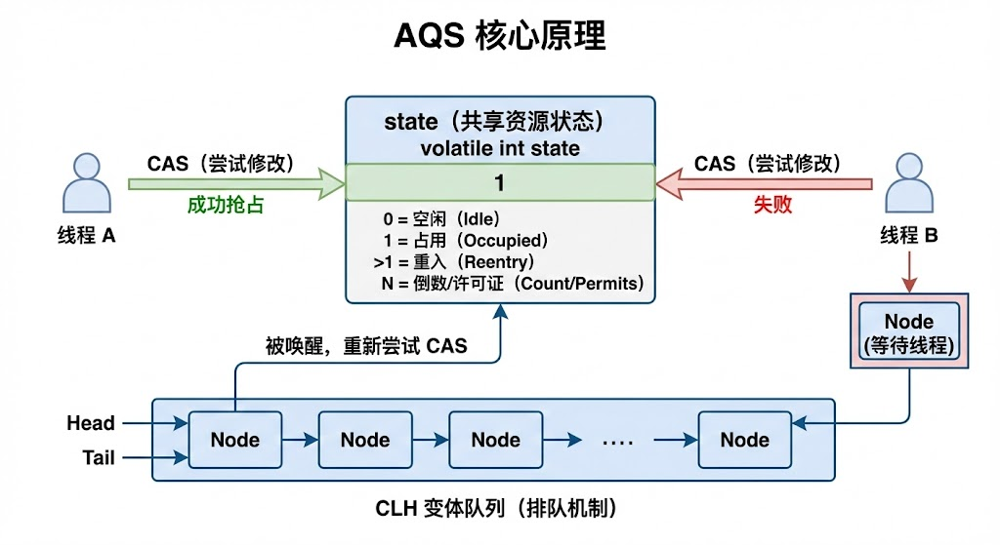

简单来说：**AQS 本质上是一个用来构建锁和同步器的框架。它核心只做了一件事——管理“共享资源的状态”和“排队的线程”。**

---

### 一、 核心原理深度解析

AQS 的底层架构可以概括为：**State（资源状态） + CLH 队列（线程排队） + CAS（原子操作）。**

#### 核心资源：volatile int state

AQS 内部维护了一个核心变量 `state`：

- **定义：**`private volatile int state;`
- **含义：** 它代表了“共享资源”的状态。
    - 比如在 `ReentrantLock` 中，state=0 表示锁空闲，state=1 表示被占用，state>1 表示重入次数。
    - 比如在 `CountDownLatch` 中，state 表示还需要倒数的次数。
    - 比如在 `Semaphore` 中，state 表示剩余的许可证数量。

#### 修改机制：CAS

- 因为是多线程并发抢占资源，AQS 使用 **CAS** 指令来保证 `state` 修改的原子性。只有 CAS 成功修改了 state 的线程，才算抢到了锁。

#### 排队机制：CLH 变体队列

- **问题：** 那些 CAS 失败、没抢到锁的线程去哪了？
- **解决：** AQS 会把它们包装成一个 `Node` 节点，加入到一个双向链表队列中等待。这个队列被称为 CLH 队列（的变体）。
- **行为：** 队列里的节点会挂起，直到前驱节点释放资源后唤醒它，它再去尝试 CAS 抢锁。

---

### 二、 面试标准回答

**AQS 是 Java 并发包（JUC）的核心基石，ReentrantLock、CountDownLatch、Semaphore 等工具都是基于它实现的。**

**它的核心原理可以概括为三个部分：**

第一，核心状态管理：

AQS 内部维护了一个 volatile int state 变量，用来表示当前的同步状态。

- 比如在 ReentrantLock 中，0 代表锁空闲，1 代表被占用。
- 线程之间通过 **CAS** 原子操作来争夺这个 state 的使用权。谁 CAS 成功，谁就抢到了锁。

第二，FIFO 等待队列：

对于那些 CAS 失败）的线程，AQS 不会让它们一直空转，而是把它们封装成 Node 节点，放入一个双向链表中排队等待。

- 这个队列基于 **CLH 锁** 的变体实现。
- 队列中的线程会被阻塞，直到持有锁的线程释放资源，唤醒队列头部的节点，它才会再次尝试去抢 state。
