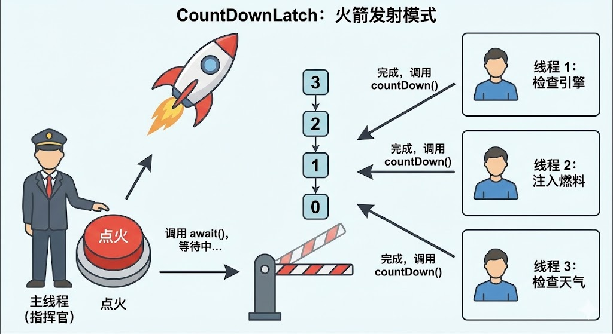
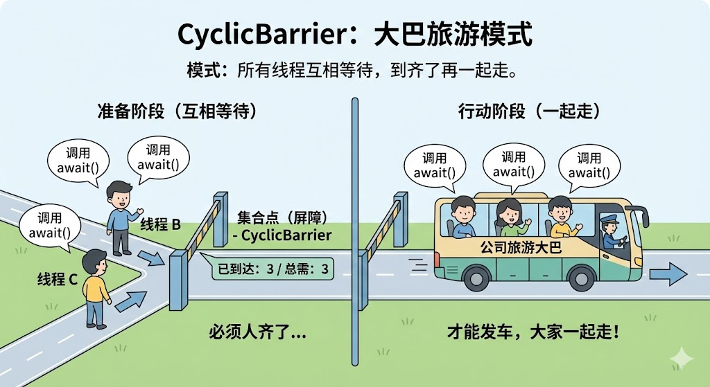

简单一句话概括：**CountDownLatch 是“一个等多个”（一次性），CyclicBarrier 是“多个互相等”（可循环）。**

---

### 一、 核心区别深度解析

虽然它们都能让线程等待，但应用场景和底层逻辑完全不同：

#### 侧重点不同

- **CountDownLatch：**

- **模式：** 强调“一个线程等其他人干完活”。
- **场景：** 就像火箭发射。主线程（指挥官）按下按钮等待，必须要等检查引擎、注入燃料、检查天气这 3 个子任务（其他线程）都完成了，主线程才能继续执行点火。
- **动作：** 主要是主线程调 `await()`，其他线程调 `countDown()`。
- **CyclicBarrier：**

- **模式：** 强调“所有线程互相等待，到齐了再一起走”。
- **场景：** 就像公司组织大巴旅游。大家在不同的地方准备，但是必须要在集合点（屏障）等到人齐了，司机才能发车。
- **动作：** 所有线程都调 `await()`，大家互相等。

#### 可复用性不同

- **CountDownLatch：** 是**一次性**的。计数器减到 0 之后，就废了，不能重置。
- **CyclicBarrier：** 是**可循环**的（所以叫 Cyclic）。当计数器减到 0，屏障被打破后，它会自动重置，可以用于多轮次的计算任务。

#### 底层实现完全不同

- **CountDownLatch：** 直接基于 **AQS** 的共享模式实现。它的计数器就是 AQS 的 `state` 变量。
- **CyclicBarrier：** 它是基于 **ReentrantLock** 和 **Condition** 实现的。它的“计数”其实是靠 Lock 保护的一个普通变量，等待则是靠 Condition 的 `await`。

---

### 二、 面试标准回答

首先，它们的底层实现不一样。

- **CountDownLatch** 是直接基于 **AQS** 的共享模式实现的，它通过 AQS 的 `state` 变量来维护计数。
- **CyclicBarrier** 则是基于 **ReentrantLock** 和 **Condition** 条件队列实现的，它是更高层级的封装。

**其次，关于核心功能的区别，主要有两点：**

**第一点是“等待的主体”不同：**

- **CountDownLatch** 侧重于“一个（或多个）线程等待其他线程完成任务”。就像火箭发射，主线程等待所有检查项完成后才能点火。
- **CyclicBarrier** 侧重于“所有线程互相等待”。就像朋友聚餐，所有人（线程）都到了饭店门口（同步点），才能一起进去吃饭。

**第二点是“复用性”不同：**

- **CountDownLatch** 是**一次性**的。计数器减到 0 就结束了，无法重置，如果想再次使用只能 new 一个新的。
- **CyclicBarrier** 是**可循环**的。当计数器减到 0，屏障打开后，它会自动重置，适合处理分阶段的多轮计算任务。
