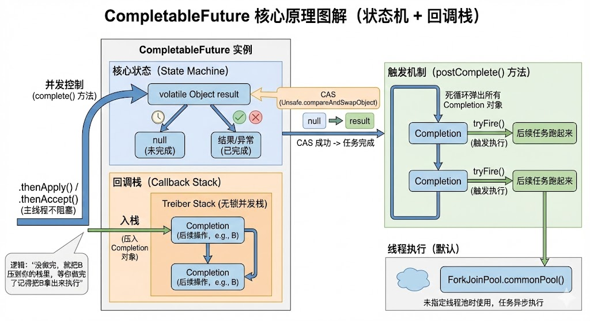

简单来说：**CompletableFuture 的底层是一个基于 CAS 实现的“观察者模式” + “无锁栈”结构。它把所有后续要执行的任务封装成对象，压入一个栈中，等待前序任务完成后触发。**

---

### 一、 核心原理深度解析

`CompletableFuture` 的实现并不依赖复杂的锁，而是极其精简的“状态机”逻辑：

#### 核心状态

- 内部有一个 `volatile Object result` 成员变量。
- 这个变量不仅仅存结果，还存状态。
    - 如果为 null（或特定中间态），表示任务未完成。
    - 如果被赋值了（正常结果或异常对象），表示任务结束。
- **并发控制：** 也就是 `complete()` 方法，本质上就是利用 **CAS (Unsafe.compareAndSwapObject)** 尝试把 `result` 从 null 更新为结果值。谁 CAS 成功，谁就完成了任务。

#### 回调栈

- 当你调用 `.thenApply()` 或 `.thenAccept()` 时，主线程并没有阻塞。
- **封装：** 源码会把这个后续操作封装成一个 `Completion` 对象（这是一个抽象类，实际上是一个链表节点）。
- **入栈：** 这个 `Completion` 对象会被压入 `CompletableFuture` 内部维护的一个 **Treiber Stack（一种基于 CAS 的无锁并发栈）** 中。
- **逻辑：** “任务 A，如果你做完了，你就自己执行 B；如果你没做完，我就把 B 压到你的栈里，等你做完了记得把 B 拿出来执行。”

#### 触发机制

- 当前序任务执行结束（调用 `complete` 或 `completeExceptionally`）时，在 CAS 更新 `result` 成功后，会调用一个 `postComplete()` 方法。
- 这个方法会**死循环**地从栈中弹出所有等待的 `Completion` 对象，并触发它们的 `tryFire()` 方法，从而让后续任务跑起来。

#### 线程执行

- 如果没有指定线程池，默认使用 `ForkJoinPool.commonPool()`。
- 这也是为什么有时候你没传线程池，任务也能异步执行的原因。

---

### 二、 面试标准回答

**CompletableFuture 的底层实现可以概括为：基于 CAS 的状态机 + Treiber Stack（无锁栈）维护的回调链。**

**具体来说，它包含三个核心要素：**

第一，状态的原子性管理。

它内部维护了一个 volatile 的 result 变量。

- 所有的 `complete` 操作，本质上都是通过 **CAS**将这个 result 从 `null` 或者是 `ALT`（中间态）更新为具体的值。
- 只有 CAS 成功的线程，才算真正完成了任务，这保证了状态流转的线程安全。

第二，基于栈的异步回调机制。

当我们链式调用 .thenApply 或 .thenAccept 时，底层并不会阻塞等待。

- 它会将后续的任务封装成一个 `Completion` 对象。
- 然后尝试判断当前任务是否已完成：
    - 如果**没完成**，就通过 CAS 把这个 `Completion` 对象压入一个**无锁栈（Treiber Stack）**中挂起。
    - 如果**已完成**，则直接触发回调。

第三，触发驱动。

当主任务执行完毕（也就是 result 被 CAS 更新后），它会执行一个 postComplete() 方法。

- 这个方法会循环从栈中弹出所有等待的 `Completion` 对象，并依次触发它们的 `tryFire()` 方法。
- 这样就实现了“一个任务做完，自动唤醒下一个任务”的链式反应。
