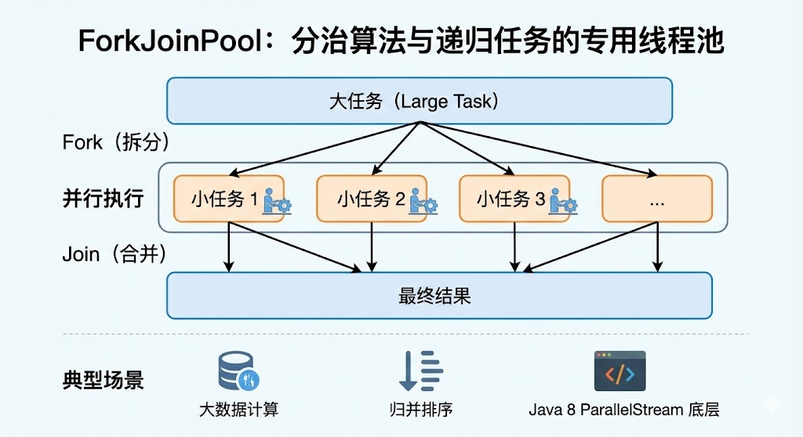
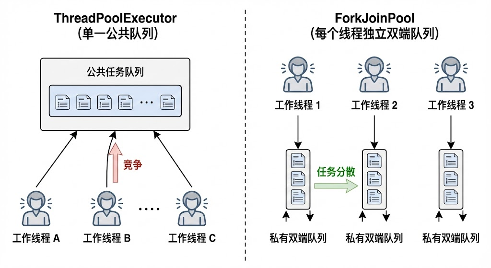
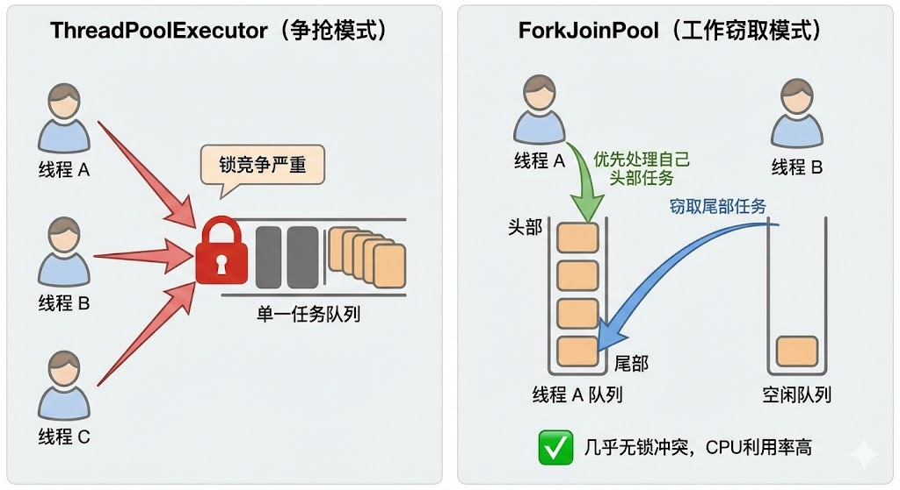

### 一、 核心概念与区别解析

#### ForkJoinPool 是什么？

它是 JDK 7 引入的一种特殊的线程池，专门为了**“分治算法”和“递归任务”**而设计。

- **分治思想：** 它把一个大任务拆成无数个小任务并行执行，最后再把结果合起来。
- **典型场景：** 大数据计算、归并排序、Java 8 的 `ParallelStream` 底层。

#### 与 ThreadPoolExecutor 的本质区别

我们可以从**队列结构**和**调度策略**两个最底层的维度来区分：

- **队列结构不同（最关键）：**

- **ThreadPoolExecutor：** 内部只有一个**公共的任务队列**。所有线程都要去这个队列里抢任务，存在竞争。
- **ForkJoinPool：****每个工作线程都有自己独立的双端队列。** 任务被分散在各个线程的私有队列中。
- **工作模式不同（工作窃取 vs 争抢）：**

- **ThreadPoolExecutor：** 是**“争抢模式”**。多个线程竞争同一个队列的锁，并发高时锁竞争严重。
- **ForkJoinPool：** 是**“工作窃取模式”**。
    - 线程优先处理自己队列头部的任务。
    - 如果自己的任务做完了，它不会闲着，而是去其他线程队列的**尾部**“偷”一个任务来做。
    - **优势：** “偷”和“取”在队列的两端，几乎没有锁冲突，CPU 利用率极高。

---

### 二、 面试标准回答

如果在面试中被问到“ForkJoinPool 是什么？和 ThreadPoolExecutor 有什么区别？”，建议按以下逻辑作答：

**面试官您好，ForkJoinPool 是 JDK 7 引入的，专门用于处理“分治任务”的线程池。它和普通的 ThreadPoolExecutor 主要有三个核心区别：**

**第一，设计初衷不同：**

- `ThreadPoolExecutor` 适合执行互相独立的、耗时较短的任务，比如处理 Web 请求或数据库查询（IO 密集型）。
- `ForkJoinPool` 适合执行可以递归拆解的大型计算任务，比如大数据排序或图像处理（CPU 密集型）。

**第二，任务队列的结构不同（底层实现）：**

- `ThreadPoolExecutor` 内部维护的是**一个公共的阻塞队列**，所有线程都去这一个队列里抢任务，在并发极高时会有锁竞争。
- `ForkJoinPool` 中的**每个工作线程都有自己独立的双端队列（Deque）**，任务是分散存储的，减少了线程间的资源竞争。

**第三，调度算法不同（核心亮点）：**

- 这也是 ForkJoinPool 最著名的**“工作窃取算法”**。
- 在 ForkJoinPool 中，线程优先处理自己队列里的任务。当某个线程把自己队列的任务做完后，它不会闲下来，而是会去其他忙碌线程的队列**尾部**“偷”任务来执行。
- 这种机制能最大程度地压榨 CPU 性能，保证所有线程都在干活，不会出现“一核有难，七核围观”的现象。
