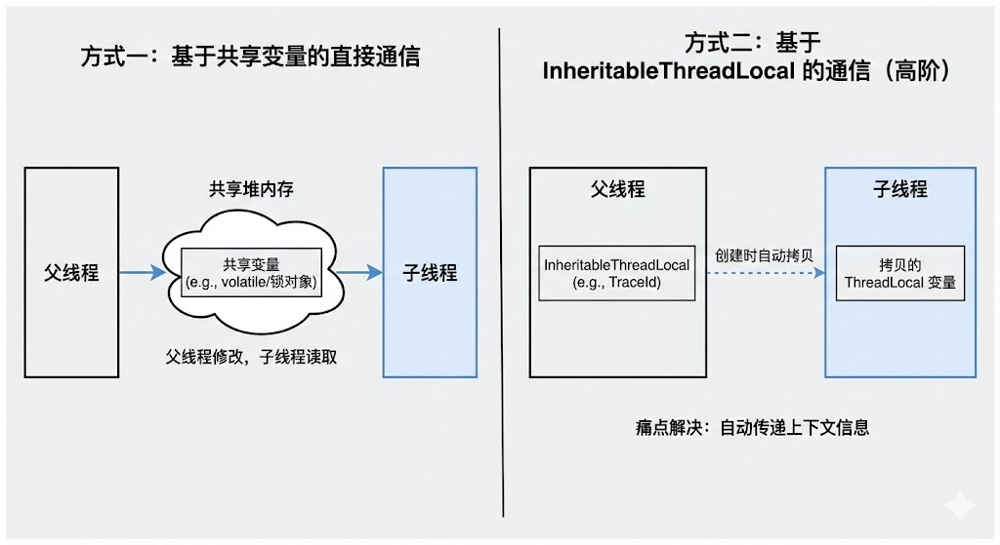

### 一、 核心方式深度解析

#### 基于共享变量的直接通信

- **原理：** Java 的堆内存是所有线程共享的。
- **做法：** 父线程修改一个 `volatile` 变量或 synchronized 锁住的对象，子线程去读取这个变量。

#### 基于“InheritableThreadLocal”的通信（高阶）

- **痛点：** 父线程有一个 `TraceId` 或 `UserSession`，它创建了一个子线程去处理业务，子线程也需要用到这个 ID。
- **做法：** 使用 `InheritableThreadLocal`。它会在创建子线程的那一刻，自动把父线程里的 ThreadLocal 变量**拷贝**一份给子线程。

---

### 二、 面试标准回答

**Java 线程间的通信本质上都是基于“共享内存”模型的。在实际开发中，根据通信的目的不同，我一般把它们分为两类：**

第一类是：基于共享变量。

这是最基础的方式。父子线程共享同一个对象或变量。

- 为了保证可见性，我们通常会用 `volatile` 关键字修饰共享变量。
- 或者使用 `synchronized`/`Lock` 锁机制来保证数据的线程安全。
- 比如父线程修改一个配置标志位，子线程实时感知并做出反应。

第二类是：基于 InheritableThreadLocal。

这是一种特殊的“隐式”通信，主要用于全链路追踪。

- 当我们使用 `InheritableThreadLocal` 时，子线程在创建的瞬间，会自动“继承”（拷贝）父线程中的 ThreadLocal 变量。
- 这在微服务开发中非常有用，比如把 RequestId 或 UserID 从主线程透传给异步子线程，保证日志链路不断层。
