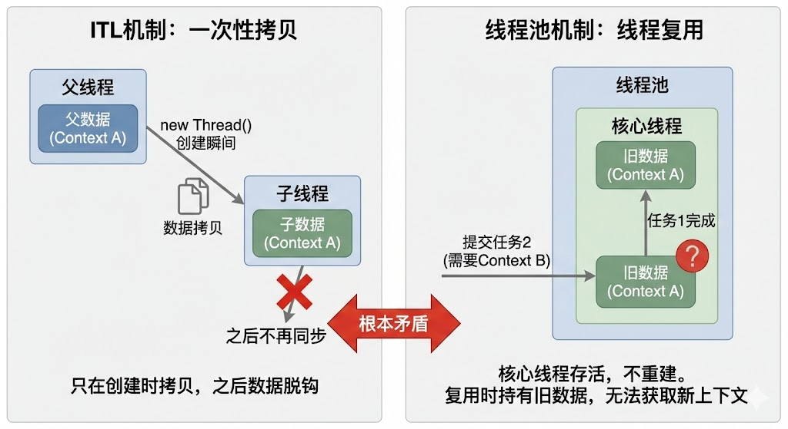
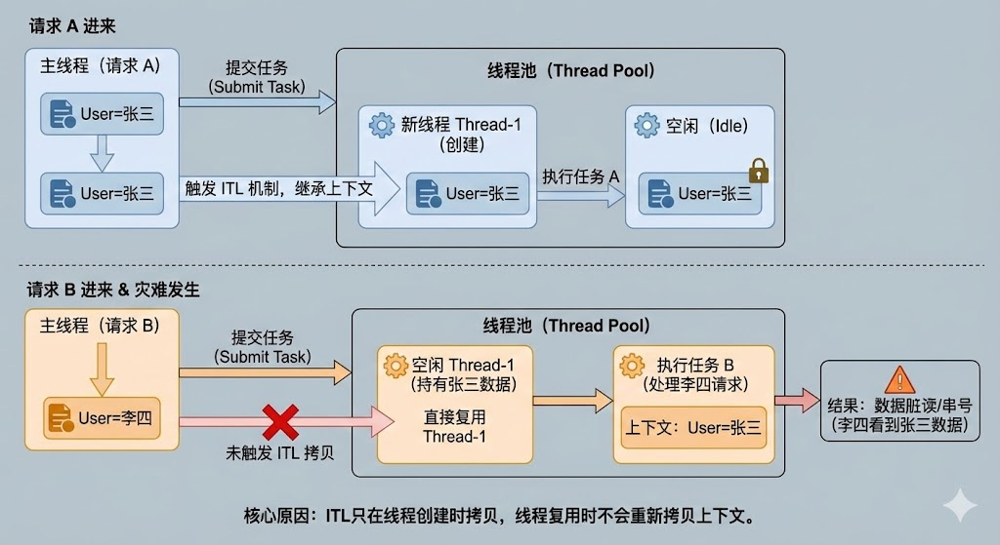

`**InheritableThreadLocal**` **(ITL) 在线程池中完全不好用，而且有“致命”的坑。结论是：严禁在线程池场景下直接使用它。**

### 一、 核心坑点深度解析

#### 根本矛盾

- **ITL 的机制：**`InheritableThreadLocal` 在于**拷贝**。它只在 `new Thread()`（线程创建）的那一瞬间，把父线程的变量拷贝给子线程。除此之外，它再也不会同步数据了。
- **线程池的机制：** 线程池的核心理念是**复用**。核心线程创建后，会一直存活，处理完一个任务紧接着处理下一个，并不会销毁重建。

#### 数据脏读/串号

想象这样一个场景：

1. **请求 A 进来：** 主线程携带 `User=张三`。它提交任务给线程池，线程池创建一个新线程 `Thread-1`。
    1. 此时触发 ITL 机制，`Thread-1` 继承了 `User=张三`。
2. **请求 A 结束：**`Thread-1` 任务做完，回到池子里待命（注意：此时它身上还背着 `User=张三` 的数据）。
3. **请求 B 进来：** 主线程携带 `User=李四`。它提交任务，线程池发现 `Thread-1` 空闲，于是直接复用它。
    1. **关键点来了：** 因为没有发生“创建线程”的动作，ITL 的拷贝机制**不会触发**。
4. **灾难发生：**`Thread-1` 处理请求 B 时，读到的上下文依然是 `User=张三`。
    1. **结果：** 李四看到了张三的订单数据。这就是典型的**上下文污染**。

### 二、 解决方案（TransmittableThreadLocal）

既然 JDK 自带的 ITL 不行，业界标准做法是使用阿里巴巴开源的 **TTL (TransmittableThreadLocal)**。

TTL 的逻辑是把拷贝的时机，从“创建线程时”挪到了“**任务提交/执行时**”：

1. **Capture：** 在任务提交或者封装的时候，把当前主线程的上下文抓取出来。
2. **Replay：** 在子线程开始执行任务之前，把抓取到的上下文“刷”进子线程里。
3. **Restore：** 任务执行完后，把子线程恢复成原本的样子（防止污染）。

---

### 三、 面试标准回答

**这个问题的结论非常明确：在线程池环境下，是严禁使用** `**InheritableThreadLocal**` **的。因为它会导致严重的“上下文污染”问题。**

**原因主要在于它的设计机制和线程池是冲突的：**

- `InheritableThreadLocal` 只有在线程创建的那一刻，才会把父线程的数据拷贝给子线程。
- 而线程池的核心是**线程复用**。线程一旦创建好，就会一直留在池子里反复使用，不会重新创建。

这就导致了一个具体的 Bug 场景：

比如第一个请求进来，创建了一个核心线程，继承了“用户 A”的数据。任务结束后，线程回收到池子里，但它内部的 ThreadLocalMap 并没有清空。

当第二个请求“用户 B”进来时，线程池复用了这个线程。由于没有发生线程创建动作，新的数据传不进去，这个线程依然拿着“用户 A”的数据在跑。

后果就是： 用户 B 可能会看到用户 A 的数据，或者日志里的 TraceId 发生了串号，这是严重的生产事故。

标准解决方案：

在实际生产中，我们一般会引入阿里巴巴开源的 TransmittableThreadLocal (TTL)。

它的原理是利用装饰器模式，在任务提交或者任务执行的时刻去“捕获”和“回放”上下文，而不是依赖线程创建。并在任务结束后自动“恢复”现场，从而完美解决了线程复用导致的数据不一致问题。
