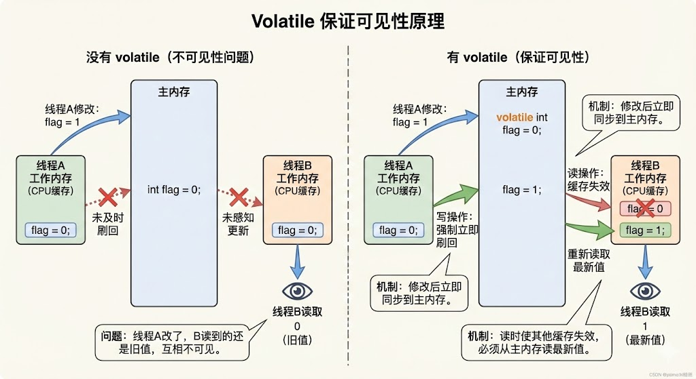
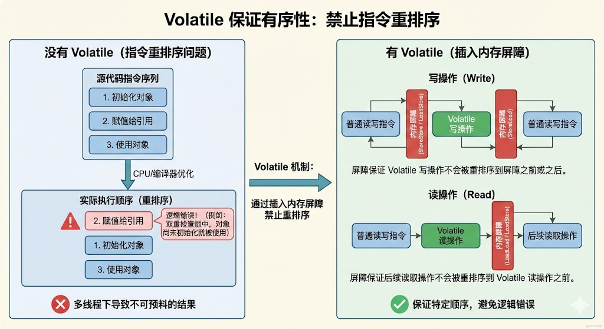
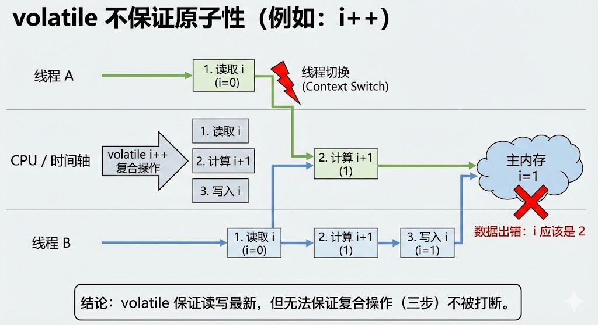

## 一、 Volatile 关键字的原理与作用

`volatile` 解决的核心问题是 **可见性** 和 **有序性**。

### 1. 保证可见性

这是 `volatile` 最主要的作用。

- **问题来源：** 每个线程都有自己的工作内存（对应 CPU 缓存）。线程 A 修改了共享变量，但数据可能只写在了自己的缓存中，没有及时刷回主内存。线程 B 读到的还是旧值。
- **Volatile 机制：**
    - **写操作：** 当一个线程修改了 `volatile` 变量时，它会强制将这个值立即刷回主内存。
    - **读操作：** 同时，它会使其他 CPU 缓存中该变量的副本**失效**。其他线程在读取时，必须重新从主内存中获取最新值。

### 2. 保证有序性

- **问题来源：****指令重排序**。为了提高效率，编译器和 CPU 可能会打乱指令的执行顺序（在不影响单线程结果的前提下）。但在多线程中，这种重排序可能导致逻辑错误（例如著名的双重检查锁）。
- **Volatile 机制：** 它通过插入内存屏障来禁止特定类型的指令重排序。
    - **写操作：** 在 `volatile` 写操作的前后插入屏障，保证写操作不会被重排序到屏障之前或之后。
    - **读操作：** 在 `volatile` 读操作之后插入屏障，保证后续读取操作不会被重排序到屏障之前。

### 3. 不保证原子性

- `volatile` 无法保证复合操作的原子性。
- 例如 `i++` 这个操作，它实际上是三个步骤：读取 i；计算 i+1；写入 i。`volatile` 只能保证每次读写都是最新的，但无法保证这三步作为一个整体不被打断。如果在读取和写入之间发生了线程切换，数据依然会出错。

---

## 二、 Java 内存模型

`volatile` 的存在正是为了解决 JMM 在并发环境下暴露的问题。

### 1. JMM 是什么？

JMM 是一种**抽象概念**，它定义了线程和主内存之间的抽象关系：

- 所有变量都存储在主内存中。
- 每条线程都有自己的**工作内存**，工作内存中保存了该线程使用到的变量的**副本**（这个副本就是 CPU 缓存的抽象）。
- 线程对变量的所有操作（读取、赋值）都必须在工作内存中进行，不能直接操作主内存。线程间通信必须通过主内存。

### 2. JMM 带来的三个并发问题

JMM 规范了这三个问题，`volatile`、`synchronized`、`Lock` 等工具就是用来弥补这些缺陷的。

| **问题名称** | **描述** | **解决方案** |
| --- | --- | --- |
| **可见性** | 线程的工作内存修改后，其他线程看不到最新值。 | volatile、synchronized、Lock |
| **原子性** | 多个操作作为一个整体，可能被线程调度打断。 | synchronized、Lock、Atomic 类 |
| **有序性** | 编译器和 CPU 的指令重排序，导致执行顺序和代码顺序不一致。 | volatile（内存屏障）、synchronized（锁保证） |

## 三、 面试标准回答

**这个问题可以分为两部分：**`**volatile**` **的作用和 JMM 的理解。**

**首先，**`**volatile**` **关键字是 Java 最轻量级的同步机制，它主要解决并发中的两个核心问题：可见性和有序性。**

1. **可见性：** 由于 JMM 的设定，每个线程都有自己的工作内存。`volatile` 保证了对该变量的修改会立即被同步到主内存，并且会导致其他线程缓存中的旧值失效。这样，其他线程要读取时，就必须重新从主内存获取最新值。
2. **有序性：**`volatile` 通过在读写操作时插入内存屏障来禁止指令重排序，保证代码执行的顺序，从而避免重排序导致的并发问题。

**需要特别强调的是：**`volatile`**不保证原子性**，因为它只负责读写的同步，无法保证复合操作（如 `i++`）作为一个整体不被打断。

**其次，关于 JMM：** JMM 是一个抽象概念，它规范了 Java 虚拟机如何与计算机内存（主内存/缓存）协同工作。它的核心思想是：所有变量都存在于**主内存**，而线程操作的只是这些变量在自己工作内存中的副本。

- **JMM 存在的意义**，就是为了在并发场景下，明确地定义在何时、何地，一个线程对共享变量的修改对另一个线程是可见的。
- JMM 规范的存在，正是为了让 `volatile`、`synchronized` 等关键字，能通过底层的内存屏障等机制，解决由 CPU 缓存、指令重排带来的**可见性**和**有序性**问题。
