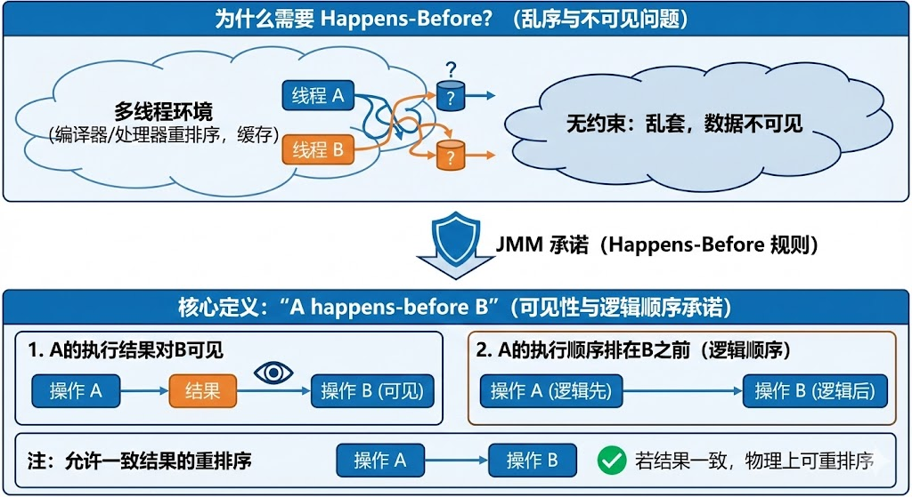

简单来说：**Happens-Before 是 Java 内存模型（JMM）定义的一套规则，用于保证一个操作的结果对另一个操作是可见的。**

PS：面试的时候一般只会关注 happens-before 这个概念的理解，具体的规则能记就记，记不住其实也无伤大雅，

### 一、 核心概念深度解析

#### 为什么需要它？

在多线程环境下，为了优化性能，编译器和处理器会对指令进行**重排序**，缓存也会导致内存不可见。

- 如果没有约束，两个线程同时跑，谁先谁后、谁能看到谁的数据，完全是乱套的。
- **Happens-Before** 就是 JMM 向程序员提供的一份“承诺”：**只要你的代码遵循了这些规则，我就保证 A 操作的结果一定能被 B 操作看到，不管底层怎么重排序。**

#### 核心定义

**“A happens-before B”** 并不代表 A 一定要在 B 之前执行（物理时间），而是指：

1. **A 的执行结果对 B 是可见的。**
2. **A 的执行顺序排在 B 之前（逻辑顺序）。**
- *注：如果 A 和 B 重排序后，执行结果和按照 happens-before 执行的结果一致，JMM 是允许这种重排序的。*

### 二、 必须记住的 6 条核心规则

虽然 JMM 定义了很多条，但面试中只需要记住这几条最常用的：

1. **程序次序规则：**

在一个线程内，按照代码顺序，前面的操作 happens-before 后面的操作。（即：单线程内，代码看起来是按顺序执行的）。

1. **管程锁定规则：**

一个 unlock 操作 happens-before 后续对同一个锁的 lock 操作。（即：释放锁之前的修改，对下一个拿到锁的线程是可见的）。

1. **Volatile 变量规则**

对一个 volatile 变量的写操作，happens-before 后续对这个变量的读操作。（即：你改了，我马上能看见）。

1. **传递性：**

如果 A happens-before B，且 B happens-before C，那么 A happens-before C。（这条最重要，它把前几条规则串联起来了）。

1. **线程启动规则：**

主线程调用 threadA.start() 之前的所有操作，都 happens-before 线程 A 中的任意操作。

1. **线程终止规则：**

线程 A 中的所有操作，都 happens-before 主线程从 threadA.join() 返回。

---

### 三、 面试标准回答

**Happens-Before 是 Java 内存模型中定义的一套规则，它是判断数据是否存在竞争、线程是否安全的主要依据。**

简单来说，它的核心含义是“可见性保障”：

如果操作 A happens-before 操作 B，那么 JMM 保证 A 的操作结果对 B 是可见的，且 A 的执行顺序排在 B 之前。

- 这里要注意，它强调的是**结果的可见性**，而不是物理时间的先后。只要结果不出错，JVM 依然可以进行指令重排序优化。

**我们在开发中经常利用这几条规则来保证线程安全：**

**第一是“程序次序规则”：** 在同一个线程内，书写在前面的代码操作结果，对后面的代码是可见的。

**第二是“Volatile 规则”：** 对一个 volatile 变量的写操作，对于后续对这个变量的读操作是可见的。这保证了 volatile 的可见性。

**第三是“锁规则”：** 一个锁的解锁操作，对于后续对同一个锁的加锁操作是可见的。这就解释了为什么 synchronized 能保证可见性。

**第四是“传递性”：** 如果 A hb B，B hb C，那么 A hb C。

- **举个例子：** 利用传递性，我们可以让 volatile 变量作为一个“开关”。只要 volatile 变量写操作可见了，那么在它之前修改的所有普通变量也对后续线程可见了。
