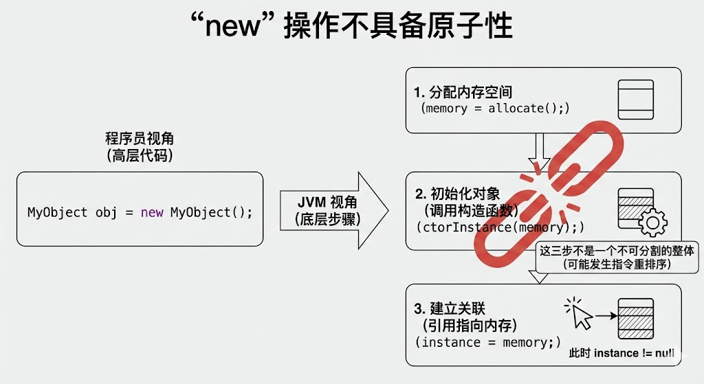
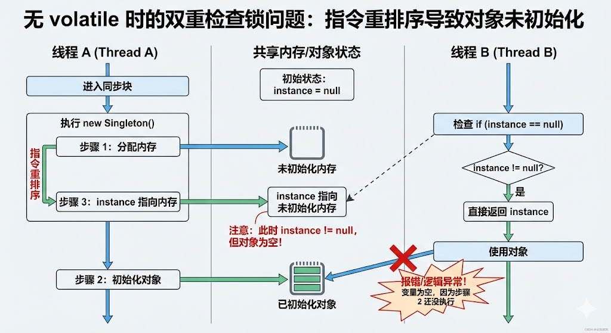

结论：**加上** `**volatile**` **主要是为了禁止“指令重排序”，防止其他线程拿到一个“只分配了内存、但还没有初始化完成”的半成品对象，导致程序崩溃。**

### 一、 核心原理深度解析

为什么需要 `volatile`？这要从 Java 代码中简单的一句 `instance = new Singleton();` 说起。

#### "new" 不具备原子性

在我们的眼里，创建对象只是一行代码。但在 JVM 的视角（字节码/汇编层面），这行代码实际上包含了**三个步骤**：

1. **分配内存：**`memory = allocate();` // 给对象分配一块内存空间
2. **初始化对象：**`ctorInstance(memory);` // 调用构造函数，初始化成员变量
3. **建立关联：**`instance = memory;` // 把 instance 引用指向这块内存（此时 instance != null）

#### 指令重排序的陷阱

现代编译器和 CPU 为了优化性能，允许将上述步骤进行**重排序**（只要单线程下结果不变）。

- **正常顺序：** 1 -> 2 -> 3
- **重排后顺序：****1 -> 3 -> 2** （这是允许的，因为步骤 2 和 3 没有数据依赖）

#### 半初始化对象

如果不加 `volatile`，发生了 **1 -> 3 -> 2** 的重排序，多线程环境下就会出事：

1. **线程 A** 进入同步块，执行 `new Singleton()`。它先执行了步骤 1（分配内存）和步骤 3（instance 指向内存）。**注意：此时步骤 2 还没执行，对象还没初始化，但 instance 已经不是 null 了。**
2. **线程 B** 此时刚好过来，在同步块外面的第一个 `if (instance == null)` 处检查。
3. 因为线程 A 已经执行了步骤 3，所以线程 B 发现 `instance` 不为 null。
4. **线程 B 直接返回了 instance。**
5. 线程 B 拿到这个对象去使用，结果发现里面的变量都是空的（因为线程 A 的步骤 2 还没跑），直接报错或逻辑异常。

#### Volatile 的作用

当把 `instance` 变量声明为 `volatile` 后，JMM 会在写操作前后插入**内存屏障**，强制禁止步骤 2 和步骤 3 的重排序。这就保证了：**对象必须完全初始化好了，才能把引用赋值给 instance。**

---

### 二、 面试标准回答

**这主要是为了防止“指令重排序”导致的“对象半初始化”问题。**

**具体来说，我们可以把问题拆解为三个层面：**

第一，对象的创建过程不是原子的。

在 Java 中，new 一个对象在字节码层面通常包含三步：

1. 分配内存空间。
2. 调用构造方法初始化对象。
3. 将引用指向分配的内存地址。

第二，编译器优化可能导致指令重排。

为了优化性能，JVM 或 CPU 可能会把执行顺序调整为 1 -> 3 -> 2。也就是说，先把引用指向内存（此时引用不为 null），再由构造方法进行初始化。

第三，并发场景下的隐患。

如果发生重排序，当线程 A 执行完第 3 步（指向内存）但还没执行第 2 步（初始化）时，恰好线程 B 进来了。

线程 B 在第一层 if (instance == null) 判断时，发现 instance 已经不为空了，就会直接返回这个对象。

但实际上，这个对象还是个“半成品”，里面的属性还没初始化。 线程 B 使用该对象就会导致程序出错。

加上 volatile 关键字，就是利用它的内存屏障功能，禁止这三步操作的重排序，保证 “先初始化，后指向引用” 的顺序，从而保证线程安全。
