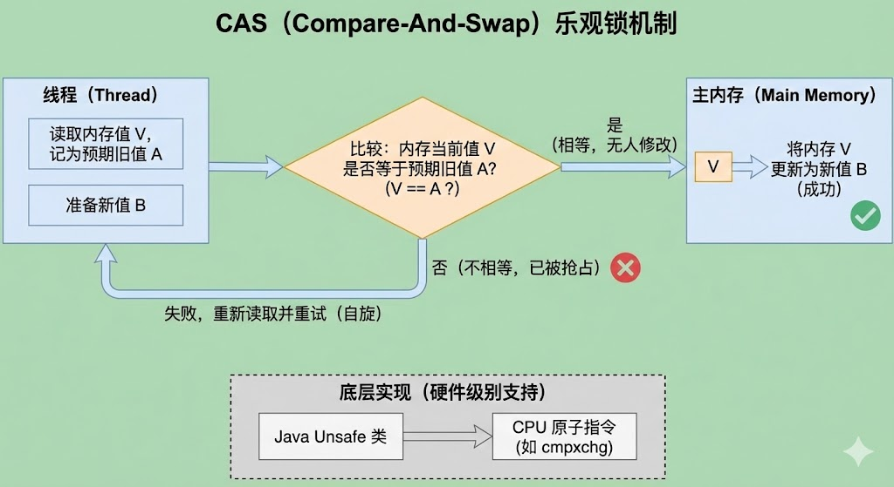
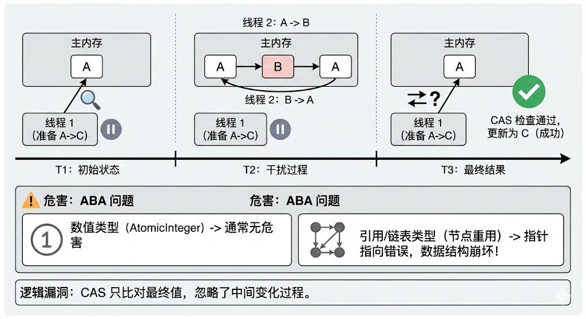

简单概括：**CAS 是并发包的基石，它通过硬件层面的原子指令实现了“无锁原子操作”。但在特定场景下，它会因为无法感知数据的中间变化过程，而遭遇 ABA 问题，解决方法是加版本号。**

### 一、 核心原理解析

#### 什么是 CAS？

CAS 是一种**乐观锁**机制。它不加锁（没有 `synchronized` 那样的重量级开销），而是假设没有冲突去尝试修改。如果失败了，就重试（自旋）。

它包含三个核心操作数：

- **V ：** 内存中现在的数值。
- **A ：** 我预期的旧值（我读到的那个值）。
- **B ：** 我想把它改成的新值。

**逻辑：** 只有当 **V == A** 时（说明还没人改过），我才把 V 更新成 B。否则，说明有人抢先一步改了，我的这次操作失败，重新读取再试。

*底层实现：* Java 的 CAS 依赖于 `Unsafe` 类，最终调用的是 CPU 的原子指令（如 x86 下的 `cmpxchg`），这是硬件级别的支持。

#### 什么是 ABA 问题？

CAS 有个逻辑漏洞：**它只看结果，不看过程。**

**场景还原：**

1. 主内存里有一个变量 `A`。
2. **线程 1** 读到了 `A`，准备把它改成 `C`，但因为 CPU 调度暂停了。
3. **线程 2** 进来了，把 `A` 改成了 `B`，然后又把 `B` 改回了 `A`。
4. **线程 1** 恢复运行，它拿着手里的预期值 `A` 去和内存比，发现内存里还是 `A`（它不知道中间发生过变化）。
5. **结果：** CAS 检查通过，数据被更新。

**危害：** 对于单纯的数值（如 `AtomicInteger`）通常没影响。但在**链表**或**栈**的操作中（涉及节点引用），如果一个节点被回收后又被重用，ABA 问题会导致指针指向错误，引发数据结构崩坏。

#### 如何解决 ABA 问题？

核心思路是：加版本号。

不仅要比对“值”，还要比对“版本”。

- 以前是：`A -> B -> A` （检查值，通过）。
- 现在是：`1A -> 2B -> 3A`。
- 线程 1 拿着 `1A` 去比对，发现内存里是 `3A`，虽然值一样，但版本号变了，CAS 失败。

---

### 二、 面试标准回答

**CAS 是 Java 并发包底层最核心的机制，绝大多数原子类都是基于它实现的。**

首先，关于 CAS：

它是一种轻量级的乐观锁机制。它不依赖操作系统层面的 Mutex 锁，而是通过 CPU 提供的原子指令来实现。

- 它的核心逻辑包含三个参数：内存地址 V、预期原值 A、新值 B。
- 只有当内存中的实际值等于预期原值 A 时，才会把内存更新为 B，否则不做任何操作或重试。
- 这种机制避免了线程切换的开销，在低竞争下性能非常高。

但是，CAS 有一个著名的漏洞，就是 ABA 问题：

CAS 的检查机制是“只看结果，不看过程”。

- 假设一个变量原本是 A，被别的线程改成了 B，又改回了 A。
- 此时当前线程去检查，发现它还是 A，就会误认为它没有被修改过，从而执行更新操作。
- 在处理数值运算时这通常没问题，但在处理**栈**或**链表**（涉及节点引用）时，这可能会导致严重的逻辑错误。

解决 ABA 问题的标准方案是：引入版本号。

我们可以借鉴数据库乐观锁的思想，在对比数据的同时，对比一个版本号或时间戳。
