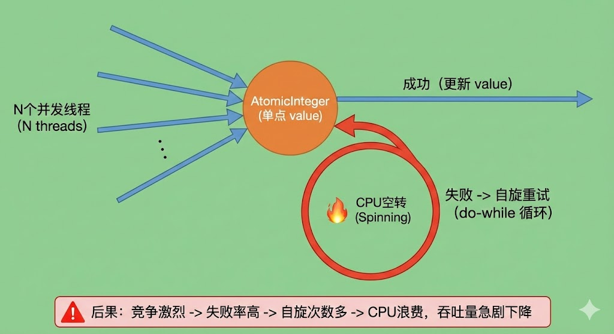
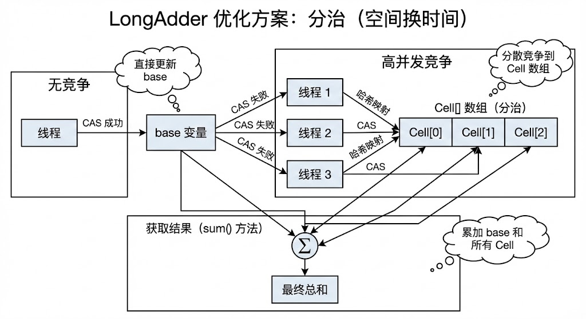

简单一句话总结：**AtomicInteger 慢是因为所有线程都在抢夺同一个变量的修改权，大量失败重试导致 CPU 飙升；优化方案是使用** `**LongAdder**`**，它利用“空间换时间”，把一个变量拆成多份让线程分头去改。**

### 一、 核心痛点与优化原理

#### 为什么 AtomicInteger 会变慢？

- **单点热点问题：**`AtomicInteger` 内部只维护了一个 `value` 变量。
- **悲观的自旋：** 当 N 个线程同时去执行 `CAS(expect, update)` 时，同一时刻只有一个线程能成功。
- **恶性循环：** 剩下 N-1 个失败的线程，并不会挂起，而是会在 `do-while` 循环里无限重试（自旋）。
- **后果：** 竞争越激烈，失败率越高，自旋次数越多，CPU 就被白白浪费在空转上，导致吞吐量急剧下降。

#### 优化方案：LongAdder

JDK 8 引入了 `LongAdder`（以及 `DoubleAdder`），专门解决高并发写的问题。

- **核心思想：****分治**，也就是“空间换时间”。
- **实现机制：**
    - 它内部维护了一个 `Cell[]` 数组。
    - 当没有竞争时，直接更新 `base` 变量（和 AtomicInteger 一样）。
    - 当出现竞争（CAS 失败）时，它不再死磕 `base`，而是根据当前线程的哈希值，映射到 `Cell` 数组中的某一个槽位上去做 CAS。
    - **效果：** 相当于把“1 个变量的竞争”分散到了“N 个 Cell 的竞争”，冲突概率大大降低。
- **获取结果：** 当我们需要最终数值时，调用 `sum()` 方法，它会把 `base` 和所有 `Cell` 里的值加在一起返回。

---

### 二、 面试标准回答

**AtomicInteger 虽然基于 CAS 实现了无锁机制，但在高并发写场景下确实存在性能瓶颈，主要原因是“热点竞争”导致的自旋消耗。**

首先，分析性能下降的原因：

AtomicInteger 内部维护着唯一的一个 volatile value。

- 当有大量线程同时去更新这个值时，因为 CAS 的机制，同一时刻只能有一个线程成功。
- 其他大量失败的线程，会进入 `while` 循环不断进行重试（自旋）。
- 在竞争极其激烈时，这种高频的失败和重试，会消耗大量的 CPU 资源，导致系统性能显著下降。

其次，关于优化方案：

在 JDK 8 中，推荐使用 LongAdder 来替代 AtomicInteger 处理高并发计数场景。

LongAdder 的核心优化思路是“分散热点”：

它不再让所有线程抢一个变量，而是维护了一个 Cell[] 数组。

1. 当竞争不激烈时，直接通过 CAS 修改 `base` 基础值。
2. 一旦发生竞争，它会根据线程的 Hash 值，将线程分散到不同的 `Cell`（单元格）中去修改各自的值。
3. 这样就将“多线程争夺一个点”变成了“多线程对应多个点”，极大降低了 CAS 失败和自旋的概率。

最后，需要注意一点区别：

AtomicInteger 的 get() 拿到的是绝对实时的准确值。

而 LongAdder 的 sum() 方法是把 base 和所有 Cell 累加起来，在统计过程中如果有新的并发更新，可能拿到的结果只是一个**“最终一致”**的值，但对于高并发计数来说，这是完全可以接受的。
