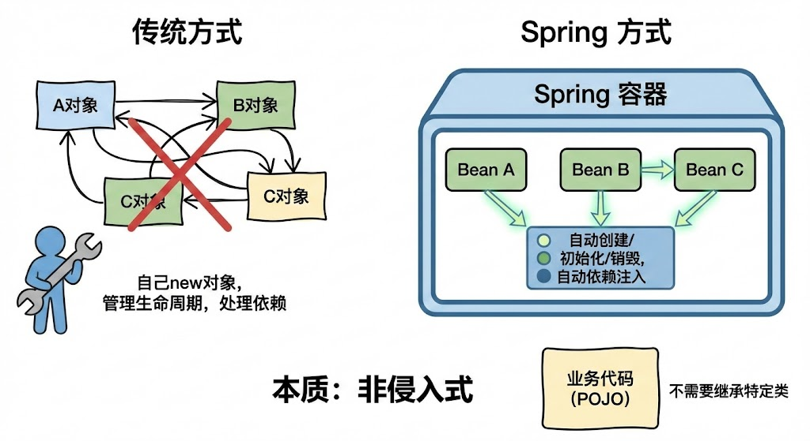
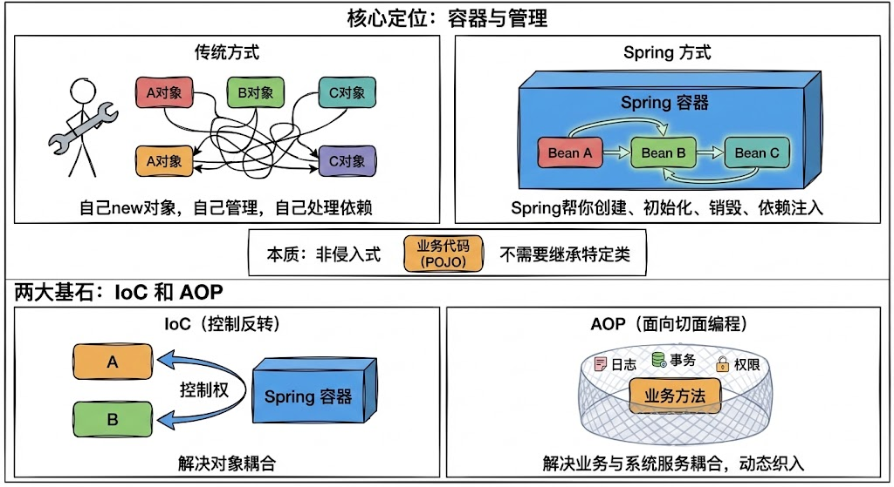

**Spring 不仅仅是一个框架，更是一个生态。它的核心理念是通过 IoC 和 AOP 来解耦，从而简化企业级应用的开发复杂度。**

### 一、 核心维度深度解析

#### 核心定位：容器与管理

    - **传统方式：** 我们需要自己 `new` 对象，自己管理对象的生命周期，自己处理依赖关系（比如 A 依赖 B，B 依赖 C）。
    - **Spring 方式：** Spring 就是一个**容器**。你把对象（Bean）交给它，它帮你创建、初始化、销毁，并自动把依赖注入进去。
    - **本质：****非侵入式**的。你的业务代码不需要继承 Spring 的特定类，甚至不需要依赖 Spring 的包（在最纯粹的 POJO 模式下）。

#### 两大基石：IoC 和 AOP

    - IoC (控制反转)： 解决的是对象之间耦合的问题。
    - **AOP** **(****面向切面编程****)：** 解决的是**业务逻辑与系统服务****耦合**的问题。
        - 比如日志、事务、权限检查。这些代码到处都是，Spring 把它们抽离出来，动态地“织入”到业务方法中。

#### 现代演进：从框架到全家桶

    - 早期的 Spring 是一堆 XML 配置，很繁琐。
    - 现在的 Spring 指的是 **全家桶**。
        - **Spring Boot：** 约定优于配置，快速启动。
        - **Spring Cloud：** 微服务治理。
        - **Spring Security：** 安全框架。

---

### 二、 面试标准回答

**Spring 是 Java 企业级开发事实上的标准。它不仅仅是一个框架，更是一个庞大的技术生态。它的核心使命只有一句话：简化 Java 开发。**

**具体可以从三个维度来理解：**

第一，核心层面：

这是 Spring 最根本的两大基石。

- **IoC（控制反转）：** Spring 作为一个容器，接管了对象的创建和管理权。它通过**依赖注入（DI）**，让我们不需要手动 `new` 对象，而是由容器自动组装。这极大地降低了组件之间的耦合度。
- **AOP（面向切面编程）：** 它允许我们将日志、事务、权限等“非业务逻辑”从核心业务代码中剥离出来，统一管理。其中最经典的应用就是**声明式事务**，让我们只需加一个注解就能控制事务，而不用写繁琐的 try-catch 代码。

第二，特性层面：

Spring 是一个非侵入式的框架，它被被称为 Java 界的“胶水”。它可以非常轻松地集成各种第三方框架，比如 MyBatis、Redis、RabbitMQ 等，让这些技术能无缝地协同工作。

第三，生态层面：

现在的 Spring 已经发展为一个全家桶。

- **Spring Boot** 通过“约定优于配置”，让我们可以零配置快速启动项目。
- **Spring Cloud** 则提供了完整的微服务解决方案。

总结一下：

Spring 本质上是一个管理 Bean 的容器，它通过 IoC 和 AOP 实现了代码的解耦，并以此为基础衍生出了 Spring Boot 等强大的生态，极大地提高了我们的开发效率。

### 购买了课程的同学，本八股动画视频持续更新！

### 后续视频更新也会在群里分享，一定要先进群！
