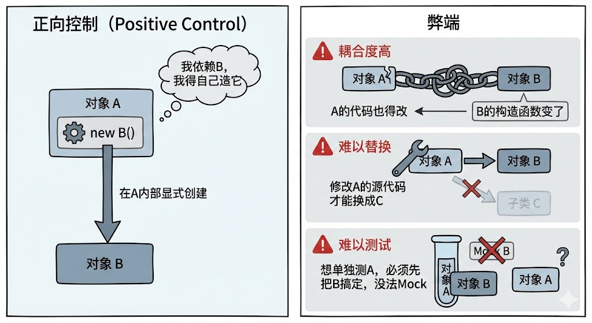
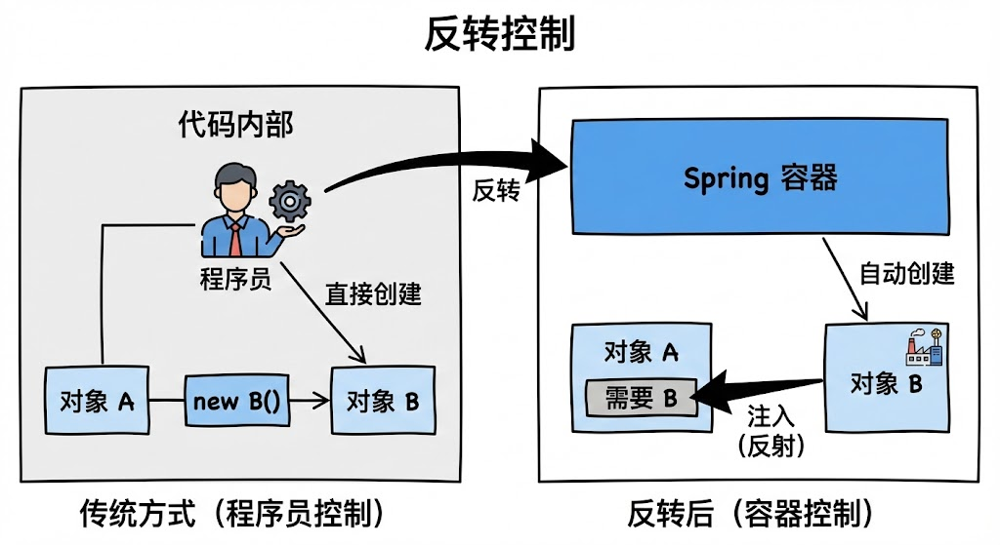

**IOC（控制反转）是一种设计思想，它的核心是将对象的创建权和管理权从代码中剥离出来，交给 Spring 容器去统一管理。这样做最大的好处就是实现了代码的解耦。**

### 一、 核心原理深度解析

我们必须搞清楚两个问题：**谁控制了谁？反转了什么？**

#### 正向控制

- **场景：** 假设对象 A 依赖于对象 B。
- **做法：** 在 A 的代码内部，我们必须显式地 `new B()`。
- **弊端：**
    - **耦合度高：** 如果 B 的构造函数变了，A 的代码也得改。
    - **难以替换：** 如果想把 B 换成子类 C，必须修改 A 的源代码。
    - **难以测试：** 想单独测 A，还得先把 B 搞定，没法 Mock。

#### 反转控制

- **做法：** 对象 A 不再去 `new B()` 了，它只声明“我需要一个 B”。
- **谁来控制：****Spring 容器**。容器在启动时，会自动创建好 B，然后通过反射把 B **注入**到 A 里面。
- **反转了什么：****对象的创建权**和**依赖关系的维护权**，从程序员的手里（代码内部），反转到了容器的手里。

#### IOC 与 DI 的关系

这是面试常考的辨析。

- **IOC ：** 是**思想**，是目标（我要让控制权反转）。
- **DI：** 是**手段**，是实现（通过依赖注入来实现控制反转）。
- **结论：** IOC 是理论，DI 是实践。

---

### 二、 面试标准回答

**IOC 是 Spring 框架最核心的设计思想。可以总结为一句话：IOC 是为了解耦，将对象的创建权移交给容器。**

**具体来说，可以从以下三个层面来理解：**

第一，“谁控制谁，控制什么”：

在传统的 Java 开发中，如果 A 类依赖 B 类，我们需要在 A 类里手动通过 new 关键字来创建 B 的实例。这时候，依赖对象的创建和生命周期是由程序员在代码里主动控制的。

而在 Spring 中，我们不再手动 new 对象，而是把对象交给 Spring 容器去管理。这就是“控制”。

第二，什么是“反转”：

所谓的反转，就是对象的创建权和依赖关系的维护权发生了转移。

以前是我们主动去“找”资源，现在变成了被动等待容器把资源“送”过来。

第三，为什么要这么做：

这么做的最大好处就是解耦。
