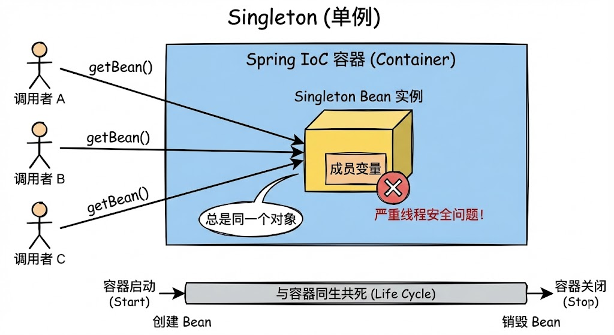
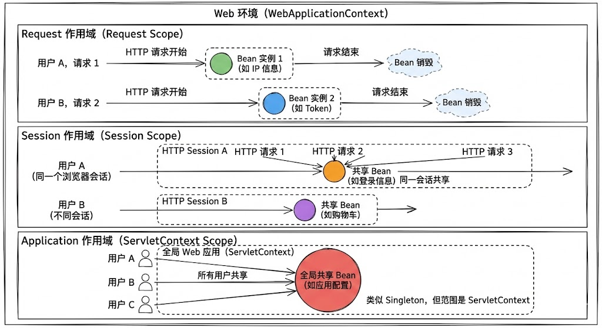

**Spring Bean 的作用域决定了 Bean 的生命周期。最常用的是 Singleton（默认单例）和 Prototype（多例），在 Web 环境下还有 Request、Session 等作用域。**

---

### 一、 核心作用域深度解析

#### 两个核心作用域

- **Singleton（单例）**

    - **机制：** 在整个 Spring IoC 容器中，**只会创建一个 Bean 实例**。无论你调用多少次 `getBean()`，拿到的都是同一个对象。
    - **生命周期：** 与容器同生共死。容器启动时创建，容器关闭时销毁。
- **注意：** 因为是共享的，所以**不要在 Singleton Bean 里定义成员变量**，否则会有严重的线程安全问题。
- **Prototype（多例/原型）**
    - **机制：** 每次从容器中 `getBean()`，都会**new 一个全新的对象**给你。
    - **生命周期：** Spring 只负责“生”，不负责“养”。容器把它创建出来交给调用者后，就不再管理它的生命周期了（不会执行销毁回调）。
    - **场景：** 只有当你需要对象包含状态（比如 `User` 对象），或者该对象是非线程安全的时候才用。

#### Web 环境专用作用域（只有 WebApplicationContext 能用）

- **Request：**
    - **机制：** 每一次 HTTP 请求，都会创建一个新的 Bean。请求结束，Bean 销毁。
    - **场景：** 比如用户的 IP 信息、Token 解析结果。
- **Session：**
    - **机制：** 同一个 HTTP Session 共享一个 Bean。
    - **场景：** 比如用户的登录信息、购物车信息。
- **Application (ServletContext)：**
    - **机制：** 全局 Web 应用共享一个 Bean（类似 ServletContext）。这跟 Singleton 很像，区别在于 Singleton 是针对 Spring 容器的，Application 是针对 Servlet 上下文的。

---

### 二、 面试标准回答

**Spring 中 Bean 的作用域主要决定了 Bean 实例的生命周期和可见范围。最常用的主要有 5 种，我可以把它们分为两类。**

**第一类是基础作用域，也是最常用的：**

1. Singleton（单例）：
    1. 这是 Spring 的默认作用域。
    2. 在整个 Spring 容器中，这个 Bean 只有一个实例。所有的请求都共享这一个对象。
        1. *注意点：* 因为是共享的，所以我们通常只把无状态的类（比如 Service、Dao）定义为 Singleton，以避免线程安全问题。
2. Prototype（多例）：
    1. 每次向容器获取 Bean 时（比如 getBean），都会创建一个全新的实例。
        1. *注意点：* Spring 容器只负责创建它，不负责销毁它，资源的释放需要开发者自己处理。

**第二类是 Web 环境下的特有作用域：**

1. **Request：** 每一次 HTTP 请求都会产生一个新的 Bean，请求结束 Bean 就销毁。
2. **Session：** 同一个 HTTP Session 共享同一个 Bean，通常用来存储用户会话数据。
3. **Application：** 在整个 Web 应用的生命周期内共享一个 Bean。
