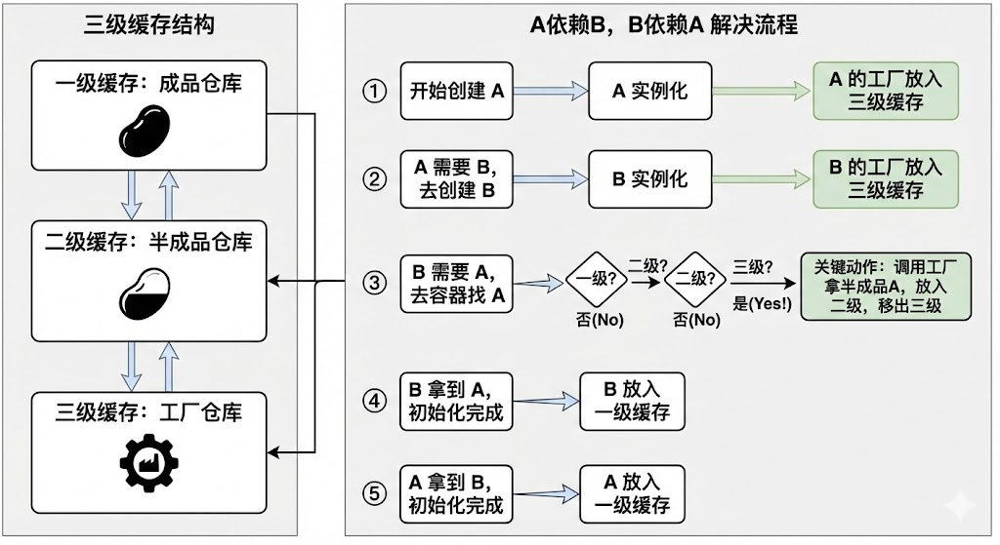
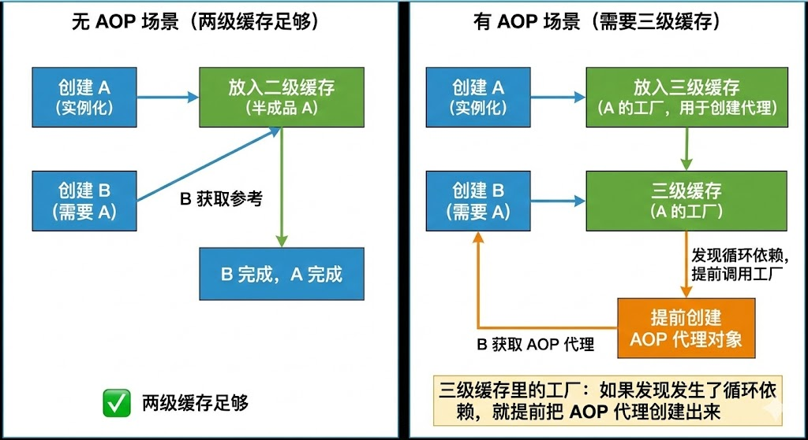

**Spring 利用“三级缓存”机制，通过将“实例化”和“初始化”分开，提前暴露一个“半成品”对象的引用，从而解决了单例 Bean 的循环依赖问题。**

### 一、 核心原理深度解析

要解决 A 依赖 B，B 又依赖 A 的死结，Spring 的逻辑是这样的：

#### 前置条件

Spring **只能**解决以下场景的循环依赖：

- 必须是 **单例** Bean。
- 必须是 **Setter 注入** 或 **字段注入**。
- *<u>注意：构造器注入是无法解决的，因为无法实例化。多例也是无法解决的。</u>*

#### 三级缓存结构

在 `DefaultSingletonBeanRegistry` 类中，定义了三个 Map：

1. **一级缓存：****成品仓库**。存放完全初始化好的 Bean（经历了完整生命周期）。
2. **二级缓存：****半成品仓库**。存放已经被实例化、但还没有属性赋值的 Bean。
3. **三级缓存 ：****工厂仓库**。存放 ObjectFactory，用于在需要时生成半成品对象。

#### 解决流程

假设 A 依赖 B，B 依赖 A：

1. **创建 A：** Spring 开始创建 A，调用构造方法实例化 A（此时 A 是半成品）。
2. **暴露工厂：** 将 A 的 ObjectFactory 放入 **三级缓存**。
3. **注入 B：** A 发现自己需要 B，去容器找 B，没找到，于是去创建 B。
4. **创建 B：** B 实例化，将 B 的工厂放入三级缓存。
5. **注入 A：** B 发现自己需要 A，去容器找 A。
    1. 一级缓存？没有。
    2. 二级缓存？没有。
    3. 三级缓存？**找到了！**
    4. **关键动作：** 调用三级缓存中 A 的工厂方法，拿到 A 的引用（如果是 AOP，这里拿到的是 A 的代理对象），把 A 放入 **二级缓存**，并从三级缓存移除。
6. **B 完成：** B 拿到了 A 的引用，完成了属性赋值和初始化。B 变成了成品，放入 **一级缓存**。
7. **A 完成：** A 顺利拿到了 B（因为 B 已经是成品了），完成了剩下的初始化。A 也放入 **一级缓存**。

---

### 二、 为什么需要“三级”缓存？

面试官常问：**“如果不考虑 AOP，两级缓存够不够？”**

- 够，如果没有 AOP，直接把半成品放到二级缓存就完事了。
- **为什么要三级：** 就是为了处理 **AOP 代理**。
    - Spring 的原则是：Bean 在生命周期的最后一步（初始化后）才创建代理。
    - 但在循环依赖中，B 需要拿到 A 的代理对象（而不是原始对象）。
    - 三级缓存里的工厂就是干这个的：**如果发现发生了循环依赖，就提前把 AOP 代理创建出来**，否则就按兵不动，遵循正常生命周期。

### 三、**如果我非要在构造器里使用循环依赖，有没有办法解决？”**

- **回答要点：**
    - **使用** `**@Lazy**` **注解：** 在构造器参数上加 `@Lazy`。Spring 会生成一个代理对象传进去，等真正调用该对象方法时，再去容器里找真实的 Bean。
    - **改为 Setter 注入：** 修改代码结构（治标治本）。

---

### 四、 面试标准回答

**Spring 是通过“三级缓存”机制来解决单例 Bean 的循环依赖问题的。**

首先，我们要明确它能解决的前提：

它只能解决 单例模式 下，通过 Setter 或字段注入 产生的循环依赖。如果是构造器注入，还是会抛出异常。

**具体的解决流程，我以 A、B 两个类相互依赖为例：**

1. **实例化 A：** Spring 先将 A 实例化（只是 `new` 了一个空对象）。此时，Spring 会利用 **三级缓存**，提前将 A 的 ObjectFactory 暴露出来。
2. **属性赋值：** A 在填充属性时发现依赖 B，于是去尝试获取 B。
3. **实例化 B：** 容器发现 B 不存在，就开始实例化 B。B 在填充属性时发现依赖 A。
4. **获取 A：** B 去容器里找 A。它在一级、二级缓存中都没找到，但在 **三级缓存** 中找到了 A 的工厂对象。
5. **提前引用：** B 调用这个工厂方法，拿到了 A 的**早期引用**（如果 A 需要 AOP，这里拿到的就是 A 的代理对象），并把它放入 **二级缓存**。
6. **闭环：** B 拿到了 A，顺利完成初始化，放入一级缓存。A 接着拿到 B，也完成初始化，放入一级缓存。

关于为什么需要三级缓存：

这主要是为了处理 AOP 代理 的情况。

Spring 的设计原则是尽可能在 Bean 生命周期的最后阶段才创建代理。
