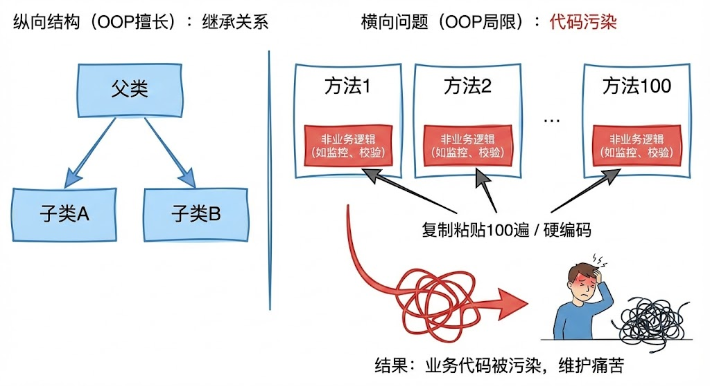
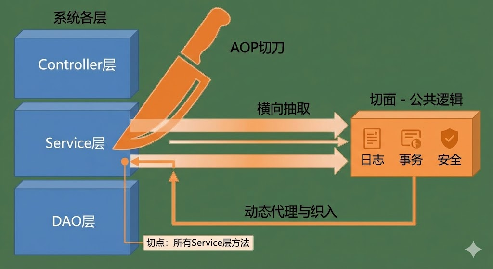

**AOP是一种编程范式，它是 OOP的补充。它的核心目的是把那些重复的、与业务无关的“横切逻辑”剥离出来，在运行时动态地“织入”到业务代码中，从而实现解耦。**

### 一、 核心原理深度解析

#### OOP 的局限性

- **纵向结构：** 面向对象擅长处理**纵向**的继承关系。
- **问题：** 当我们需要给系统中的 100 个方法都加上“性能监控”或“权限校验”时，OOP 只能让我们把代码复制粘贴 100 遍，或者硬编码调用一个工具类。这导致业务代码被非业务逻辑“污染”了，维护起来非常痛苦。

#### AOP 的横向抽取

- **横向结构：** AOP 像一把刀，把系统**横向切开**。
- **做法：**
    - 把日志、事务这些公共逻辑提取出来，封装成一个**切面**。
    - 定义**切点**，告诉程序这些逻辑要在哪里执行（比如“所有 Service 层的方法”）。
    - 通过**动态代理**技术，在程序运行时，把切面**自动织入**到目标方法中。

#### 核心应用场景

- **日志记录：** 记录请求入参、出参、响应时间。
- **声明式事务：** Spring 的 `@Transactional` 注解。
- **权限验证：** 方法级别的角色检查。
- **统一异常处理：** 捕获特定异常并统一返回格式。
- **缓存管理：** 查询前查缓存，查询后存缓存。

---

### 二、 面试标准回答

AOP 是对 OOP的一种补充。OOP 擅长封装纵向的业务逻辑（比如用户模块、订单模块），但在处理横向的通用逻辑时（比如每个模块都要记录日志、都要开启事务），OOP 会导致大量重复代码，侵入业务逻辑。

AOP 的核心作用：

就是将这些与核心业务无关、但又影响多个模块的“横切关注点”单独抽取出来，封装成切面。然后通过动态代理的方式，在运行时将这些逻辑动态地“织入”到业务代码中。

它的核心优势是：

实现了非业务逻辑与业务逻辑的完全解耦，让业务代码更加纯粹，同时减少了代码冗余。

**常见的应用场景主要有 3 个：**

1. **日志与监控：** 比如统一记录接口的调用耗时、入参出参。
2. **声明式事务管理：** 也就是 Spring 的 `@Transactional`。我们不需要在代码里写 `commit` 和 `rollback`，AOP 会自动在方法执行前开启事务，成功后提交，失败后回滚。
3. **权限控制：** 在方法执行前拦截，判断用户是否有权限操作。
