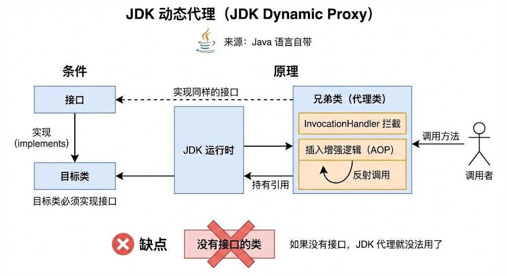
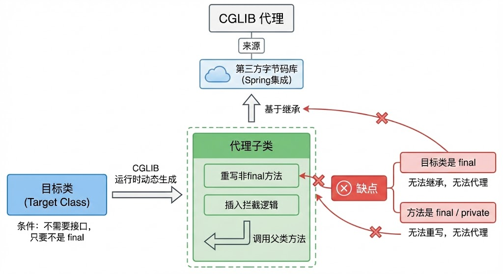

**Spring AOP 的底层原理就是“动态代理”。在应用启动时，Spring 会为目标对象生成一个代理对象。当我们在代码中调用目标方法时，实际上调用的是这个代理对象，它会拦截请求，先执行切面逻辑，再通过反射调用真正的业务方法。**

### 一、 核心原理深度解析

Spring AOP 不会修改你的源代码，它是在**运行期间**，通过**字节码技术**或者**反射技术**，在内存中临时生成一个“影子对象”。根据目标对象是否实现了接口，Spring 会自动选择以下两种技术之一：

#### JDK 动态代理

    - **来源：** Java 语言自带的功能
    - **条件：** 目标类**必须实现接口**。
    - **原理：**
        - JDK 会在运行时生成一个实现了同样接口的“兄弟类”。
        - 这个兄弟类持有目标对象的引用。
        - 当你调用方法时，兄弟类会通过 `InvocationHandler` 进行拦截，插入增强逻辑（AOP），然后通过反射调用目标对象的方法。
    - **缺点：** 如果你的类没有接口，JDK 代理就没法用了。

#### CGLIB 代理

- **来源：** 第三方的字节码生成库，Spring 把它集成了进来。
- **条件：** 目标类**不需要接口**，只要不是 `final` 的就行。
- **原理：**
    - **基于继承。** CGLIB 会在运行时动态生成一个目标类的**子类**。
    - 它重写了目标类的所有非 `final` 方法。
    - 在子类中，它插入了拦截逻辑，通过方法调用链来调用父类（目标对象）的方法。
- **缺点：** 因为是基于继承的，所以如果目标类被 `final` 修饰，或者方法被 `final` / `private` 修饰，CGLIB 就没法重写，也就没法代理。

#### Spring 的选择策略

- **经典策略：** 如果目标对象实现了接口，默认用 JDK 动态代理；如果没有接口，强制用 CGLIB。
- **Spring Boot 2.x 之后的变化：** 为了避免“类型转换异常”等坑，Spring Boot 默认会将配置 `proxy-target-class` 设为 `true`，也就是**默认强制使用 CGLIB**（除非你显式配置要用 JDK）。

---

### 二、 面试标准回答

**Spring AOP 的底层原理非常明确，一句话总结就是：动态代理。**

**Spring 会在运行期间，为目标对象动态生成一个代理对象。我们调用方法时，实际上是先调到了代理对象，由代理对象执行完切面逻辑（比如开启事务、记录日志）后，再通过反射去调用真正的业务方法。**

**具体的实现方式主要有两种，Spring 会根据情况自动切换：**

第一种是 JDK 动态代理，这是 Java 核心库自带的机制。

- **适用场景：** 针对**实现了接口**的类。
- **原理：** 它通过反射机制，在运行时创建一个实现了相同接口的代理类。
- **局限性：** 既然是基于接口的，那么如果一个类没有实现任何接口，JDK 动态代理就无法使用了。

第二种是 CGLIB 代理，是一个基于字节码操作的第三方库。

- **适用场景：** 针对**没有实现接口**的类。
- **原理：** 它是通过**继承**的方式实现的。它会在运行时动态生成一个目标类的子类，并重写其中的方法进行增强。
- **局限性：** 因为是基于继承，所以目标类不能被 `final` 修饰，目标方法也不能是 `final` 的，否则无法被重写。
