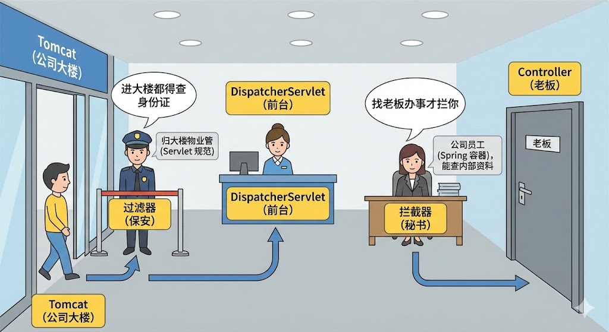

**过滤器是 Servlet 规范的一部分，属于 Web 容器，它拦截在请求进入 Servlet 之前；而拦截器是 Spring 框架的一部分，它拦截在 DispatcherServlet 到 Controller 之间。**

### 一、 核心区别深度解析

我们可以把整个 Web 请求处理流程想象成“进入公司办事”：

- **Tomcat (Web 容器)：** 公司大楼。
- **过滤器：****大楼门口的保安**。不管你是找谁的（哪个 Servlet），只要进大楼都得查身份证。他只归大楼物业（Servlet 规范）管，不管公司内部具体的业务。
- **DispatcherServlet：** 公司前台。
- **拦截器：****老板办公室门口的秘书**。只有你是找老板（Controller）办事时，她才会拦住你。她是公司（Spring 容器）的员工，所以她能查阅公司内部资料（使用 Spring Bean）。
- **Controller：** 老板。

#### 核心差异维度：

1. **归属不同：**
    1. **Filter：** 依赖于 **Servlet 容器**（如 Tomcat）。它基于函数回调实现，跟 Spring 没关系。
    2. **Interceptor：** 依赖于 **Spring Web MVC 框架**。
2. **触发时机不同：**
    1. 请求进来：`Filter` -> `DispatcherServlet` -> `Interceptor` -> `Controller`。
    2. Filter 是把守第一道关卡的，连 Spring 框架还没启动处理请求时，Filter 就已经工作了。
3. **能力不同：**
    1. **Filter：** 也就是能改改请求头、编码格式。它**很难直接注入 Spring 的 Bean**，因为它初始化的时候 Spring 容器可能还没准备好。
    2. **Interceptor：** 它可以直接使用 `@Autowired` 注入 Service 或 DAO，能读取 Spring 上下文中的所有信息，也能获取到你要访问的是哪个 Controller 的哪个 Method。

### 二、 面试标准回答

**这两个组件虽然都是用来拦截请求的，但它们的作用域和底层机制完全不同。**

**简单来说，Filter 是 Servlet 规范层面的，而 Interceptor 是 Spring 框架层面的。**

**第一，执行时机和范围不同：**

- **Filter** 运行在 Web 容器中，它拦截在请求进入 `DispatcherServlet` 之前。它的范围非常大，几乎可以拦截所有进入容器的请求。
- **Interceptor** 运行在 Spring MVC 框架内部，它拦截在 `DispatcherServlet` 到 `Controller` 之间。它只拦截分发给 Spring Controller 的请求。

**第二，依赖的容器不同：**

- **Filter** 依赖于 Servlet 容器（如 Tomcat），是基于函数回调实现的。
- **Interceptor** 不依赖 Servlet 容器，而是依赖于 Spring 容器，是基于 Java 反射机制实现的。

**第三，访问内部资源的能力不同：**

- **Filter** 因为执行得太早，通常很难直接注入 Spring 的 Bean（Service 等），往往只能处理像字符编码、跨域配置这种通用的、与业务逻辑解耦的工作。
- **Interceptor** 是 Spring 的一部分，可以完美支持依赖注入，能轻松访问 Service 层，甚至能直接获取到即将执行的 Controller 方法信息，适合做权限校验、日志审计等业务相关的逻辑。

如果要做通用的字符过滤、安全检查，用 Filter；如果要做跟具体业务逻辑相关、或者需要读取 Spring 上下文的判断，用 Interceptor。
