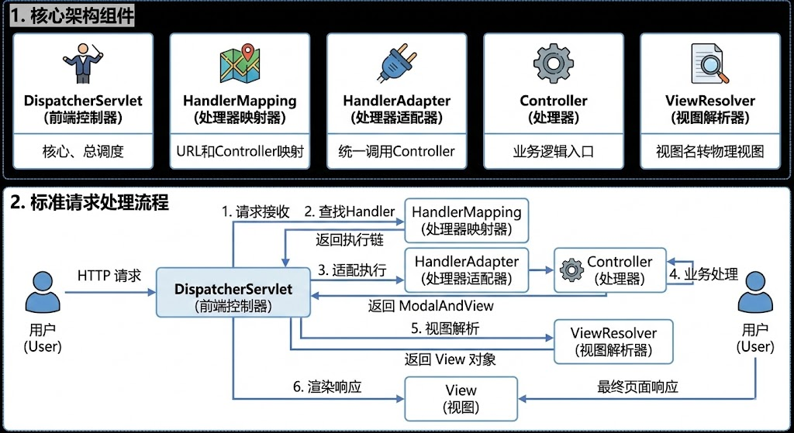

### 一、 核心原理深度解析

Spring MVC 的核心架构是基于**前端控制器模式设计的。它主要由一个核心调度器**和**四个辅助组件**组成。

#### 1. 核心架构组件

- **DispatcherServlet（前端控制器）：** 它是整个流程的核心，本质上是一个 Servlet。它负责接收所有进入的 HTTP 请求，并统筹调度其他组件来完成处理，起到了“总调度”的作用。
- **HandlerMapping（处理器映射器）：** 负责建立请求 URL 和 Controller 方法之间的映射关系。它解析请求，告诉调度器“这个 URL 应该由哪个 Controller 来处理”。
- **HandlerAdapter（处理器适配器）：** 负责调用具体的 Controller 方法。因为 Controller 的写法多种多样（实现接口、注解等），适配器用来消除差异，统一调用接口。
- **Controller（处理器）：** 开发者编写的业务逻辑入口，负责调用 Service 层业务，处理数据。
- **ViewResolver（视图解析器）：** 负责将逻辑视图名称（String）转换成物理视图（如 JSP、Thymeleaf 模板），并进行渲染。

#### 2. 标准请求处理流程

1. **请求接收：** 用户发送 HTTP 请求，请求首先到达 `DispatcherServlet`。
2. **查找 Handler：**`DispatcherServlet` 调用 `HandlerMapping`，根据 URL 查找对应的 Handler（即 Controller），此时会返回一个执行链（包含 Controller 和拦截器）。
3. **适配执行：**`DispatcherServlet` 调用 `HandlerAdapter`，通过适配器执行 Controller 中的业务方法。
4. **业务处理：** Controller 执行业务逻辑，返回 `ModelAndView` 对象（包含模型数据和视图名称）。
5. **视图解析：**`DispatcherServlet` 将视图名称传给 `ViewResolver`，解析出具体的 View 对象。
6. **渲染响应：**`DispatcherServlet` 将模型数据填充到 View 中，生成最终页面响应给用户。

---

### 二、 面试标准回答

**Spring MVC 是 Spring 框架中用于构建 Web 应用的模块，它是基于 Java Servlet API 构建的。**

**我可以从“架构设计”和“执行流程”两个层面来回答这个问题：**

第一，在架构设计上：

它采用了标准的 MVC设计模式，并核心运用了 “前端控制器” 模式。

也就是说，它提供了一个核心的 DispatcherServlet 作为统一的入口，由它来分发所有的请求。这样做的好处是将“请求分发”、“业务处理”和“视图渲染”彻底解耦，职责分明。

第二，在核心执行流程上：

当一个 HTTP 请求到达服务器时，会严格遵循以下步骤：

1. **请求分发：** 请求首先被 `**DispatcherServlet**` 拦截。
2. **查找处理器：** 调度器会查询 `**HandlerMapping**`，根据 URL 找到具体的 **Controller** 以及相关的拦截器。
3. **执行业务：** 调度器通过 `**HandlerAdapter**` 去反射调用 Controller 的业务方法。Controller 执行完毕后，通常会返回一个 `**ModelAndView**` 对象。
4. **解析视图：** 调度器拿着视图名称去查询 `**ViewResolver**`，找到真正的视图文件。
5. **渲染返回：** 最后将数据填充进视图，响应给客户端。
