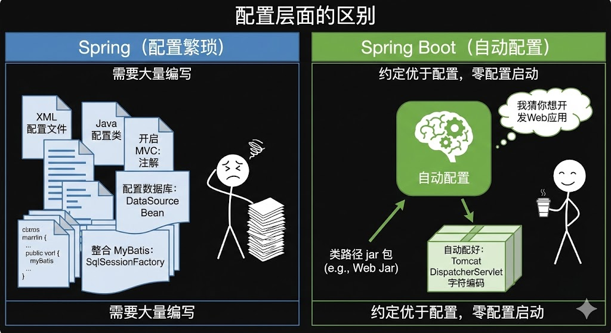
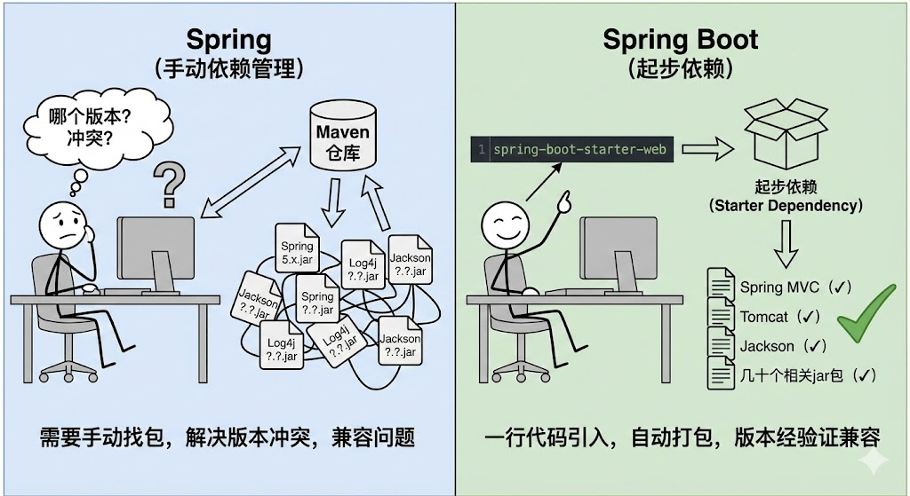
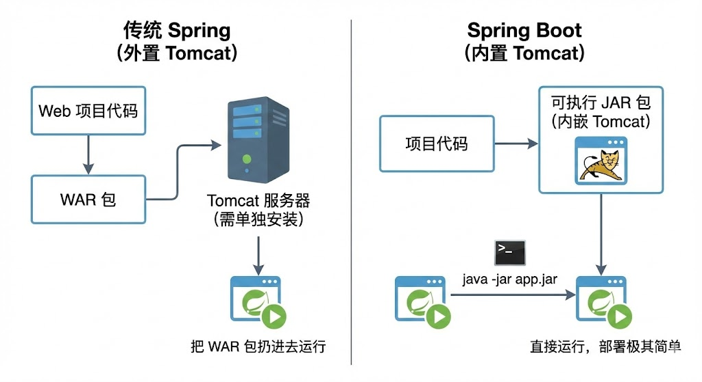

**Spring 是一个 Java 企业级开发框架，核心是 IoC 和 AOP。而 Spring Boot 是 Spring 的一套快速开发脚手架。Spring Boot 并没有增加新的功能，它只是通过“自动配置”和“起步依赖”把我们从繁琐的 Spring 配置中解放了出来。**

---

### 一、 核心区别深度解析

我们可以把 Spring Boot 看作是 Spring 的**“自动化版本”**。

#### 配置层面的区别

- **Spring：** 需要编写大量的 XML 配置文件或者 Java 配置类。比如开启 MVC 要加注解，配置数据库要配 DataSource Bean，整合 MyBatis 要配 SqlSessionFactory。
- **Spring Boot：** 采用 **“约定优于配置”**的理念。
    - 它引入了 **自动配置** 。
    - 只要你的类路径下引入了相关 jar 包，Spring Boot 就“猜到”你想开发 Web 应用，自动帮你配好 Tomcat、DispatcherServlet 和字符编码，你几乎零配置就能跑起来。

#### 依赖管理的区别

- **Spring：** 你需要自己去 Maven 仓库找 jar 包，不仅要找对版本，还要解决版本冲突。比如 Spring 5.x 要配 Log4j 哪个版本？
- **Spring Boot：** 提供了 **起步依赖**。
    - 比如你想做 Web 开发，直接引入 `spring-boot-starter-web` 这一行代码。
    - 它会自动把 Spring MVC、Tomcat、Jackson 等几十个相关的 jar 包全部打包拉下来，并且版本都是经过验证兼容的，彻底解决了版本冲突问题。

#### 运行模式的区别：外置 vs 内置

- **Spring：** 传统的 Web 项目打包成 WAR 包，需要下载并安装 Tomcat，然后把 WAR 包扔进去运行。
- **Spring Boot：****内嵌了Tomcat容器** 。
    - 项目打包成一个可执行的 **JAR** 包。
    - 直接运行 `java -jar app.jar` 或者执行 `main` 方法就能启动服务，这让微服务的部署变得极其简单。

---

### 二、 面试标准回答

**Spring Boot 是 Spring 框架的扩展，它本身并不提供新的功能，而是专门用于简化 Spring 应用的配置、搭建和运行。**

**具体的区别主要体现在以下三个方面：**

**第一，在配置方式上：**

- **Spring** 需要我们编写大量的 XML 或 Java 配置类来组装 Bean，配置非常繁琐，容易出错。
- 而 **Spring Boot** 遵循 **“约定优于配置”** 的理念。它通过 **“自动配置”** 机制，根据我们引入的依赖自动推断并配置好相应的组件。比如引入了 Web 依赖，它就自动配置好 Tomcat 和 Spring MVC，让我们能零配置快速启动。

**第二，在依赖管理上：**

- **Spring** 项目需要我们需要手动管理各种第三方库的版本，容易产生版本冲突。
- **Spring Boot** 提供了 **“起步依赖”**。我们只需要引入一个父级 starter，它就会把相关的几十个 jar 包一次性打包引入，并且由 Spring Boot 统一管理版本，彻底解决了依赖冲突问题。

**第三，在部署和运行模式上：**

- 传统的 **Spring Web** 项目通常需要打包成 WAR 包，并部署到外置的 Tomcat 中运行。
- **Spring Boot** 默认 **内嵌了 Tomcat 容器**，可以将项目打包成一个可执行的 **JAR 包**。我们只需要运行 `main` 方法或者 `java -jar` 命令就能启动服务，这非常契合微服务架构下快速部署的需求。
