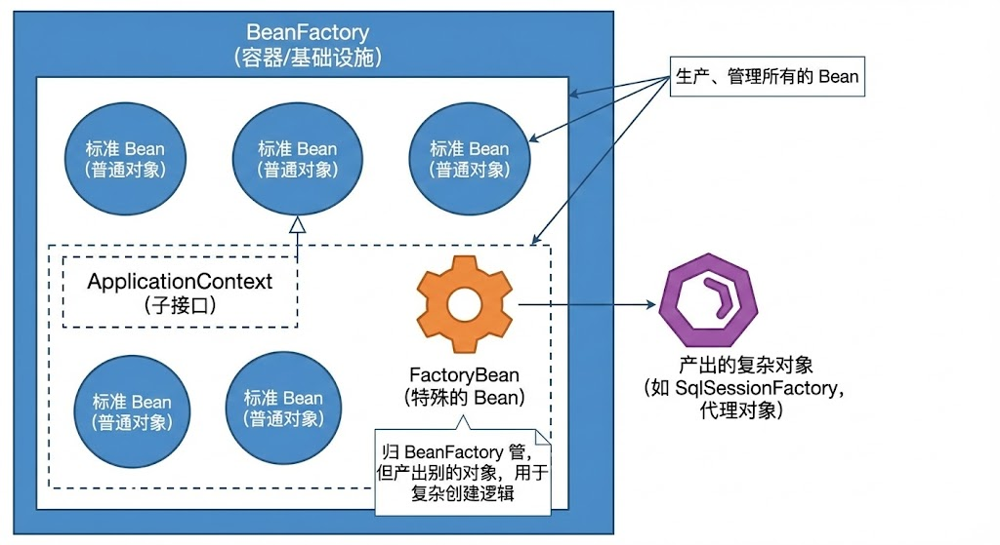

**名字虽然像，但地位完全不同。BeanFactory 是“工厂”，是 Spring 的心脏；FactoryBean 是“Bean”，是 Spring 提供的一种扩展机制。**

---

### 一、 核心区别深度解析

- **BeanFactory：**
    - 它是整个 Spring 框架的**基础设施**。
    - 它是一个**容器**，负责生产、管理所有的 Bean。所有的 Bean 都在它里面。
    - 我们常用的 `ApplicationContext` 就是 BeanFactory 的子接口。
- **FactoryBean ：**
    - 它本质上是一个 **Bean**，也归 BeanFactory 管。
    - 但它是一个**特殊的 Bean**。它不产出自己，而是产出**别的对象**。
    - **场景：** 当你需要创建一个非常复杂的对象（比如 MyBatis 的 `SqlSessionFactory`，或者一个复杂的代理对象），用 XML 或注解很难描述时，你就写一个 `FactoryBean`，在 Java 代码里手写复杂的创建逻辑。

#### 关键的“获取”差异（& 符号）：

假设有一个 FactoryBean 叫 `myBean`。

- `getBean("myBean")`：拿到的是它**生产出来的产品**（调用了 `getObject()` 后的结果）。
- `getBean("&myBean")`：拿到的是 **FactoryBean 这个工厂本身**。

---

### 二、 面试标准回答

**用一句话总结：BeanFactory 是 Spring 容器的顶层接口（它是工厂），而 FactoryBean 是一个可以生产对象的特殊 Bean（它是产品）。**

**具体区别主要体现在以下三点：**

**第一，定位不同：**

- **BeanFactory：** 是 Spring IoC 容器的**核心接口**。它负责管理所有 Bean 的生命周期（实例化、初始化、依赖注入）。它是 Spring 框架的“基础设施”。
- **FactoryBean：** 是 Spring 提供的一种**扩展接口**。它本质上还是一个 Bean，也归 BeanFactory 管理。但它的作用是允许开发者通过代码去**定制化**地生成复杂的 Bean。

**第二，作用不同：**

- **BeanFactory** 提供的是标准的 Bean 创建流程（基于 XML 或注解）。
- **FactoryBean** 提供的是**个性化**的创建流程。当我们创建一个对象的过程非常复杂（例如 MyBatis 的 `SqlSessionFactory`，或者创建 RPC 代理对象），无法简单地用 XML 描述时，我们就会实现 `FactoryBean` 接口，在 `getObject()` 方法里写 Java 代码来构建这个对象。

第三，获取方式不同：

假设我们在 Spring 中定义了一个 id 为 demo 的 FactoryBean：

- 当我们调用 `context.getBean("demo")` 时，Spring 返回的是这个 FactoryBean **生产出来的对象**（即 `getObject()` 的返回值）。
- 如果我们真的想获取 FactoryBean **这个工厂对象本身**，需要在 id 前面加一个 `&` 符号，即 `context.getBean("&demo")`。
