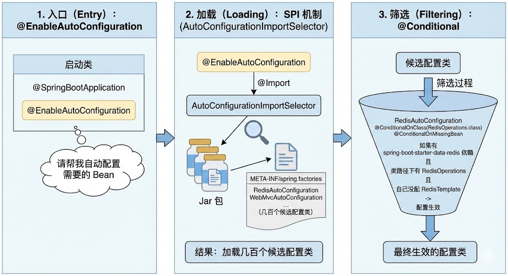

**Spring Boot 的自动配置原理，本质上就是“SPI 机制（加载） + @Conditional 注解（筛选）”。启动时，它从类路径下的 META-INF 文件中读取所有的配置类，然后根据当前环境（有没有这个 Jar 包、有没有这个 Bean）来决定是否真正激活这些配置。**

---

### 一、 核心原理深度解析

自动配置主要由三步完成：

#### 入口：`@EnableAutoConfiguration`

    - 你写的启动类上都有 `@SpringBootApplication`。
    - 这个注解是一个复合注解，里面最关键的一个叫 `**@EnableAutoConfiguration**`。
    - 它的作用就是告诉 Spring Boot：“请帮我把那些我没配置但需要的 Bean，自动配置好。”

#### 加载：SPI 机制 (AutoConfigurationImportSelector)

    - `@EnableAutoConfiguration` 内部使用 `@Import` 导入了一个核心类：`**AutoConfigurationImportSelector**`。
    - 这个类的作用就是去扫描所有 Jar 包。
    - **扫描哪里？**
        - 它会去读取 `META-INF/spring.factories` 文件。
        - 这些文件里列出了几百个自动配置类（如 `RedisAutoConfiguration`, `WebMvcAutoConfiguration`）。
    - **结果：** 此时，它把这几百个候选配置类全加载进来了。

#### 筛选：`@Conditional`

    - 如果这几百个配置全都生效，应用就爆炸了。所以需要**筛选**。
    - 每个自动配置类上都加了 `**@Conditional**` 系列注解。
    - **举个例子（Redis）：**
        - `RedisAutoConfiguration` 上面有 `@ConditionalOnClass(RedisOperations.class)`。
        - **逻辑：** 只有当你项目里引入了 `spring-boot-starter-data-redis` 依赖，类路径下有了 `RedisOperations` 这个类，这个配置才会生效。
        - 同时还有 `@ConditionalOnMissingBean`。意思是：如果你自己手动配了一个 RedisTemplate，那 Spring Boot 就不会加载；如果你没配，它才帮你配。

### 二、 面试标准回答

**Spring Boot 自动配置的核心原理，可以总结为八个字：SPI 加载，条件筛选。**

**整个流程从启动类的** `**@SpringBootApplication**` **注解开始，具体分为三个步骤：**

第一步是“开启自动配置”：

@SpringBootApplication 是一个复合注解，其中最核心的是 @EnableAutoConfiguration。它显式地开启了自动配置功能，并利用 @Import 导入了 AutoConfigurationImportSelector 类。

第二步是“加载候选配置”：

AutoConfigurationImportSelector 会扫描所有 Jar 包类路径下的特定文件。

这些文件中列出了所有可能的自动配置类。Spring Boot 会先把这几百个配置类全部读取出来作为**候选者**。

第三步是“条件筛选”（@Conditional）：

这是最关键的一步。这几百个配置类并不会全部生效，因为它们上面都标注了 @Conditional 系列注解。

- 比如 `**@ConditionalOnClass**`：判断当前类路径下有没有某个 Jar 包（例如，只有引入了 Redis 的依赖，Redis 的自动配置才会生效）。
- 比如 `**@ConditionalOnMissingBean**`：判断容器中是否已经有了用户自定义的 Bean。如果用户自己配了，Spring Boot 就不生效；如果用户没配，Spring Boot 就自动配置。
