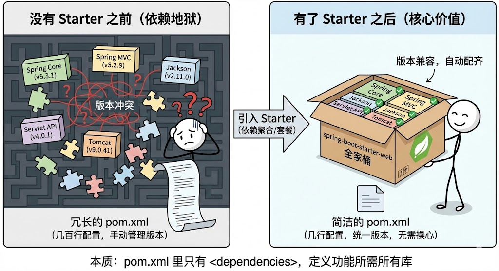

**Starter 本质上就是一组依赖的集合。它的作用是把某种功能所需要的所有 Jar 包打包在一起，让我们只需要引入一个依赖，就能把所有相关的环境都准备好，不需要关心版本冲突。**

---

### 一、 核心原理深度解析

在没有 Spring Boot 之前，我们要开发一个 Web 项目，需要在 Maven 里写一大堆依赖：Spring Core、Spring MVC、Jackson、Servlet API、Tomcat... 还要一个个去试它们的版本兼不兼容。

**Starter 就是为了解决这个“依赖地狱”而生的。**

#### 本质：依赖聚合

    - **你可以把它理解为“套餐”。**
    - 比如你去肯德基，不用一个个点汉堡、可乐、薯条（可能会漏点，或者搭配不对）。你直接点一个“全家桶”，它就把这三样东西都给你配齐了。
    - **技术实现：** Starter 的 `pom.xml` 里没有任何 Java 代码，只有 `<dependencies>`，里面定义了该功能所需的所有第三方库。

#### 核心价值

    - **简化配置：**`pom.xml` 从几百行缩减到几行。
    - **统一版本：** Starter 内部已经把所有依赖的版本都协调好了，你不需要写版本号，完全不用担心 Jar 包冲突。

---

### 二、 面试标准回答

**用一句话概括：它就是一组预定义好的依赖集合，目的是为了让我们“一站式”地引入某种功能，而不需要手动去管理复杂的 Jar 包版本和依赖关系。**

**具体来说，可以从以下两个方面来理解：**

第一，解决了什么问题：

在以前的 Spring 开发中，如果我们想做一个 Web 项目，需要在 Maven 中引入 Spring MVC、Tomcat、Jackson 等五六个依赖，还要仔细核对它们的版本是否兼容，非常容易出错。

而 Starter 把这些相关的 Jar 包打包成了一个整体。比如引入 spring-boot-starter-web，它就会自动把 Tomcat、Spring MVC、Json 处理库全部引入进来。

它本质上就是一个 Maven 的 BOM，帮我们完成了“依赖聚合”和“版本锁定”。

第二，有什么应用场景：

Starter 的应用场景主要分为两类：

1. **官方提供的通用场景：**

这是我们最常用的。比如：

- 开发 Web 接口，用 `spring-boot-starter-web`。
- 操作数据库，用 `spring-boot-starter-data-jpa` 或 `jdbc`。
- 做单元测试，用 `spring-boot-starter-test`。
- 做缓存，用 `spring-boot-starter-data-redis`。
1. **自定义 Starter：**

这也是我在项目中经常用到的。我们会把公司内部通用的中间件逻辑封装成 Starter。

- 比如：**统一的日志收集 Starter**、**统一的鉴权 Starter**、或者**自定义的短信发送 Starter**。
- 各个微服务只需要引入这个 Starter，配置几个参数，就能直接拥有这些功能，极大地减少了重复代码，实现了公司技术标准的统一。
