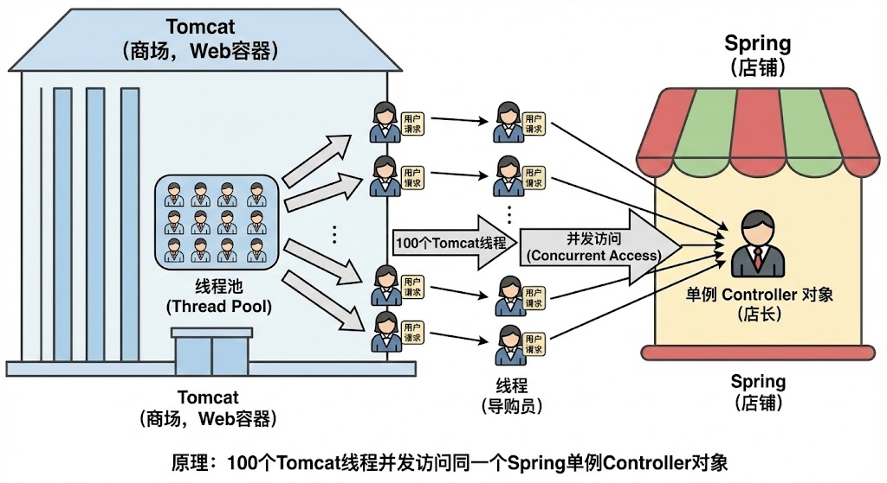

**Spring 框架本身并不负责创建和管理请求线程，这事是 Web 容器（如 Tomcat）干的。但因为 Spring 的 Controller 默认是单例的，所以确实存在“多线程并发访问同一个对象”的情况，这就要求我们的 Controller 必须是无状态的。**

---

### 一、 核心原理深度解析

我们可以把 Tomcat 和 Spring 的关系想象成“商场”和“店铺”：

- **Tomcat** **(Web 容器)：** 是商场。它负责安保和接待。商场里有很多**导购员（****线程池****中的线程）**。
- **Spring (****Controller****)：** 是商场里的一家店铺，为了省钱，这家店只雇佣了**一个店长（****单例** **Controller）**。

#### 线程是谁创建的？—— Tomcat

当 100 个用户同时发起 HTTP 请求时：

    1. 并不是 Spring 创建了 100 个线程。
    2. 而是 **Tomcat** 从自己的线程池里分配了 100 个线程来处理这些请求。
    3. 这 100 个线程就像 100 个导购员，分别带着用户的请求，跑进了 Spring 的地盘。

#### 多线程是如何访问 Controller 的？

    - **单例模式****：** Spring 容器启动时，Controller 被实例化，默认是单例的。堆内存里只有这一个 Controller 对象。
    - **并发访问：** 那 100 个 Tomcat 线程，会同时调用这**同一个** Controller 对象的 `method()` 方法。
    - **原理：** 这就是**多线程并发访问同一个对象**。

### 二、 面试标准回答

首先，明确结论：

Spring MVC 本身并不负责为每个请求创建新的线程。线程的维护和调度是由底层的 Web 容器来完成的。

**具体的底层执行流程是这样的：**

**第一，线程池分发：**

当多个用户同时发起请求时，Tomcat 会从自带的线程池中分配出多个线程。每个请求对应一个独立的线程。

**第二，单例 Bean 的并发访问：**

这些线程会进入 Spring 容器内部进行处理。

在 Spring 中，Controller 和 Service 默认都是 单例的。这意味着在 JVM 的堆内存中，这个 Controller 对象只有一份。

所以，实际上是多条线程同时在访问同一个 Controller 对象的方法。

**第三，如何保证线程安全：**

既然是多线程访问同一个对象，为什么没出问题呢？

是因为我们的 Controller 通常设计为“无状态”的。我们在 Controller 里通常只定义 Service 等不可变的依赖，这些是线程安全的。
