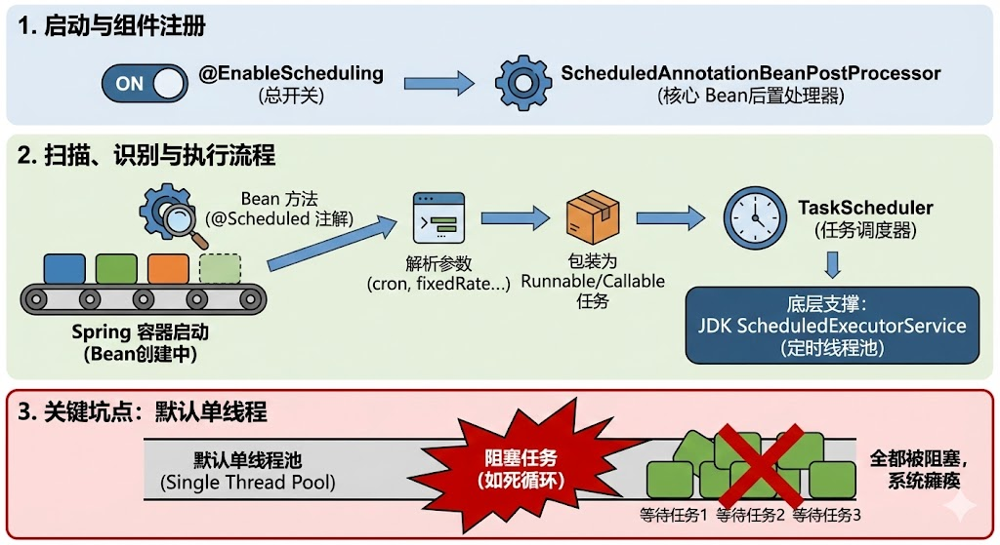

**Spring Task 是 Spring 框架自带的轻量级定时任务支持。它不需要集成 Quartz 那么复杂的配置，只需要一个** `**@Scheduled**` **注解就能实现定时任务。其底层原理是利用** `**BeanPostProcessor**` **扫描注解，并封装成 Runnable 任务交给 JDK 的** `**ScheduledThreadPoolExecutor**` **去执行。**

---

### 一、 核心原理深度解析

#### 启动开关：`@EnableScheduling`

    - 这是总开关。它会导入一个配置类，注册一个核心组件：`**ScheduledAnnotationBeanPostProcessor**`。
    - 这个名字很长，但它是核心。记住它是一个 **BeanPostProcessor**（Bean 后置处理器）。

#### 扫描与识别

    - 当 Spring 容器启动，创建 Bean 的时候，`ScheduledAnnotationBeanPostProcessor` 会拦截所有的 Bean。
    - 它会检查这个 Bean 的方法上有没有加 `**@Scheduled**` 注解。
    - 如果有，它就解析注解里的参数（cron 表达式、fixedRate 等）。

#### 任务注册与执行

    - 解析完成后，Spring 会把这个方法包装成一个 `Runnable` 或 `Callable` 对象。
    - 然后，它会把这个任务交给 `**TaskScheduler**`（任务调度器）去处理。
    - **底层支撑：**`TaskScheduler` 的默认实现通常是基于 JDK 的 `**ScheduledExecutorService**`（也就是 JDK 自带的定时线程池）来做的。

#### 关键坑点：默认单线程

    - 这是原理中最重要的一个细节，Spring Task **默认**只有一个线程的线程池。
    - **后果：** 如果你有 5 个定时任务，其中一个任务卡死了（比如死循环），其他 4 个任务**全都会被阻塞**，导致整个系统的定时任务瘫痪。

---

### 二、 面试标准回答

**Spring Task 是 Spring 框架提供的一种轻量级的定时任务解决方案。**

**相比于 Quartz 这种重量级的分布式调度框架，Spring Task 非常简单，通常只需要在方法上加上** `**@Scheduled**` **注解就能使用。**

**关于它的实现原理，主要可以分为“扫描”和“执行”两个阶段：**

**第一阶段是“扫描与注册”：**

当我们在启动类上加上 @EnableScheduling 注解后，Spring 会向容器中注册一个核心的后置处理器，叫做 ScheduledAnnotationBeanPostProcessor。

在 Spring 启动过程中，这个后置处理器会扫描所有的 Bean，查看它们的方法上是否有 @Scheduled 注解。

如果有，它就会解析 Cron 表达式或定时参数，将该方法封装成一个具体的 Task 对象。

**第二阶段是“调度与执行”：**

封装好的任务会被提交给 TaskScheduler，Spring 底层本质上是利用了 JDK 原生的ScheduledExecutorService（也就是 JDK 的定时线程池）来实现具体的调度逻辑的。

这里有一个非常重要的细节，Spring Task 默认配置的线程池大小是 1。

这意味着，如果系统中有多个定时任务，它们是串行执行的。如果其中一个任务执行时间过长甚至阻塞，会直接导致后续的其他任务无法准时执行。

所以在生产环境中，我们通常会自定义一个线程池来替换掉默认的单线程池，从而支持多任务并发执行。
