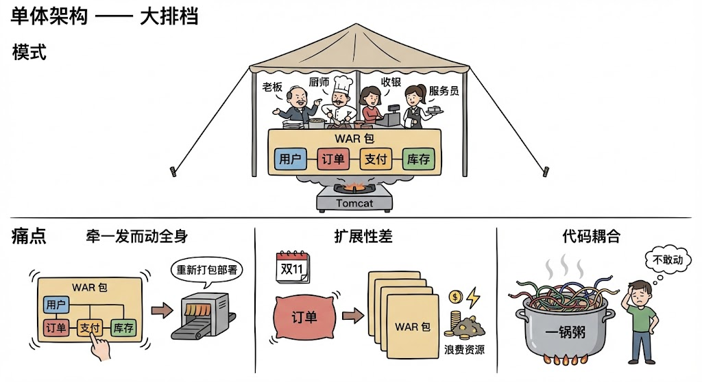
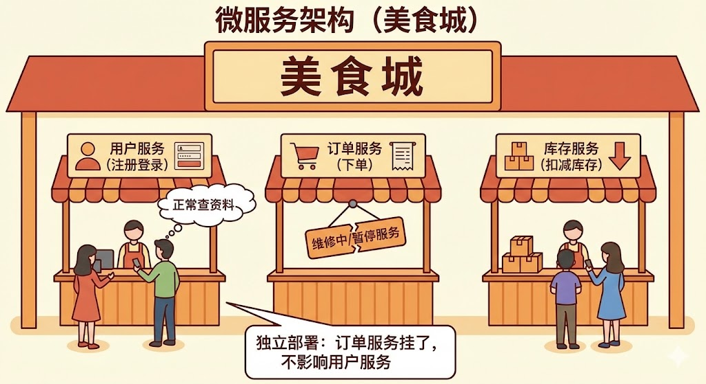
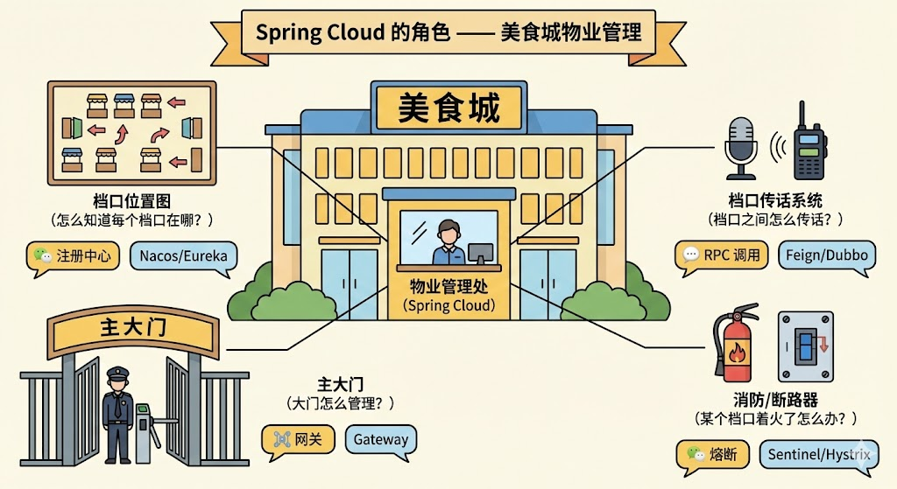

**微服务是一种架构风格，它把一个庞大的单体应用拆分成了一组小的、独立的服务。每个服务只关注单一的业务功能，独立部署、独立维护数据。而 Spring Cloud 就是为了解决这些服务拆分后带来的通信、治理和运维难题而存在的。**

### 一、 核心概念深度解析

我们可以把架构演进比作“开餐厅”：

#### 1. 单体架构 —— 也就是“大排档”

- **模式：** 老板、厨师、收银、服务员都在一个大通铺里。
- **代码：** 所有的业务模块（用户、订单、支付、库存）都打包在一个 `war` 包里，跑在一个 Tomcat 上。
- **痛点：**
    - **牵一发而动全身：** 只是改了“支付”模块的一行代码，整个系统都得重新打包部署。
    - **扩展性差：** 双 11 只有“订单”模块压力大，但你必须把整个庞大的系统都扩容，非常浪费资源。
    - **代码****耦合****：** 几年下来，模块之间互相调用，乱成一锅粥，没人敢动

#### 2. 微服务架构 —— 也就是“美食城”

- **模式：** 把大排档拆成了独立的小档口。卖面的只管卖面，卖饮料的只管卖饮料。
- **拆分原则：****按业务领域拆分**
    - **用户服务**：只管用户注册登录。
    - **订单服务**：只管下单。
    - **库存服务**：只管扣减库存。
- **特征：**
    - **独立部署：** 订单服务挂了，不影响用户服务查资料。

#### 3. Spring Cloud 的角色 —— 美食城物业管理

- 拆分成了 100 个服务后，麻烦来了：
    - 怎么知道每个档口在哪？（注册中心 - Nacos/Eureka）
    - 档口之间怎么传话？（RPC 调用 - Feign/Dubbo）
    - 某个档口着火了怎么办？（熔断 - Sentinel/Hystrix）
    - 大门怎么管理？（网关 - Gateway）

---

### 二、 面试标准回答

**简单来说，微服务就是一种将单体应用“化整为零”的架构风格。**

**具体可以从三个维度来阐述：**

**第一，从“拆分”的角度：**

以前的单体应用，所有的业务模块（比如用户、订单、库存）都耦合在一个项目中，打成一个包部署。

而微服务主张按照“业务领域”将系统拆分成一个个独立的、松耦合的小服务。每个服务只关注单一的业务功能。

**第二，从“运行”的角度：**

拆分后的每个微服务，都是一个**独立的进程**。

- 它们可以**独立部署**和升级，不需要为了改一个模块而重启整个系统。
- 它们可以**独立扩展**，比如订单服务压力大，我只需要给订单服务增加节点，而不需要扩容整个系统。

**第三，从“代价”的角度：**

- 微服务虽然解决了耦合和扩展性问题，但也带来了巨大的**分布式复杂性**。
- 比如服务之间如何发现？网络通信失败了怎么办？分布式事务怎么处理？
- 这就是 **Spring Cloud** 存在的意义。它提供了一整套治理工具（如 Nacos、Feign、Gateway、Sentinel），帮我们屏蔽了这些分布式系统的复杂性，让我们能像开发单体应用一样开发微服务。

### 购买了课程的同学，本八股动画视频持续更新！

### 后续视频更新也会在群里分享，一定要先进群！
