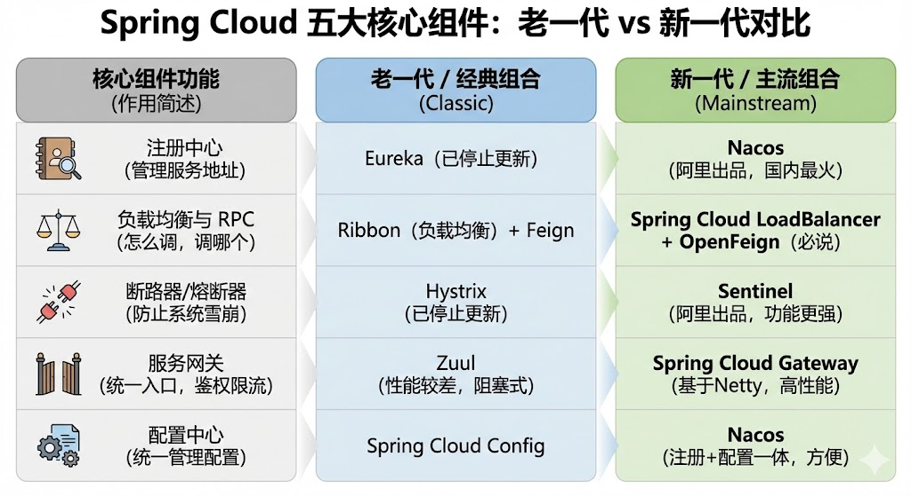

**Spring Cloud 是一套微服务解决方案的“全家桶”。它基于 Spring Boot，为分布式系统中的服务治理、注册发现、断路器、路由网关等常见模式提供了标准化的实现。**

---

### 一、 核心体系深度解析

它主要由**五大核心组件**构成，但这几年技术迭代很快，面试时建议同时提到“老一代”**和**“新一代”的对比，这非常加分。

#### 注册中心

- **作用：** 管理所有微服务的地址。A 服务要调 B 服务，得先去这里查 B 的 IP 和端口。
    - **组件：**
        - *经典：***Eureka**（已停止更新）。
        - *主流：***Nacos**（阿里出品，目前国内最火）。

#### 负载均衡与远程调用 (RPC)

    - **作用：** 既然查到了 B 服务有 3 个实例，我该调哪一个？（负载均衡）。怎么调？（像调本地方法一样调远程）。
    - **组件：**
        - *经典：***Ribbon**（负载均衡）、**Feign**。
        - *主流：***Spring Cloud LoadBalancer**、**OpenFeign**（必说）。

#### 断路器/熔断器

    - **作用：** B 服务挂了，A 服务别傻等，直接切断请求，防止整个系统雪崩。
    - **组件：**
        - *经典：***Hystrix**（已停止更新）。
        - *主流：***Sentinel**（阿里出品，功能更强）。

#### 服务网关

    - **作用：** 所有外部请求的统一入口。负责鉴权、限流、路由转发。
    - **组件：**
        - *经典：***Zuul**（性能较差，阻塞式）。
        - *主流：***Spring Cloud Gateway**（基于 Netty，非阻塞，性能强）。

#### 配置中心

    - **作用：** 几十个微服务的配置文件如果散落在各自的项目里，改起来会死人。配置中心负责统一管理，修改后实时生效。
    - **组件：**
        - *经典：***Spring Cloud Config**。
        - *主流：***Nacos**（集注册中心与配置中心于一体，非常方便）。

---

### 二、 面试标准回答

**Spring Cloud 是一系列框架的有序集合，它基于 Spring Boot，为微服务架构中的各种常见问题提供了一站式的解决方案。**

**关于它的核心组件，我们可以按功能将其划分为“微服务五大件”。目前业界主要经历了从 Netflix 套件到 Spring Cloud Alibaba 套件的迭代：**

**第一是“注册中心”：**

它是服务治理的核心。

- 早期我们常用 **Eureka**。
- 但现在国内项目大多转向了 **Nacos**，因为它同时支持注册中心和配置中心，且支持 CP/AP 切换。

**第二是“负载均衡与远程调用”：**

- 早期通过 **Ribbon** 做负载均衡，用 **Feign** 做声明式调用。
- 现在推荐使用 **OpenFeign**，配合 **Spring Cloud LoadBalancer**，让我们能像调用本地接口一样调用远程服务。

第三是“断路器”：

为了防止服务雪崩。

- 以前的标准是 **Hystrix**。
- 现在主流方案是 **Sentinel**，它提供了更强大的流控规则和可视化控制台。

第四是“服务网关”：

它是系统的统一入口，负责路由和鉴权。

- 老一代用 **Zuul** 1.x。
- 现在大部份企业全线都升级到了 **Spring Cloud Gateway**，它是基于 Netty 的响应式编程，性能更强。

第五是“配置中心”：

用于统一管理配置文件。

- 可以用官方的 **Spring Cloud Config**。
- 但通常直接用 **Nacos** 兼任配置中心，减少部署成本。
