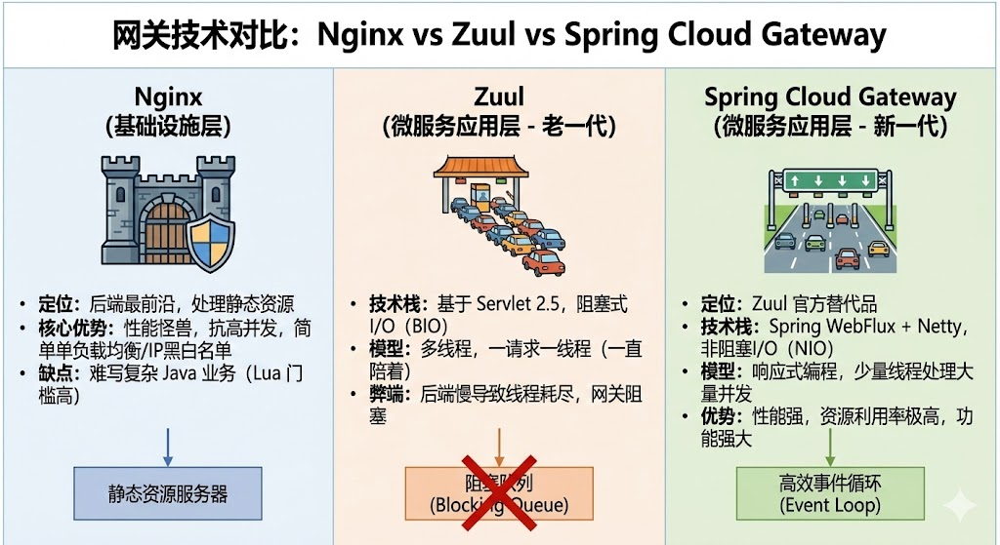

**Nginx 是 C 语言写的，性能最强，通常作为最外层的反向代理；Zuul 和 Gateway 是 Java 写的微服务网关，处理具体的业务逻辑。而在 Java 网关中，Spring Cloud Gateway 是 Zuul 的替代者，它基于非阻塞 IO，性能远优于 Zuul。**

---

### 一、 核心区别深度解析

#### Nginx

    - **定位：****基础设施层**。它处于整个后端的最前沿，一般部署用于处理静态资源，例如前端的一些资源。
    - **核心优势：****性能怪兽**。它主要负责抗住高并发流量，做简单的负载均衡、静态资源服务器、IP 黑白名单。
    - **缺点：** 很难写复杂的 Java 业务逻辑（虽然可以用 Lua，但开发门槛高）。

#### Zuul

    - **定位：****微服务应用层**。
    - **技术栈：** 基于 **Servlet 2.5**，使用阻塞式 I/O（BIO）， **多线程模型**。每一个请求进来，它就分配一个线程一直陪着，直到请求结束。
    - **弊端：** 如果后端服务响应慢，Zuul 的线程池很快就会被耗尽，导致网关阻塞。

#### Spring Cloud Gateway

    - **定位：****Zuul 的官方替代品**。
    - **技术栈：** 基于 **Spring WebFlux** 和 **Netty**，使用非阻塞 I/O（NIO）。 **响应式编程模型**。少量线程处理大量并发，资源利用率极高。
    - **优势：** 性能比 Zuul 强很多，功能更强大。

---

### 二、 面试标准回答

**这三个组件虽然都叫“网关”或“代理”，但在实际架构中，它们的定位和技术实现是有很大区别的。**

**我可以把它们分为“流量网关”和“业务网关”两类来对比：**

**第一，Nginx 与 后两者的区别：**

- **Nginx** 是 C 语言编写的，属于**流量网关**。它的优势是性能极高，稳定性极强。在架构中，它通常部署在最外层，负责反向代理、静态资源缓存和第一层的负载均衡。
- **Zuul 和 Gateway** 是 Java 编写的，属于**业务网关**。它们部署在 Nginx 之后，专门用于处理与业务强耦合的逻辑，比如统一鉴权、动态路由、灰度发布等。因为是 Java 写的，我们扩展起来非常方便。

第二，Zuul 与 Gateway 的区别：

这两者都是 Spring Cloud 生态的组件，但 Gateway 是 Zuul 的替代者。

- **I/O 模型不同：**
    - **Zuul 1.x** 基于 Servlet 构建，采用的是 **阻塞式 I/O（BIO）**。它的模型是“一个请求对应一个线程”，如果后端服务响应慢，网关线程池很容易被耗尽，成为性能瓶颈。
    - **Gateway** 基于 Spring WebFlux 和 Netty 构建，采用的是 **非阻塞 I/O（NIO）**。它利用响应式编程，可以用少量的线程处理高并发请求，资源利用率更高。
