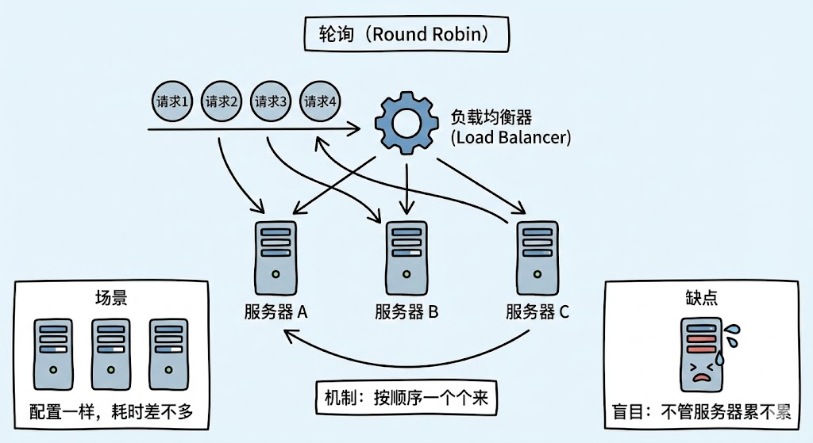
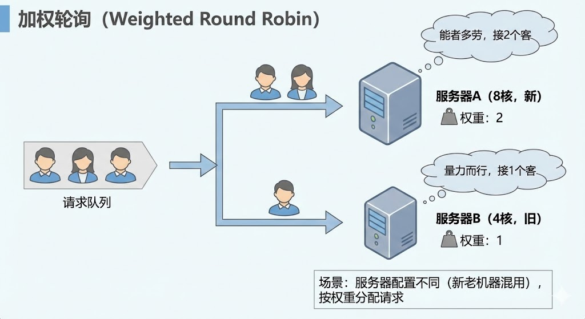
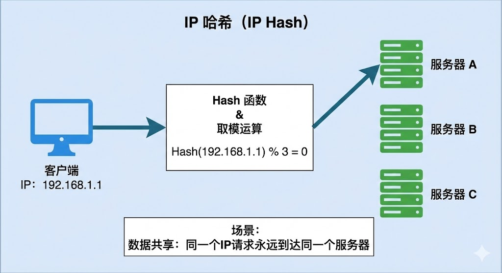
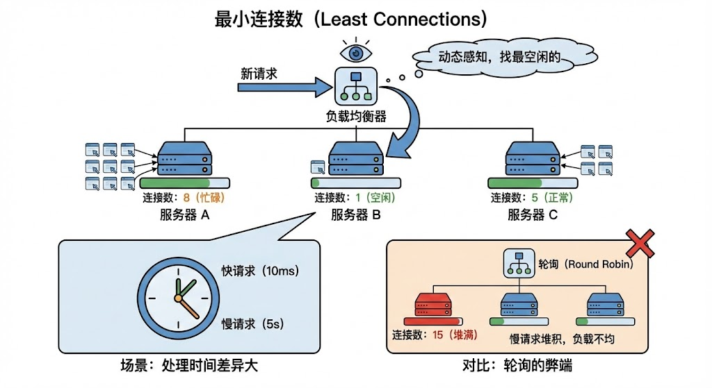
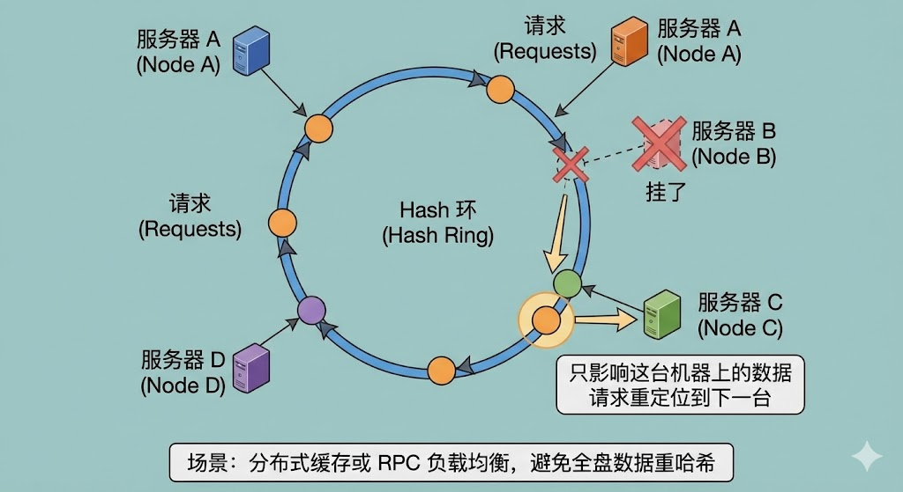

**负载均衡策略主要分为静态和动态两类。最常用的是轮询和加权轮询，但在需要 Session 保持时会用哈希，在处理长连接或请求处理时间差异大时会用最小连接数。**

### 一、 核心策略深度解析

#### 轮询

    - **机制：** 按顺序一个个来。第 1 个请求给 A，第 2 个给 B，第 3 个给 C，第 4 个又给 A。
    - **场景：** 服务器硬件配置完全一样，且请求处理耗时差不多。
    - **缺点：** 它是“盲目”的，不管服务器累不累。

#### 加权轮询

    - **机制：** 给配置好的服务器更高的权重。比如 A 是新买的 8 核机器，B 是老旧的 4 核机器。我们给 A 权重设为 2，B 设为 1。结果就是：A 接 2 个客，B 接 1 个客。
    - **场景：****生产环境最常用**。因为服务器很少是完全同构的，总有新老机器混用。

#### IP 哈希

    - **机制：** 对客户端的 IP 地址算一个 Hash 值，然后对服务器数量取模。
    - **结果：** 只要 IP 没变，这个用户永远会被分发到同一台服务器上。
    - **场景：****解决 数据 共享问题，可以让同一个IP的请求到达同一个服务器。**

#### 最小连接数

    - **机制：** 它是动态感知的。负载均衡器会看哪台服务器当前建立的连接数最少，就分给谁。
    - **场景：** 请求处理时间差异很大的场景。比如有的请求 10ms 就在处理完了，有的请求要 5s。如果用轮询，那个处理慢的服务器很快就会被堆满。

#### 一致性哈希

    - **机制：** 把服务器和请求都映射到一个 Hash 环上。
    - **场景：** 主要用于**分布式缓存**或 RPC 负载均衡。它的好处是，当某台机器挂了，只影响这台机器上的数据，不会导致全盘数据重哈希。

---

### 二、 面试标准回答

**负载均衡策略是分布式系统中非常重要的一环。根据我在项目中的经验，常用的策略主要有以下 4 种，我会结合具体的使用场景来解释：**

第一种是“轮询”：

这是最基础的策略，也是很多组件的默认策略。它就是按顺序把请求轮流分发给服务器。

- *适用场景：* 当我们的服务器配置完全一致，且每个请求的处理时间相近时，用它最简单高效。

第二种是“加权轮询”：

这是生产环境中最常用的。因为在实际运维中，服务器往往是新老交替的，性能参差不齐。

- *适用场景：* 我们给高配置的机器设置更高的权重，让它处理更多的请求，避免让低配机器成为瓶颈。

第三种是“IP哈希”：

它的原理是根据请求的 IP 计算 Hash 值来分配服务器。这能保证同一个用户（同一个 IP）的请求永远落到同一台机器上。

- *适用场景：* 主要用于解决简单的 **Session 共享** 问题（会话保持）。

第四种是“最小连接数”：

这是一种动态策略。负载均衡器会实时监测每台服务器当前的连接数，谁最闲（连接数最少），就把新请求给谁。

- *适用场景：* 适合请求处理时间长短不一的场景（比如有的请求处理要 1 秒，有的只要 10 毫秒）。如果用轮询，慢的机器容易被打挂，用最小连接数能起到“削峰填谷”的作用。
