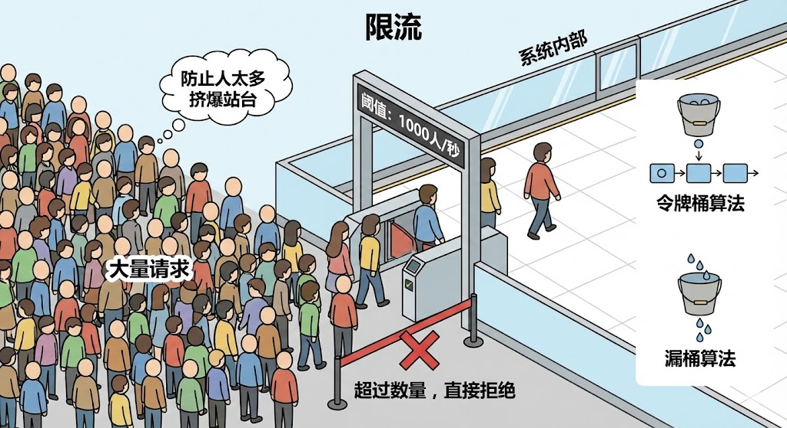
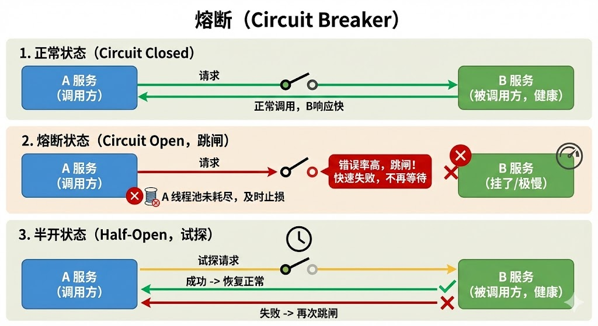
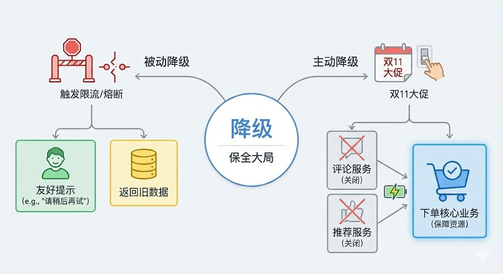

**这三者都是为了保护系统不被流量打垮。限流是“限制入口流量”，熔断是“切断出错的下游调用”，而降级是“兜底的备用方案”。**

---

### 一、 核心概念深度解析

#### 限流

    - **作用：****主动防御**。防止进入车站的人太多，把站台挤爆了。
    - **机制：** 设定一个阈值（比如每秒只准进 1000 人）。超过这个数量的请求，直接拒绝，根本不让你进系统。
    - **算法：** 令牌桶算法、漏桶算法。

#### 熔断

    - **作用：****及时止损**。假设 A 服务调用 B 服务，B 服务挂了或者响应极慢。A 如果一直傻傻地等 B，A 的线程池很快就会被耗尽，导致 A 也挂了。
    - **机制：** 当错误率达到一定比例，断路器“跳闸”。后续对 B 的请求不再发送，直接快速失败。过一段时间，断路器会进入“半开”状态，试探一下 B 好了没。

#### 降级

    - **作用：****保全大局**。
    - **场景：**
        - **被动降级：** 触发了限流或熔断后，不能直接给用户报错说“系统挂了”，而是返回一个友好的提示（比如“由于访问人数过多，请稍后再试”）或者返回缓存中的旧数据。
        - **主动降级：** 双 11 大促时，为了保下单核心业务，手动把“评论服务”、“推荐服务”关掉，释放资源给下单服务。

### 二、 面试标准回答

**这三个概念是微服务架构中保证系统高可用的“三板斧”。它们的核心目的都是为了防止“雪崩效应”，保证系统在异常情况下依然可用。**

**我是这样理解它们的分工和区别的：**

第一，限流是“预防”：

它是流量进入系统的第一道关卡。

- **原理：** 当并发请求超过了系统的承载能力（比如 TPS 超过 1000），我们通过算法（如令牌桶或漏桶）直接拒绝多余的请求。
- **目的：** 保护系统不被瞬间的大流量冲垮。这通常是在网关层或者应用入口做的。

第二，熔断是“止损”：

它发生在服务调用的过程中。

- **原理：** 类似于电路的保险丝。当消费者调用提供者时，如果失败率或者响应时间超过了阈值，熔断器就会开启。之后的请求将不再调用远程服务，而是直接快速返回。
- **目的：** 防止因为下游服务故障，导致上游服务的线程池被耗尽，从而引发整个链路的级联雪崩。它有三个经典状态：关闭、打开、半开。

第三，降级是“兜底”：

它是上述两种情况发生后的处理策略，也就是 Plan B。

- **原理：** 当服务触发了限流、或者触发了熔断、甚至只是服务超时了，我们不能让用户看到一个 500 错误或者是空白页面。
- **做法：** 我们会返回一个预设的默认值（比如空列表）、缓存数据，或者一个友好的提示信息。
- **注意：** 降级不仅是被动的，也可以是主动的。比如大促期间，为了保核心业务，我们会手动降级非核心业务（如关闭日志打印、关闭推荐服务）。
