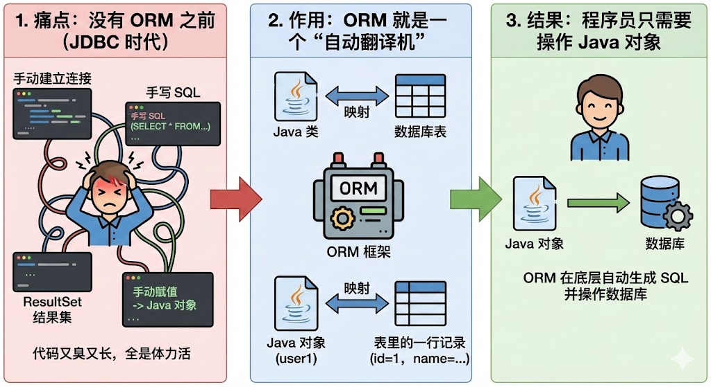

### 一、 核心概念深度解析

我们可以把数据库操作想象成“翻译工作”：Java 讲的是“对象语言”，数据库讲的是“表格语言”。

#### 什么是 ORM？

    - **痛点：** 在没有 ORM 之前（JDBC 时代），我们需要手动建立连接、手写 SQL、手动把数据库查出来的 `ResultSet` 结果集一行行赋值给 Java 对象。代码又臭又长，全是体力活。
    - **作用：** ORM 就是一个“自动翻译机”。
        - 它把 Java 类映射成数据库表。
        - 它把 Java 对象映射成表里的一行记录。
        - **结果：** 程序员只需要操作 Java 对象，ORM 框架在底层自动帮你生成 SQL 并操作数据库。

#### 什么是 MyBatis？

- **定义：** MyBatis 是一个优秀的**持久层框架**。
- **本质：** 它是一个**半自动化的** **ORM** **框架**（这是它和 Hibernate 最大的区别）。
- **工作方式：**
    - 它不像 Hibernate 那样全自动生成 SQL（黑盒）。
    - 它把 SQL 语句“剥离”出来，写在独立的 **XML 配置文件**或者**注解**里。
    - 它负责把 Java 方法的参数自动映射到 SQL 参数上，再把 SQL 执行的结果自动映射回 Java 对象。
- **核心优势：****SQL 可控**。你想怎么写就怎么写，想怎么优化就怎么优化，非常适合互联网高并发、业务复杂的场景。

---

### 二、 面试标准回答

首先，讲一下 ORM：

它的全称是 Object Relational Mapping。

在 Java 开发中，我们操作的是对象，而数据库存储的是关系型数据（表），ORM 的作用就是充当一座桥梁，建立起 Java 对象和数据库表之间的映射关系。

它的核心价值在于解放生产力：让我们不再需要手写繁琐的 JDBC 代码，而是通过操作对象就能间接操作数据库。

其次，关于 MyBatis：

MyBatis 本质上是一个 Java 持久层框架，但我更愿意称它为“半自动化的 ORM 框架”。

**为什么叫“半自动”呢？这是它的核心特点：**

- 像 Hibernate 这种全自动 ORM，它会帮我们自动生成 SQL，开发者甚至不需要懂 SQL。
- 而 MyBatis 仅仅帮我们做了“输入参数映射”和“输出结果映射”，但**具体的 SQL 语句还是需要我们自己编写的**（通常写在 XML 里）。

虽然需要手写 SQL 听起来麻烦，但它给了开发者对 SQL 的绝对控制权。在复杂的业务场景下，我们可以轻松地对 SQL 进行手动优化，而不用去研究框架底层生成了什么奇怪的语句。

### 购买了课程的同学，本八股动画视频持续更新！

### 后续视频更新也会在群里分享，一定要先进群！
