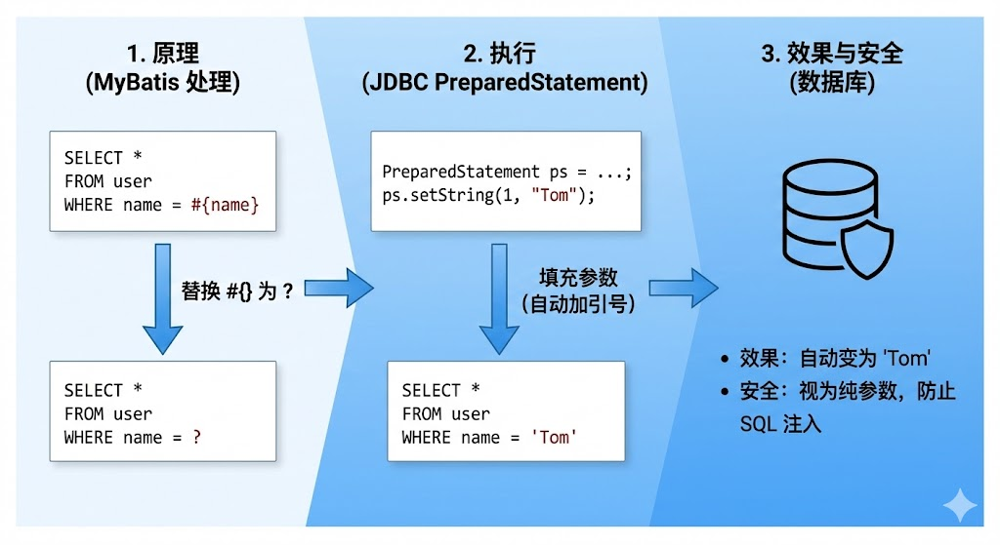
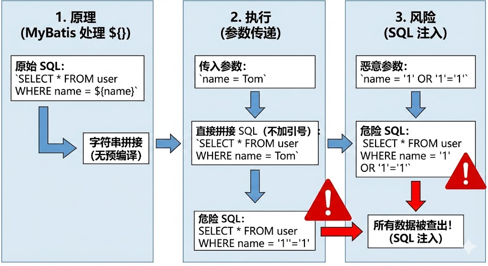

`**#**` **是预编译处理，相当于 JDBC 的** `**?**` **占位符，专门用来防注入；**`**$**` **是字符串替换，相当于直接拼接 SQL，有注入风险。**

### 一、 核心区别深度解析

#### 1. `#{}` (预编译)

- **原理：** MyBatis 在处理 `#{}` 时，会把它替换成一个 `**?**` **(问号)**。
- **执行：** 然后调用 JDBC 的 `PreparedStatement`，通过 `setString()` 等方法把参数填进去。
- **效果：** 假如你传的参数是 `Tom`，它会自动加上单引号变成 `'Tom'`。
- **安全：** 因为是预编译，数据库知道这个 `?` 只是一个参数，不会把它当成 SQL 命令去执行。所以能**防止 SQL 注入**。

#### 2. `${}` (字符串替换)

- **原理：** MyBatis 在处理 `${}` 时，就是简单的 **字符串拼接**。
- **执行：** 假如你传的参数是 `Tom`，它就直接把 `Tom` 拼在 SQL 里，**不加引号**。
- **风险：** 如果恶意用户传了 `1 OR 1=1`，这句 SQL 就变成了逻辑真，所有数据都会被查出来。这就是 **SQL 注入**。

### 二、 面试标准回答

**它们的核心区别在于“处理机制”和“安全性”。**

**首先，关于它们的区别：**

1. **处理机制不同：**
    1. `**#{}**` **是预编译处理：** MyBatis 在处理它时，会将 SQL 中的 `#{}` 替换为 JDBC 的占位符 `**?**`。接着调用 `PreparedStatement` 的 `set` 方法来赋值。
    2. `**${}**` **是字符串替换：** MyBatis 在处理它时，就是做纯粹的**字符串拼接**。它会把参数的值直接拼接到 SQL 语句中，不会自动添加引号。
2. **安全性不同（最关键点）：**
    1. `**#{}**` 因为使用了预编译，能够有效**防止 SQL 注入**，所以我们在传递查询参数（如 `where id = #{id}`）时，绝大多数情况都必须用这个。
    2. `**${}**` 因为是直接拼接，如果接收前端传入的不可信数据，极易引发 SQL 注入风险。
