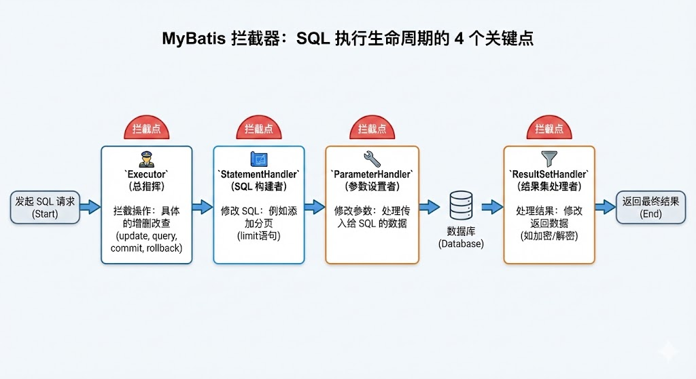
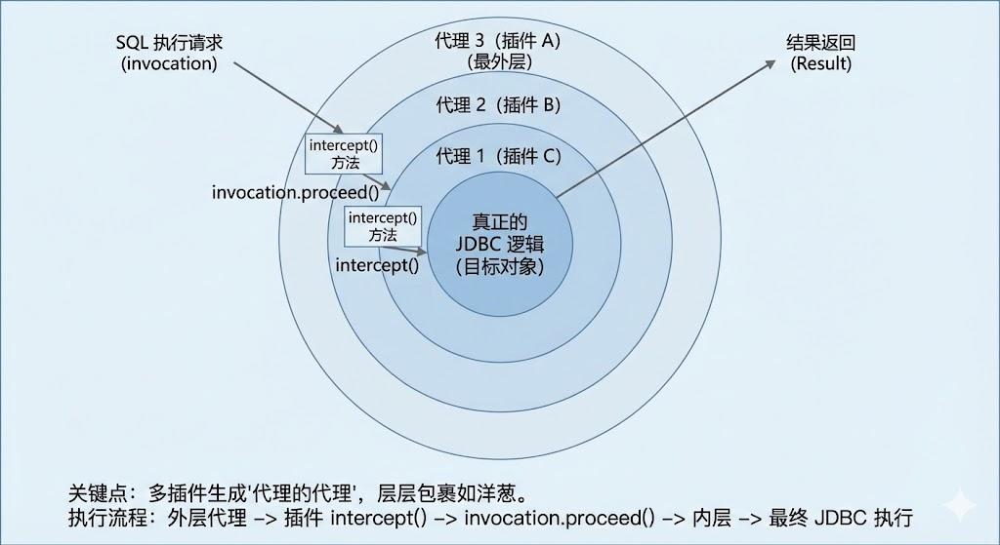

**MyBatis 插件本质上就是一个拦截器。它利用 JDK 动态代理机制，在 MyBatis 四大核心组件（Executor, StatementHandler, ParameterHandler, ResultSetHandler）的方法执行前后进行“偷天换日”，从而实现功能的增强。**

### 一、 核心原理深度解析

#### 拦截哪里？

MyBatis 允许我们在 SQL 执行过程中的 4 个关键点进行拦截，这 4 个接口对应了 SQL 执行的生命周期：

- **Executor：** 它是总指挥。拦截它，可以拦截到具体的增删改查操作（update, query, commit, rollback）。
- **StatementHandler：** 它是 SQL 构建者。拦截它，可以修改 SQL 语句（比如 PageHelper 就是在这里把 `select * ...` 改成了 `select * ... limit ...`）。
- **ParameterHandler：** 它是参数设置者。拦截它，可以修改传给 SQL 的参数。
- **ResultSetHandler：** 它是结果集处理者。拦截它，可以修改返回的结果（比如对敏感数据加密/解密）。

#### 怎么拦截？

- **代理层层包裹：**
    - 当 MyBatis 启动初始化这 4 个对象时，会调用 `interceptorChain.pluginAll(target)` 方法。
    - 这个方法会检查所有的插件。如果有插件要拦截当前对象，MyBatis 就会利用 **JDK 动态代理**，给当前对象生成一个代理对象。
    - **关键点：** 如果有多个插件，就会生成“代理的代理”。就像洋葱一样，一层包一层。
- **执行流程：**
    - 当我们执行 SQL 时，实际上调用的是最外层的代理对象。
    - 代码会先走到插件的 `intercept()` 方法。
    - 插件逻辑执行完后，调用 `invocation.proceed()`，把控制权交给下一层插件，直到剥开所有洋葱皮，最后才执行真正的 JDBC 逻辑。

---

### 二、 面试标准回答

**简单来说，MyBatis 插件本质上就是一个“拦截器”。**

**我可以从“拦截范围”和“底层原理”两个方面来解释：**

第一：

MyBatis 允许我们拦截 SQL 执行过程中最核心的四大接口：

1. **Executor**（执行器）：拦截 SQL 的执行过程。
2. **StatementHandler**（语句处理器）：这是最常用的，比如大名鼎鼎的 **PageHelper** 分页插件，就是拦截这个接口，通过修改 SQL 语句添加 `LIMIT` 来实现的。
3. **ParameterHandler**（参数处理器）：拦截参数的设置。
4. **ResultSetHandler**（结果集处理器）：拦截结果集的封装。

第二，它是怎么实现的：

它的底层完全基于 JDK 动态代理 和 责任链模式。

- **初始化阶段：** 当 MyBatis 在创建上面那 4 个核心对象时，不是直接返回原对象，而是会调用 `pluginAll` 方法去遍历所有的插件。
- **代理包装：** 如果发现有插件需要拦截当前对象，MyBatis 就会利用 `Proxy.newProxyInstance` 生成一个代理对象，把原对象包裹起来。
- **执行阶段：** 当我们发起 SQL 请求时，实际上调用的是这个代理链。请求会先进入插件的 `intercept` 方法，我们可以在这里通过 `invocation.proceed()` 控制是继续往下执行，还是直接返回，从而实现对核心逻辑的增强。
