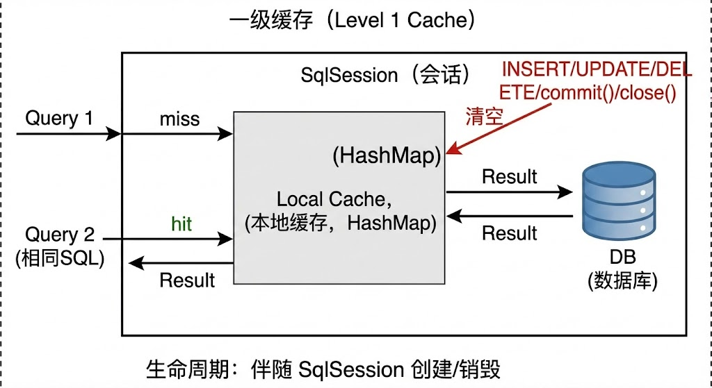
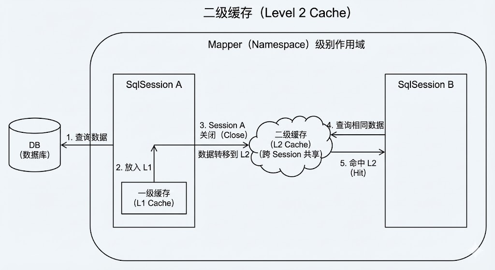
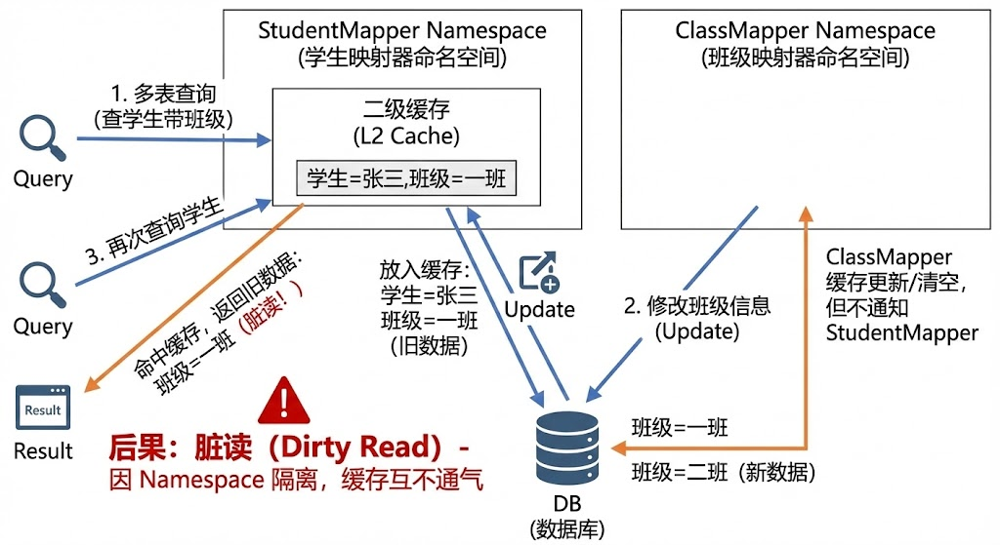

### 一、 核心原理深度解析

#### 一级缓存

1. 
    - **Scope：****SqlSession 级别**。
    - **机制：**
        - 当我们开启一个 `SqlSession` 去查询数据库时，MyBatis 会把查询结果放在一个 `HashMap`（本地缓存）里。
        - 如果在同一个 `SqlSession` 里再执行完全相同的 SQL，它就直接从 Map 里拿，不走数据库了。
    - **生命周期：** 伴随 `SqlSession` 的创建而创建，销毁而销毁。
    - **失效：** 一旦执行了 `INSERT`、`UPDATE`、`DELETE` 操作，或者调用了 `commit()`、`close()`，当前 Session 的一级缓存就会被**清空**，防止数据不一致。

#### 二级缓存

    - **Scope：****Mapper (Namespace) 级别**。
    - **机制：**
        - 它是跨 Session 的。多个 `SqlSession` 只要是操作同一个 Mapper（比如 `UserMapper`），就可以共享缓存。
        - **流程：** 数据先从 DB 出来 -> 放入一级缓存 -> Session 关闭后 -> 数据才会转移到二级缓存。
    - **实现：** 它是基于插件开发的。默认是简单的内存 Map，但可以对接 Ehcache、Redis 等中间件。

#### 为什么说二级缓存是“鸡肋”？

    - **场景：** 假设 `StudentMapper` 做了一个多表查询（查学生带出了班级信息）。
    - **Bug：** 此时，通过 `ClassMapper` 修改了班级信息。
    - **后果：**`StudentMapper` 的缓存并不知道 `ClassMapper` 更新了，它还在傻傻地返回旧的班级信息。这就是**脏读**。因为二级缓存是基于 Namespace 隔离的，它们互不通气。

---

### 二、 面试标准回答

**MyBatis 的缓存分为一级缓存和二级缓存，它们的作用域和应用场景完全不同。**

第一，关于一级缓存：

它是 SqlSession 级别的缓存，默认是开启的，而且无法关闭。

- **原理：** 在同一个数据库会话中，如果我们执行了两次完全相同的 SQL，第一次查询后，MyBatis 会将结果存入内部的一个 HashMap 中；第二次查询直接返回缓存对象，不再查询数据库。
- **失效条件：** 一旦在当前 Session 中执行了增删改操作，或者调用了 commit/close，一级缓存就会被清空，以保证数据准确性。

第二，关于二级缓存：

它是 Mapper级别的缓存，默认是关闭的。

- **原理：** 它是跨 Session 的。只要多个 Session 操作的是同一个 Mapper 文件，它们就可以共享缓存。开启它需要在 XML 中配置 `<cache/>` 标签，且实体类必须实现序列化接口。
- **局限性（重点）：** 在实际生产中，我们**很少使用** MyBatis 的二级缓存。

第三，为什么我们不用二级缓存：

主要原因是**脏读问题：** 二级缓存是基于 Namespace 隔离的。如果是多表关联查询，在一个 Mapper 中更新了数据，另一个 Mapper 的缓存可能无法感知，导致读取到脏数据。
