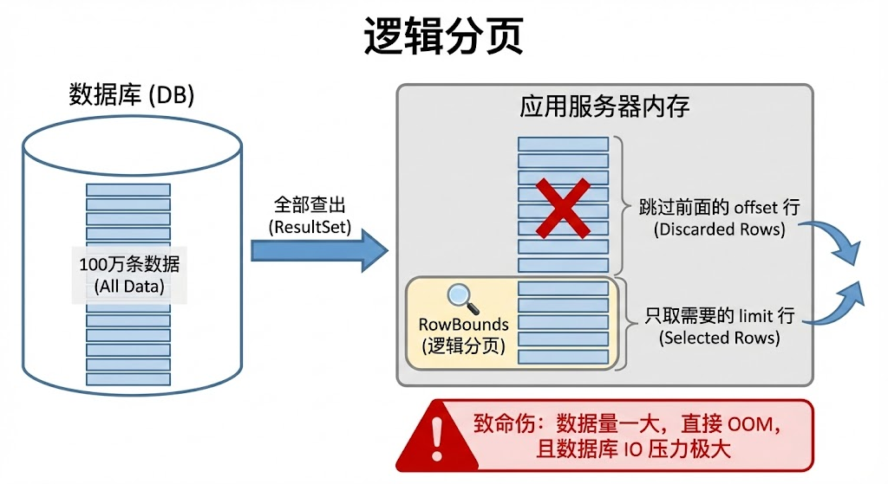
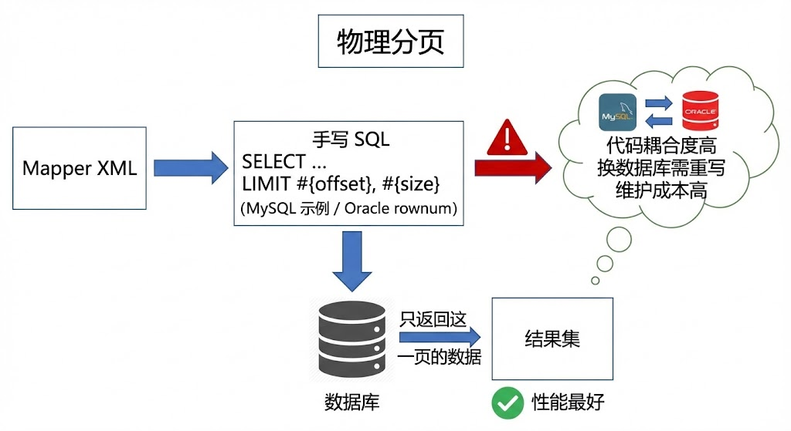

**MyBatis 实现分页主要有三种方式：数组分页（内存分页）、SQL 分页（硬编码）和拦截器分页（插件）。其中，前两种都有明显的缺陷，实际开发中我们几乎百分之百使用基于拦截器的插件（如 PageHelper 或 MyBatis-Plus）来实现物理分页。**

### 一、 核心实现模式深度解析

#### 逻辑分页

    - **方式：** 使用 MyBatis 自带的 `RowBounds` 对象。
    - **原理：**`ResultSet` 结果集全部查出来，加载到内存中，然后通过代码跳过前面的 `offset` 行，只取需要的 `limit` 行。
    - **后果：****逻辑分页**。
        - 如果数据库里有 100 万条数据，它会把 100 万条都查出来（或者是通过 JDBC 驱动游标），传输到应用服务器内存里，然后再丢掉 99 万条。
        - **致命伤：** 数据量一大，直接 **OOM**，且数据库 IO 压力极大。

#### 物理分页

    - **方式：** 在 Mapper XML 里手写 SQL。
    - **原理：** 直接在 SQL 语句末尾加上 `LIMIT #{offset}, #{size}`（MySQL）或者 `rownum`（Oracle）。
    - **后果：****物理分页**。数据库只返回这一页的数据，性能最好。
    - **缺点：****代码耦合度高**。如果以后换数据库，所有分页 SQL 都要重写，维护成本高。

#### 插件分页

    - **方式：** 使用 **PageHelper** 或 **MyBatis-Plus**。
    - **原理：** 利用 MyBatis 的 **拦截器**机制。
        - 它拦截 `StatementHandler` 的 `prepare` 方法。
        - 它解析原本的 SQL，自动在后面拼接上 `LIMIT` 语句。
        - 它还会自动再执行一条 `SELECT COUNT(*)` 语句来计算总条数。
    - **优势：** 代码完全解耦，对业务代码无侵入，性能也是物理分页的性能。

### 二、 面试标准回答

**MyBatis 实现分页主要有三种常见的手段，从原理上可以归纳为“逻辑分页”和“物理分页”两类。**

第一种是使用 RowBounds 进行逻辑分页：

它的用法很简单，在 Mapper 方法中传入一个 RowBounds 对象即可。

- 但是它的底层原理是 **“全量查询”**。它会把所有数据查出来加载到内存中，再通过游标截取我们需要的那一部分。如果数据量达到百万级，会瞬间导致应用内存溢出，且严重浪费数据库 IO 资源。

第二种是手写 SQL 进行物理分页：

也就是在 XML 文件中，直接在 SQL 语句后面拼接 LIMI。

- 这种方式性能是最好的，因为是数据库层面的过滤。
- 但缺点也很明显：**硬编码**导致 SQL 与具体的数据库方言强耦合，后续维护和迁移非常麻烦。

第三种是使用分页插件：

这是目前企业级开发中的标准方案。

- **使用方式：** 我们只需要在代码中调用 `PageHelper.startPage(pageNum, pageSize)`，后面的查询就会自动分页。
- **底层原理：** 它是基于 MyBatis 的 **拦截器**机制实现的。插件会拦截 `StatementHandler` 的 `prepare` 方法，在 SQL 执行之前，动态地解析 SQL 并在末尾拼接上数据库对应的分页语句。
