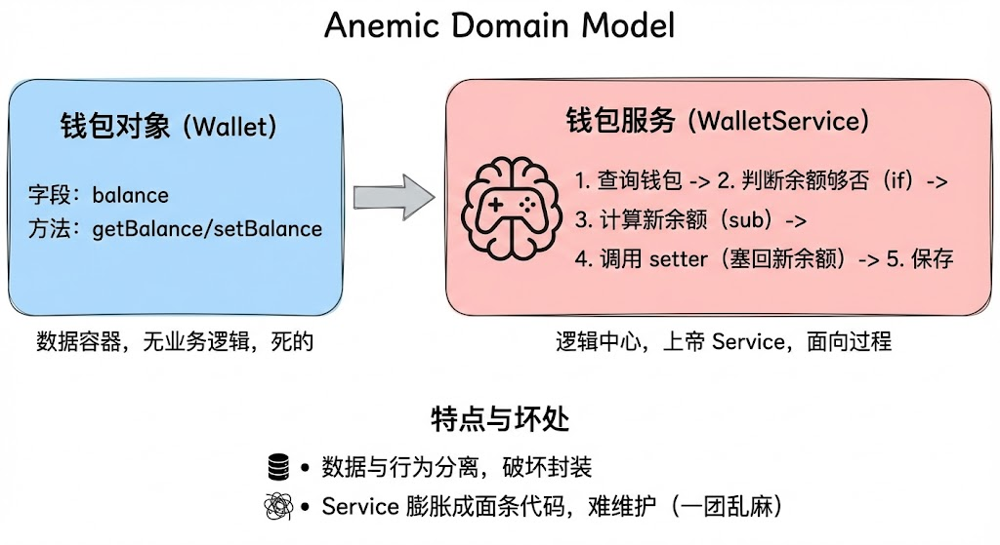
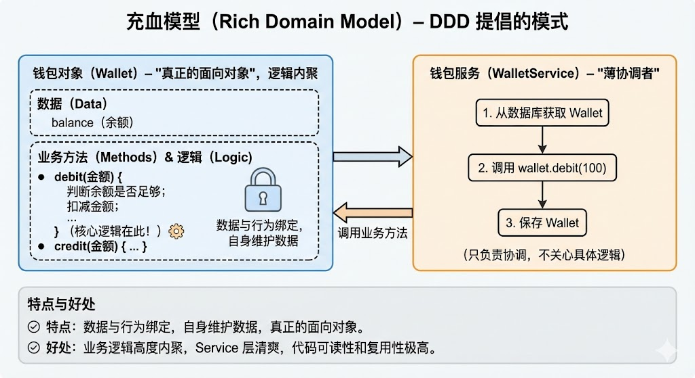

**贫血模型是“数据归对象，逻辑归 Service”，对象只是数据的搬运工；充血模型是“自己的数据自己管”，逻辑回归对象内部，回归了面向对象的初衷。**

---

### 一、 核心原理深度解析

我们可以用“钱包”这个例子来直观地对比这两种模型：

#### 贫血模型

这是我们最熟悉的开发模式（Spring MVC + MyBatis 标准写法）。

- **钱包对象 (**`**Wallet**`**)：** 只有 `balance` 字段和 `getBalance/setBalance` 方法。它没有任何业务逻辑，就是个存数据的容器。
- **钱包服务 (**`**WalletService**`**)：** 所有的逻辑都在这里。
    - 比如“扣款”：Service 先把钱包查出来，判断余额够不够（`if`），然后计算新余额（`sub`），最后调用 setter 把新余额塞回去，再保存。
- **特点：**
    - **数据与行为分离**。对象是死的，Service 是上帝。
    - 这其实本质上是**面向过程编程**，只是披了一层 Java 对象的皮。
    - **坏处：** 业务逻辑一旦复杂，Service 层会膨胀得像面条代码一样，难以维护，且破坏了对象的封装性。

#### 充血模型

这是 DDD 提倡的模式。

- **钱包对象 (**`**Wallet**`**)：** 不仅有 `balance` 数据，还有 `debit()`（扣款）、`credit()`（充值）等业务方法。
    - **逻辑内聚：** “判断余额够不够”、“扣减金额”这些逻辑，全部写在 `Wallet` 类内部。
- **钱包服务 (**`**WalletService**`**)：** 变得非常薄。它只负责协调，比如从库里把 `Wallet` 拿出来，调用 `wallet.debit(100)`，然后保存。它不关心怎么扣款，只关心扣款这个动作。
- **特点：**
    - **数据与行为绑定**。自己的数据自己维护，这才是真正的**面向对象**。
    - **好处：** 业务逻辑高度内聚，Service 层清爽，代码可读性和复用性极高。

---

### 二、 面试标准回答

**这两种模型本质上是关于“业务逻辑该放在哪里”的两种不同设计思路。**

首先，关于贫血模型：

这是我们日常开发中最常见的模式。

- **定义：** 在这种模式下，领域对象仅仅包含数据（属性和 Getter/Setter），不包含任何业务逻辑。所有的业务逻辑都集中在 Service 层中实现。
- **本质：** 它其实是披着面向对象外衣的“面向过程编程”。
- **优缺点：** 它的好处是简单，适合简单的 CRUD 业务；但缺点是破坏了对象的封装性，导致 Service 层逻辑臃肿，难以维护。

其次，关于充血模型：

这是 DDD所倡导的模式。

- **定义：** 在这种模式下，领域对象不仅包含数据，还包含了该数据相关的**业务逻辑**。
- **做法：** 我们把“原本在 Service 里的核心业务逻辑”剥离出来，写回到 Entity 内部。Service 层不再处理具体的业务细节，只负责跨对象的协调和事务控制。
- **本质：** 这才是回归了真正的“面向对象设计”。
- **优缺点：** 它的好处是业务逻辑高内聚，代码复用性强，非常适合复杂的业务系统；但缺点是对开发者的设计能力要求较高。
