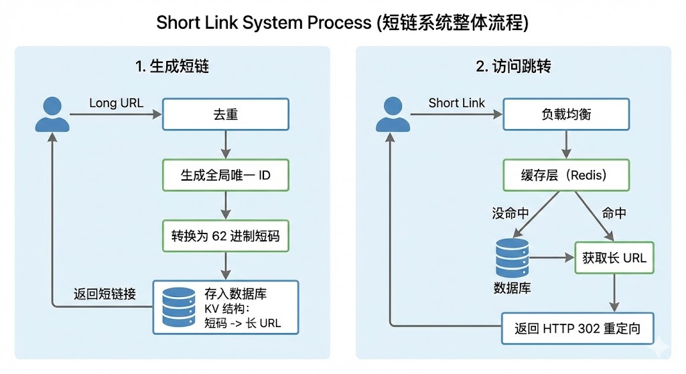

**URL 短链系统的核心是将“长链接”映射为“唯一 ID”，再将 ID 转换为“62 进制字符串”作为短码。在读取时，通过短码查库获取长链接，利用 302 重定向跳转。面对百亿级数据，我们需要采用“分库分表 + NoSQL”存储方案，并利用 Redis 缓存热点数据。**

---

### 一、 核心架构设计逻辑

我们可以把整个系统拆解为两个核心动作：**“生成”和“访问”**。

#### 整体流程

- **生成短链：** 用户发送长 URL -> 只有当该 URL 第一次出现时（去重），系统生成全局唯一 ID -> 转换为 62 进制短码 -> 存入数据库（KV 结构：短码 -> 长 URL） -> 返回短链接。
- **访问跳转：** 用户访问短链接 -> 负载均衡 -> 缓存层（Redis）查找 -> 没命中则查数据库 -> 获取长 URL -> 返回 HTTP 302 重定向。

---

### 二、 针对追问的深度解析

#### 追问一：如何将长 URL 转换为短码？（Hash 算法 vs 发号器）

- **方案 A：Hash 算法（如** **MD5** **/** **SHA****）**
    - **做法：** 对长 URL 进行 MD5 运算，得到 32 位 16 进制字符串。
    - **问题：** 结果太长了，我们通常只需要 6-7 位。如果截取前 6 位，会有**哈希冲突**的风险。虽然概率低，但处理冲突会增加系统复杂度。
    - **结论：***不太推荐，除非对短码长度不敏感。*
- **方案 B：分布式 ID 发号器 + Base62 编码（推荐）**
    - **原理：** 维护一个全局唯一的自增 ID（比如 1, 2, 3... 10000）。
    - **转换：** 将这个 10 进制的 ID 转换为 **62 进制**（0-9, a-z, A-Z 共 62 个字符）。
    - **为什么是 62 进制？** 因为 URL 安全的字符正好是这 62 个。
    - **容量计算：**
        - 6 位 Base62： $$62^6 \approx 568$$ 亿。足够覆盖百亿级数据。
        - 7 位 Base62： $$62^7 \approx 3.5$$万亿。
    - **ID 怎么生成？** 为了高性能，不能依赖 MySQL 的自增主键。通常使用 **Snowflake 雪花算法** 或者 **Redis 的** `**INCR**` **预取号段模式**。

#### 追问二：301 跳转与 302 跳转的区别？对数据分析有什么影响？

- **301：永久重定向。**
    - **机制：** 浏览器第一次拿到跳转地址后，会把映射关系**缓存**在本地。下次用户再访问短链，浏览器直接跳长链，不再请求短链服务器。
    - **后果：** 服务器负载低，但**我们失去了统计数据的能力**。无法知道用户点了多少次，无法做来源分析，这对于短链服务商是致命的。
- **302 ：临时重定向。**
    - **机制：** 告诉浏览器“你这次先跳这里，但下次还得来问我”。
    - **后果：** 浏览器每次都会请求短链服务器。虽然增加了服务器压力，但我们能**精准捕获每一次点击**，从而实现数据分析（UV/PV、地理位置、设备统计）。

#### 追问三：如果数据量达到百亿级，如何存储？如何处理哈希冲突？

- **存储选型：**
    - 这种场景是典型的 K-V 结构（ShortKey -> LongURL）。
    - 关系型数据库（MySQL）虽然稳定，但对于海量 K-V 读写略显笨重。
    - **更优解：** 使用 NoSQL，如 **HBase** 或者 **MongoDB**。如果团队技术栈受限必须用 MySQL，则必须做**分库分表**。
- **哈希冲突的处理（如果必须用 Hash 算法）：**
    - 虽然我推荐 ID 生成器方案（天然无冲突），但如果必须用 Hash：
    - **方案：** 拿长 URL 做 Hash -> 截取前 6 位 -> 去数据库查询是否存在（或用布隆过滤器预判）。
    - **如果冲突（存在但长 URL 不一样）：** 在原长 URL 后面加一个固定的“盐”（如 `[DUPLICATE]`），重新 Hash，直到不冲突为止。
- **性能优化（缓存策略）：**
    - 短链系统是极端的**读多写少**。
    - 必须引入 **Redis**。将热门的短码存入 Redis。
    - 利用 LRU 淘汰策略，保证内存中留存的都是热点链接。

### 购买了课程的同学，本八股动画视频持续更新！

### 后续视频更新也会在群里分享，一定要先进群！
