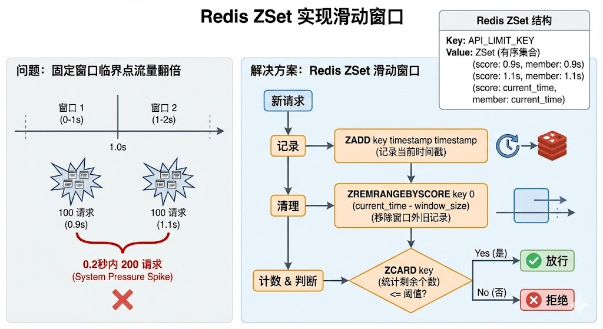
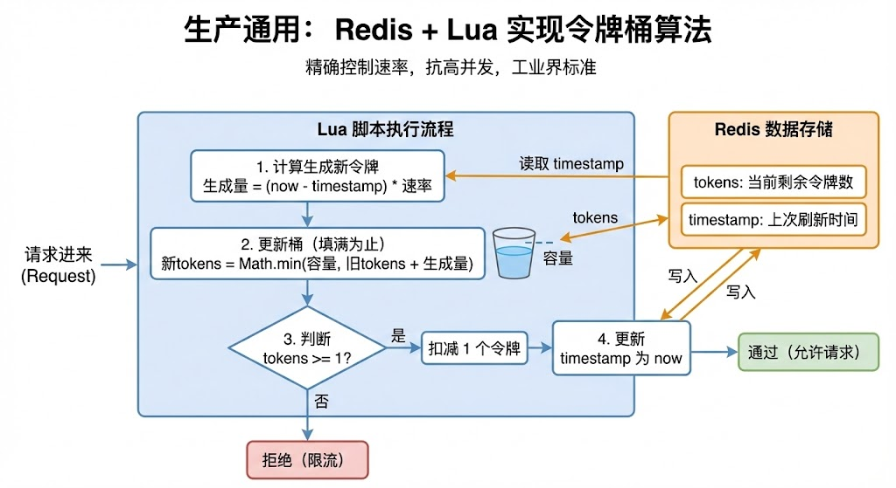

**在分布式场景下，要实现精确限流，最通用的方案是“Redis + Lua 脚本”组合。针对“精确”二字，如果要求极致的时间窗口平滑度，使用“ZSet 滑动窗口”；如果追求性能与精度的平衡，使用基于 Lua 实现的“令牌桶算法”。**

### 一、 核心难点与架构选型

在分布式环境下，流量打在不同的服务器上，单机的 `AtomicInteger` 或 `RateLimiter` 只能管住自己这台机器，管不住全局。比如你要限制全局 QPS 为 1000，你有 10 台机器，简单的每台限流 100 是不准确的（因为负载均衡不一定绝对均匀）。

要做到**精确**，必须把所有机器的计数收敛到一个地方。

- **存储介质：****Redis** 是不二之选。因为它是单线程处理命令，天然防并发，且读写极快。
- **一致性保障：****Lua 脚本**。因为“读取当前令牌数”和“扣减令牌数”是两个网络请求，在高并发下会有竞争，必须把逻辑打包在 Lua 脚本里发给 Redis，保证原子执行。

---

### 二、 两种主流的“精确”实现方案

针对“精确”定义的程度不同，有两种做法：

#### 极致精确：Redis ZSet 实现滑动窗口

如果你说的“精确”，是指要解决“固定窗口”算法在临界点流量翻倍的问题（比如 0.9秒来了 100 个请求，1.1秒又来了 100 个请求，虽然每秒都没超，但 0.2秒内压垮了系统），那么 **ZSet 滑动窗口**是唯一的解法。

- **原理：**
    - 我们将 Key 设为限流的资源名（如 API 接口）。
    - Value 是一个 Redis 的 **ZSet（有序集合）**。
    - 每当一个请求进来：
        - **记录：** 将当前请求的时间戳作为 member 和 score 写入 ZSet。
        - **清理：** 移除当前时间窗口之外的旧记录。
        - **计数：** 统计 ZSet 中剩下的元素个数。
        - **判断：** 如果个数 &lt;= 阈值，放行；否则拒绝。
- **优缺点：**
    - *优点：***非常精确**。它可以任意滑动，彻底消除了临界突刺问题。
    - *缺点：***内存消耗大**。你需要存储过去 1秒内所有请求的时间戳。如果限流阈值是 10万 QPS，那 ZSet 里就要存 10万条数据，这对 Redis 内存和 CPU 都是巨大压力。
- **适用场景：** 强一致性要求高，但 QPS 阈值不高的场景（如短信发送频率限制）。

#### 生产通用：Redis + Lua 实现令牌桶

如果你说的“精确”，是指严格控制速率，且能抗住高并发，那么 **令牌桶算法** 是工业界标准。它比固定窗口精确，比滑动窗口省资源。

- **原理：**
    - 在 Redis 中存储两个键：`tokens`（当前剩余令牌数）和 `timestamp`（上次刷新时间）。
    - 每次请求进来，执行一段 Lua 脚本：
        - **计算生成：**`now - timestamp`，计算出这段时间理论上应该生成多少个新令牌。
        - **更新桶：**`Math.min(capacity, tokens + generated)`，填满为止。
        - **判断扣减：** 如果 `tokens >= 1`，则 `tokens - 1` 并返回成功；否则返回失败。
        - **更新时间：** 将 `timestamp` 更新为当前时间。
- **为什么精确？**
    - 它不是简单地按秒清零，而是基于时间流逝线性地补充令牌。
    - Redis Lua 保证了这整个计算过程是原子的，不会出现“多扣”或“少扣”。
- **优缺点：**
    - *优点：* 性能极高，内存占用极小（只存几个数字），且支持预热和突发流量。
    - *缺点：* 实现逻辑比计数器复杂，需要维护 Lua 脚本。

---

### 三、 补充店

1. **时间同步问题：**
    1. 在分布式环境下，应用服务器的时间可能不准。在使用 ZSet 滑动窗口时，尽量使用 **Redis 服务器的时间**（Lua 脚本中获取 `redis.call('TIME')`），而不是应用服务器的 `System.currentTimeMillis()`，以保证基准一致。
2. **Redis 挂了怎么办？（降级策略）**
    1. 这是分布式限流最大的软肋。如果 Redis 崩了或者网络抖动，限流器会抛异常。
    2. **策略：** 必须要有**本地降级**。可以在本地内存（如 Guava）预设一个更大的兜底阈值。一旦 Redis 链接超时，自动切换到单机限流模式，虽然不准，但能保命，别让限流组件把业务搞挂了。
