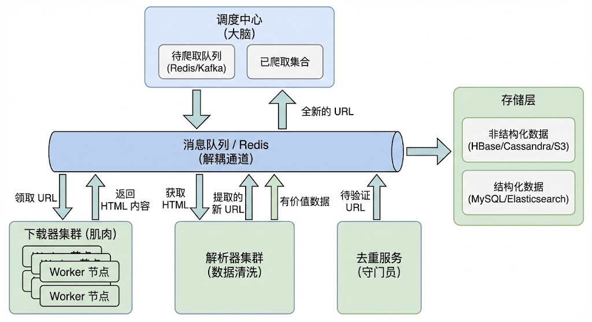

### 一、 总体架构设计

一个成熟的分布式爬虫系统常包含五个核心组件，它们通过消息队列或 Redis 进行解耦：

1. **调度中心：** 这是系统的大脑。它维护着“待爬取队列”和“已爬取集合”。在分布式场景下，通常使用 **Redis**或 **Kafka**来实现待爬取队列。
2. **下载器集群：** 这是系统的肌肉。由多台无状态的 Worker 节点组成。它们从调度中心领取 URL，进行 DNS 解析，发起 HTTP 请求获取 HTML 内容。
3. **解析器集群：** 负责数据清洗。从下载下来的 HTML 中提取有价值的数据。
4. **去重服务：** 守门员。负责判断新解析出来的 URL 是否已经存在，只有全新的 URL 才会进入待爬取队列。
5. **存储层：** 非结构化数据通常存入 HBase/Cassandra 或 S3，结构化数据存入 MySQL/Elasticsearch。

<u>核心流程：</u>

调度器分发 URL -> 下载器抓取 -> 解析器提取新链接 -> 去重服务过滤 -> 存入调度器 -> 循环往复。

---

### 二、 关键技术追问解析

#### 追问一：如何避免重复爬取 URL？（Bloom Filter 的应用）

在十亿、百亿级的数据量下，使用 `HashSet` 或数据库唯一索引查重会导致内存爆炸或性能瓶颈。**布隆过滤器**是工业界的标准解法。

- **原理：** 它不直接存储 URL 字符串，而是将 URL 通过 K 个不同的 Hash 函数映射到一个巨大的**位数组（Bit Array）** 中的 K 个点，并将这 K 个点置为 1。
- **判断逻辑：** 当一个新 URL 来了，同样进行 Hash。如果 K 个点**全都是 1**，则判定该 URL **可能存在**（直接丢弃）；如果有任意一个点是 0，则判定该 URL **一定不存在**（加入队列并更新位数组）。
- **优缺点权衡：**
    - **优势：** 极大的空间节省。存储上亿条 URL 可能只需要几百 MB 内存。
    - **代价：** 存在一定的误判率（即把“没爬过”的误判为“爬过”），导致漏抓少量页面。但在爬虫场景下，这是完全可以接受的。

#### 追问二：如何礼貌地爬取，避免对目标站点造成 DDoS？

这是爬虫能不能长久存活的关键。如果对同一个域名并发过高，会被封 IP 甚至引发法律风险。**核心策略是：基于 IP/域名的队列隔离。**

- **多队列隔离：**
    - 调度器不能维护一个大的 FIFO 队列，而是要维护 **N 个子队列**，每个子队列对应一个域名（或 IP）。
    - 例如：`Queue_Sina`，`Queue_Google`，`Queue_Baidu`。
- **延时控制：**
    - 下载器在从某个子队列拿 URL 时，必须遵循“上次访问时间 + 延时阈值（如 1秒）”的规则。
    - 如果 `Queue_Sina` 刚被消费过，Worker 就去消费 `Queue_Baidu`，强制让出时间片，实现“雨露均沾”。
