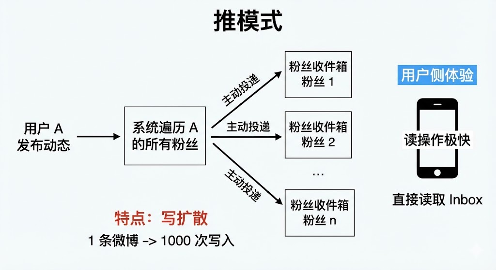
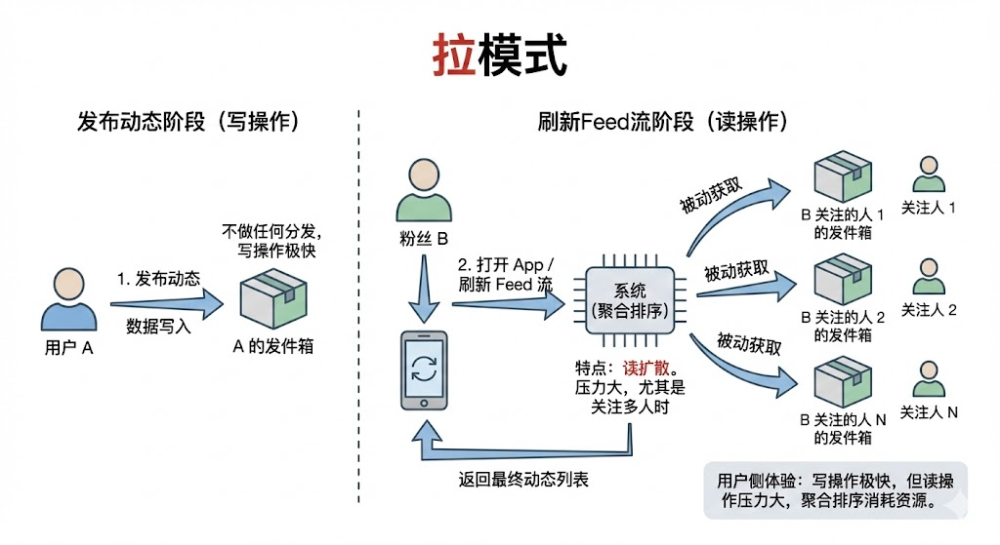
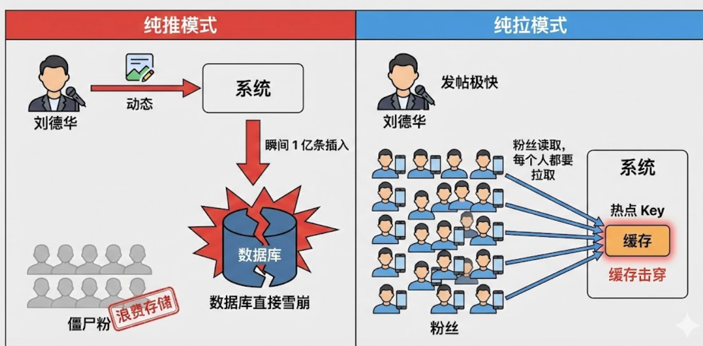
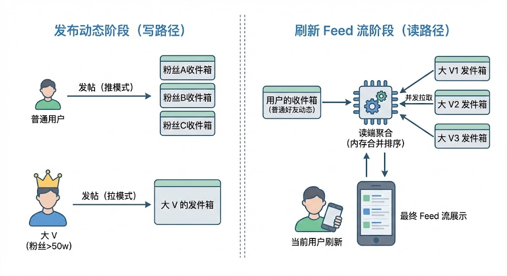

**这本质上是一个**读写扩散的权衡问题。简单来说，<u>就是把消息是“推”到用户的信箱里，还是让用户自己去“拉”取。</u>

### 一、 核心架构深度解析

我们可以把 Feed 流看作是一个巨大的邮件系统。每个用户都有一个“发件箱”和一个“收件箱”。

#### 追问一：什么是推模式与拉模式？

- **推模式：**

    - **机制：** “主动投递”。当用户 A 发布一条动态时，系统会遍历 A 的所有粉丝，把这条动态的 ID **插入到每一个粉丝的 收件箱** 中。
    - **特点：** 写扩散。如果 A 有 1000 个粉丝，发一条微博，数据库就要进行 1000 次写入操作。
    - **用户侧体验：** 读操作极快。因为粉丝打开 App 时，只需要读取自己的 Inbox 即可，不需要复杂的计算。
- **拉模式：**

- **机制：** “被动获取”。当 A 发布动态时，系统只把数据写入 A 自己的 发件箱，不做任何分发。
- **特点：** 读扩散。当粉丝 B 打开 App 刷新 Feed 流时，系统需要去查询 B 关注的所有人的 发件箱，把他们最新的动态拉取出来，在内存中进行**聚合和排序**，最后返回给 B。
- **用户侧体验：** 写操作极快，但读操作压力大，尤其是关注了成百上千人时，聚合排序非常消耗资源。

#### 追问二：两种模式分别适用于什么场景？

- **推模式：适合“朋友圈”场景（双向关系、熟人社交）。**
    - **理由：** 微信朋友圈的好友上限通常在几千人，且双向好友意味着粉丝数和关注数相对平衡。写扩散的成本完全可控，且用户对刷新速度要求极高（不仅要看内容，还要看谁点赞了），推模式能保证读取性能。
- **拉模式：适合“微博/Twitter”场景（单向关系、开放媒体）。**
    - **理由：** 在开放社交中，用户可能关注了 2000 人。如果用推模式，每个人发一条消息都要给这 2000 人写信；反之，如果用户去拉取这 2000 人的发件箱，虽然有压力，但可以通过缓存优化。最重要的是，拉模式避免了“大 V 发帖瞬间搞挂数据库”的风险。

#### 追问三：对于拥有千万粉丝的大V，如何优化？（推拉结合）

这是面试中的难题。如果拥有 1 亿粉丝的“刘德华”发了一条动态：

- **纯推模式：** 系统瞬间要插入 1 亿条数据，数据库直接雪崩，且这 1 亿粉丝里可能有一半是僵尸粉，浪费存储。
- **纯拉模式：** 虽然 刘德华发帖很快，但粉丝读取时，每个人都要去拉取 刘德华 的列表，热点 Key 会导致缓存击穿。

**<u>标准解法：推拉结合</u>**

我们需要将用户分为“普通用户”**和**“大 V”，区别对待：

1. **普通用户（推模式）：** 绝大多数普通人发帖，直接推送到粉丝的 收件箱。
2. **大 V 用户（拉模式）：** 当粉丝数超过阈值（如 50 万）的大 V 发帖时，**不进行推送**，只写入大 V 自己的 发件箱。

<u>读端聚合</u>：

1. 当一个用户刷新 Feed 流时，他的时间线由两部分组成：
    1. **收件箱：** 也就是普通好友推过来的动态。
    2. **发件箱：** 系统检查该用户关注了哪些“大 V”，并发去拉取这些大 V 的 发件箱（限制最近 3 天或 Top 10）。
    3. **合并：** 在内存中将“普通好友的动态”和“大 V 的动态”按时间戳合并排序，最终展示。

<u>进阶优化：在线推，离线拉</u>

为了进一步优化体验，系统可以只给“当前在线”或者“最近活跃”的粉丝进行推送。对于那些半年不上线的僵尸粉，完全没必要浪费资源推给他们，等他们哪天真的上线了，再去拉取也不迟。
