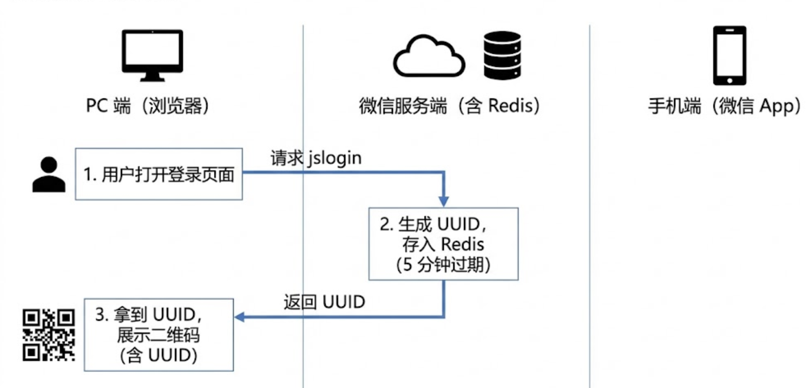
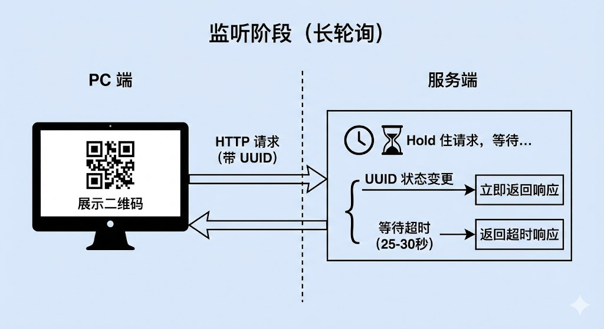
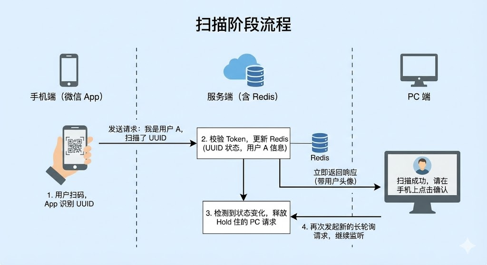
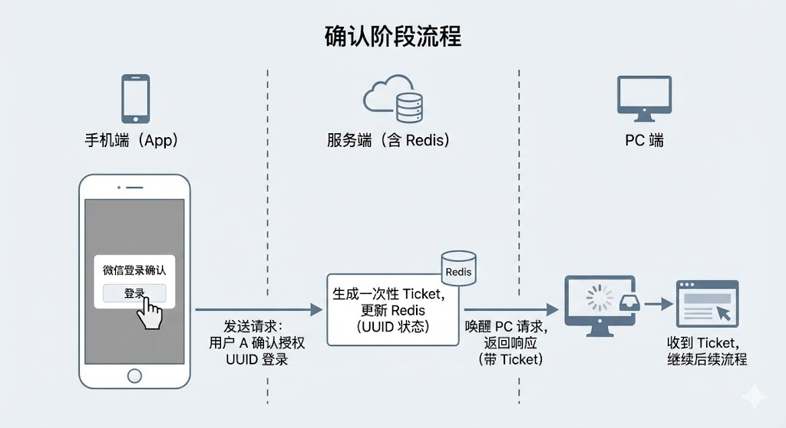

微信扫码登录的本质，是一个“以手机端的强身份认证去置换 PC 端弱身份凭证”的安全协议过程。它的核心在于将“PC端展示的 UUID”与“手机端的用户 Token”在服务端进行绑定。

**PC 端请求获得一个唯一的 UUID 并生成二维码，同时向服务端发起长轮询监听该 UUID 的状态。手机端扫码后，服务端将 UUID 与当前用户绑定并通知 PC 端“已扫码”。用户在手机点击确认后，服务端生成 PC 端的登录凭证，PC 端收到凭证后完成最终的登录跳转。**

---

### 一、 完整交互流程

我们将交互分为三个角色：**PC 端（浏览器）**、**微信服务端**、**手机端（微信 App）**。

#### 初始化阶段

    - **PC 端：** 用户打开登录页面。PC 端向服务端发起请求 `jslogin`。
    - **服务端：** 生成一个全局唯一的随机串 **UUID**，并将其存入 Redis，设置较短的过期时间（如 5 分钟）。
    - **PC 端：** 拿到 UUID，拼接成二维码图片 URL（或直接生成二维码）展示给用户。

#### 监听阶段

- **PC 端：** 展示二维码的同时，立刻发起一个 HTTP 请求，带上 UUID。
- **服务端：****Hold 住这个请求，不立即返回**。直到 UUID 的状态发生变更，或者等待超时（通常是 25-30 秒）。

#### 扫描阶段

- **手机端：** 用户用微信扫码。App 识别出二维码里的 UUID，向服务端发送请求：“我是用户 A，我扫描了 UUID ”。
- **服务端：** 校验用户 A 的 Token 有效性。校验通过后，将 Redis 中该 UUID 的状态更新，并记录下是哪个用户的**头像/昵称**。
- **服务端：** 此时，刚才 PC 端被 Hold 住的请求检测到了状态变化，服务端立即返回响应，并带上用户的头像 。
- **PC 端：** 收到响应，展示用户头像，提示“扫描成功，请在手机上点击确认”。**随即再次发起一个新的长轮询请求，继续监听。**

#### 确认阶段

- **手机端：** 屏幕上跳出“微信登录确认”页面，用户点击“登录”。
- **手机端：** App 向服务端发送请求：“用户 A 确认授权 UUID 登录”。
- **服务端：** 生成一个一次性的 **Ticket**，将 Redis 中 UUID 状态更新。
- **服务端（唤醒 PC）：** 再次唤醒 PC 端被 Hold 住的请求，返回响应，并带上 Ticket。

#### 登录阶段

- **PC 端：** 收到 200 响应和 Ticket。
- **PC 端：** 使用 Ticket 向服务端发起最终请求，置换真正的 Session Cookie / Token。
- **PC 端：** 登录成功，跳转至业务首页。

### 二、 面试追问

#### 追问一：PC 端如何知道手机已经扫码了？（轮询 vs 长轮询 vs WebSocket）

- **为什么不用短轮询？**
    - PC 端每秒问一次“扫了吗？”。
    - **缺点：** 大量请求无效，浪费服务器带宽和连接资源，且有明显延迟（比如间隔 3 秒查一次，用户扫完可能要等 3 秒才有反应，体验差）。
- **为什么不用 WebSocket？**
    - 虽然 WebSocket 是双向通信的最佳选择，但在几年前 HTTP1.1 时代，考虑到**服务器维持长连接的成本**（WebSocket 是全双工，有状态），对于仅仅是一个“登录页面”这样低频、短暂的场景，WebSocket 显得有点浪费。
- **为什么选择长轮询？**
    - **机制：** PC 发起请求 -> 服务端挂起（`sleep`）-> 有事件发生或超时（25s）才返回。PC 收到返回后，立即发起下一次请求。
    - **优点：** 兼容性极好（本质还是 HTTP），由于长时间挂起，没有无效的频繁请求，且事件响应几乎是实时的。

#### 追问二：UUID 应该如何生成并与会话绑定？

- **生成策略：**
    - UUID 必须具有不可预测的特点，防止被暴力猜解。通常使用雪花算法或 UUID 库生成。
    - 它不仅是一个 ID，更是 Redis 中的 Key。
- **绑定逻辑：**
    - 在 Redis 中维护一个 Map：`Key = UUID, Value = { Status, UserInfo, TempTicket }`。
    - **解耦：** PC 端只持有 UUID，手机端持有 UserToken。
    - **安全性：** Ticket 必须是**一次性**的。PC 端拿到 Ticket 换取 Session 后，服务端必须立即销毁该 Ticket，防止重放攻击。
