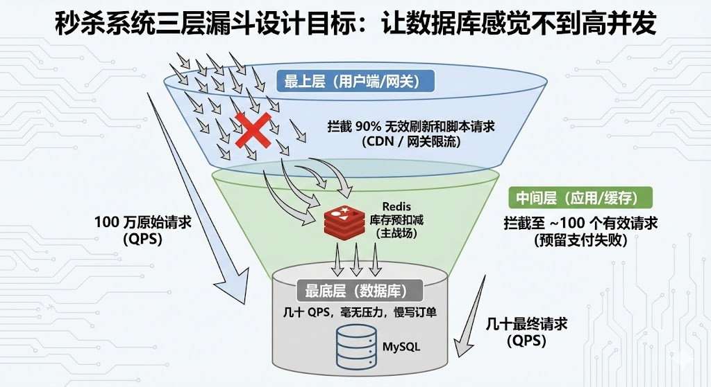
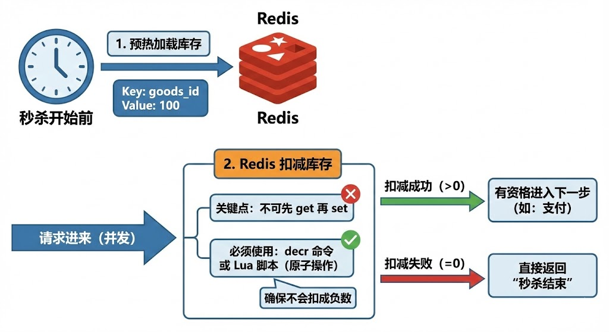
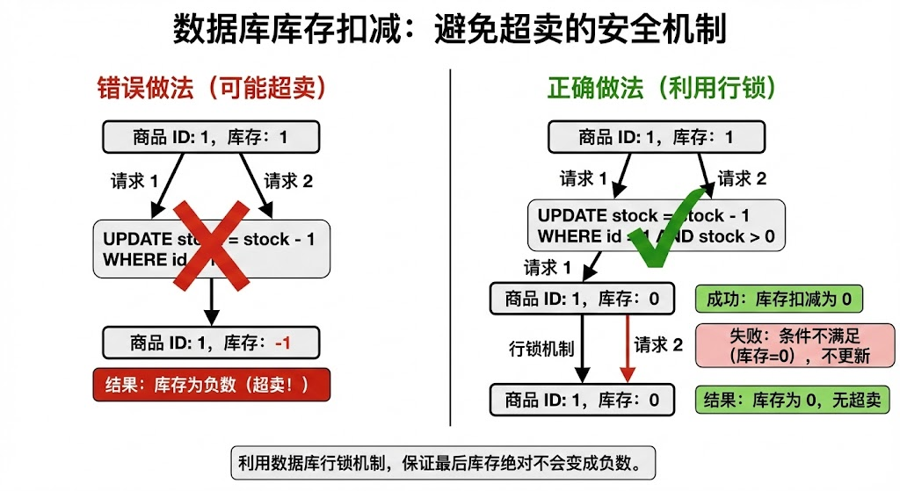
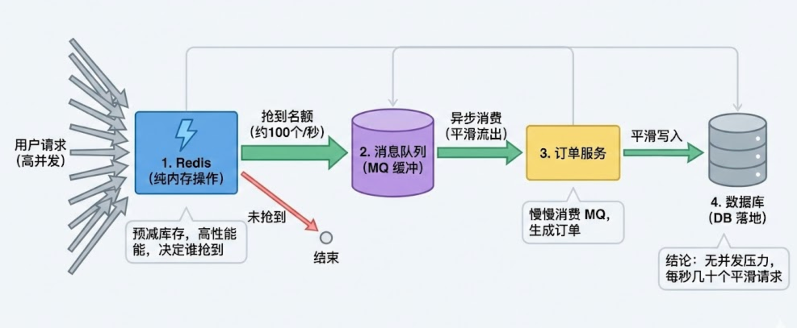
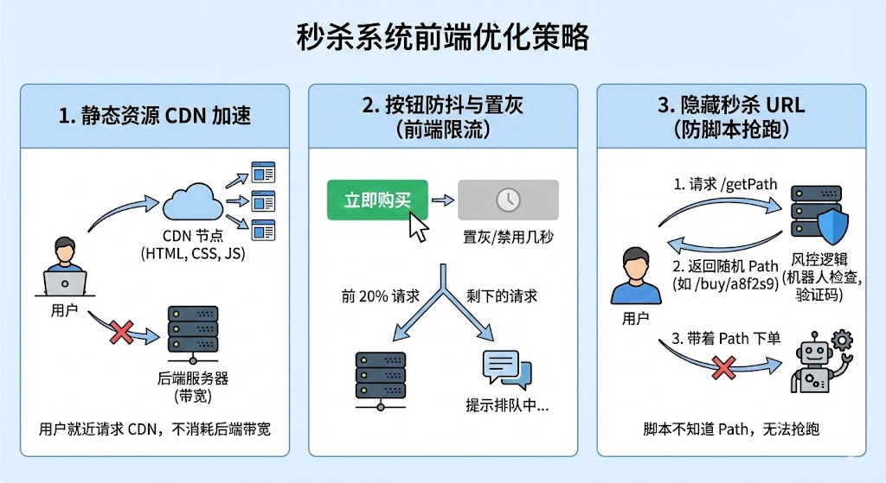
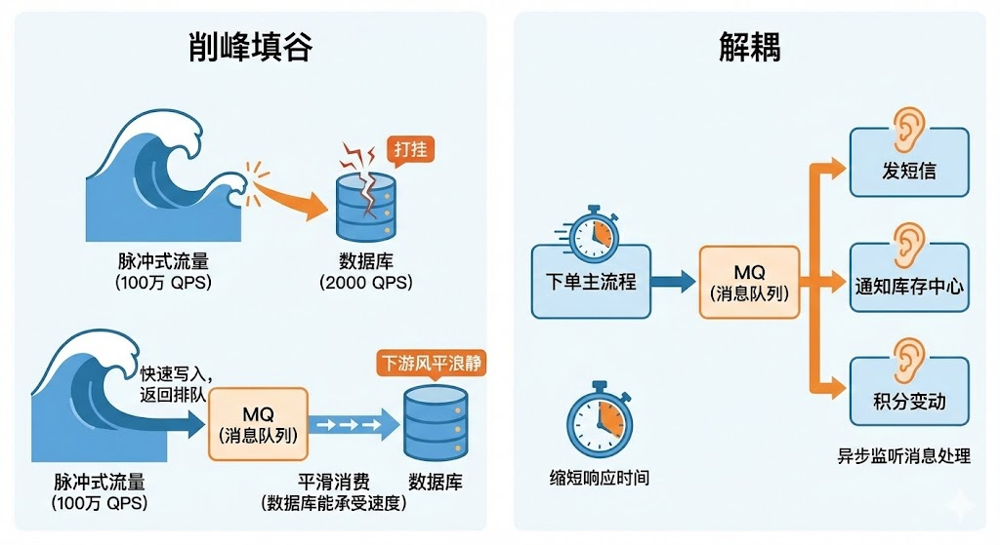

**秒杀系统的核心在于“层层过滤”。将 100 万的流量在最外层挡回去 99.9%，只让最后那 100 个“幸运儿”的请求打到数据库上。从架构上，我们采用“CDN 扛流量 -> Redis 抗读写 -> MQ 削峰 -> 数据库最终落地”的链路。**

---

### 一、 核心架构设计逻辑

针对“100 万人抢 100 件商品”的场景，我们的设计目标不是“如何让服务器抗住 100 万 QPS”，而是“如何让数据库感觉不到那 100 万 QPS”。

我们将系统分为三层漏斗：

1. **最上层（用户端/网关）：** 利用 CDN 和网关限流，拦截掉 90% 的无效刷新和脚本请求。
2. **中间层（应用/缓存）：** 利用 Redis 做库存预扣减。这里是主战场，必须在这里把 100 万请求拦截到只剩 100 个（或者稍微多一点，比如 105 个，预留支付失败的）。
3. **最底层（数据库）：** 此时流量已经变成了几十 QPS，MySQL 毫无压力，慢慢写订单即可。

---

### 二、 面试追问

#### 追问一：如何防止超卖？

- **第一道防线：Redis 原子性预减（Lua 脚本）**

    - 秒杀开始前，先把 100 件库存预热加载到 Redis 中（Key: `goods_id`, Value: `100`）。
    - 请求进来时，直接在 Redis 中扣减库存。
    - **关键点：** 不能先 `get` 再 `set`，有并发问题。必须使用 **Redis 的** `**decr**` **命令** 或者 **Lua 脚本**（推荐）。Lua 脚本可以将“判断库存 > 0”和“减库存”打包成原子操作，确保不会扣成负数。
    - Redis 扣减成功的，才有资格进入下一步；扣减失败的（库存为 0），直接返回“秒杀结束”。
- **第二道防线：数据库兜底（SQL 技巧）**

    - 万一 Redis 挂了或者数据不一致，请求打到了数据库，我们不能用 `update stock = stock - 1 where id = 1`。
    - **必须加上条件：**`update stock = stock - 1 where id = 1 AND stock > 0`。
    - 利用数据库行锁机制，保证最后库存绝对不会变成负数。

#### 追问二：如何解决数据库的并发写入压力？

    - **纯内存操作：** 前面提到的 Redis 预减库存，实际上已经完成了“谁抢到了”的判定。这部分高频写操作全在 Redis（内存）完成，性能比DB快一个数量级。
    - **异步落地：** 只有在 Redis 里抢到名额的那 100 个请求，才会触发写数据库的操作。
    - **MQ 缓冲：** 我们不直接操作数据库，而是把“创建订单”的请求扔进消息队列。订单服务慢慢消费 MQ，按照正常的数据库写入速度去生成订单。
    - **结论：** 数据库根本没有并发写入压力，它面对的只是每秒几十个的平滑写入请求。

#### 追问三：前端能做哪些优化？

    1. **静态资源 CDN：** 秒杀页面的 HTML、CSS、JS 全部推送到 CDN 节点。用户刷新页面时，请求走的是就近的 CDN，根本不消耗后端服务器带宽。
    2. **按钮防抖与置灰：**
        1. 用户点击“立即购买”后，按钮立即**置灰/禁用**几秒钟，防止手抖重复提交。
        2. 或者采用“只有前 20% 的请求发送给后端，剩下的直接前端提示排队中”，虽然暴力但有效。
    3. **隐藏秒杀 URL（防脚本）：**
        1. 秒杀按钮的 URL 不是固定的 `/buy/123`，否则脚本会在秒杀开始前一秒疯狂刷这个接口。
        2. **做法：** 采用“获取 Token -> 秒杀”的两段式。
        3. 用户先请求一个 `/getPath` 接口，服务器经过风控逻辑（检查是否是机器人、验证码是否正确），返回一个随机的动态 Path（如 `/buy/a8f2s9`）。
        4. 用户带着这个动态 Path 才能真正下单。这样脚本不知道 Path，就无法抢跑。

#### 追问四：为什么需要 MQ 削峰？

    - **削峰填谷：**

        - 秒杀的流量是脉冲式的，瞬间达到 100 万 QPS。而数据库可能只能抗 2000 QPS。
        - 如果没有 MQ，瞬间的流量峰值会直接打挂数据库。
        - 引入 MQ 后，Redis 筛选出的 100 个请求快速写入 MQ，立刻给用户返回“排队中，请稍后”。
        - 后台消费者以数据库能承受的速度慢慢拉取消息消费。哪怕上游洪峰滔天，下游依然风平浪静。
    - **解耦：**
        - 秒杀成功后，往往伴随着发短信、通知库存中心、积分变动等一堆业务。
        - 通过 MQ，下单主流程执行完就结束，其他非核心业务异步监听消息去处理，缩短了接口响应时间。
