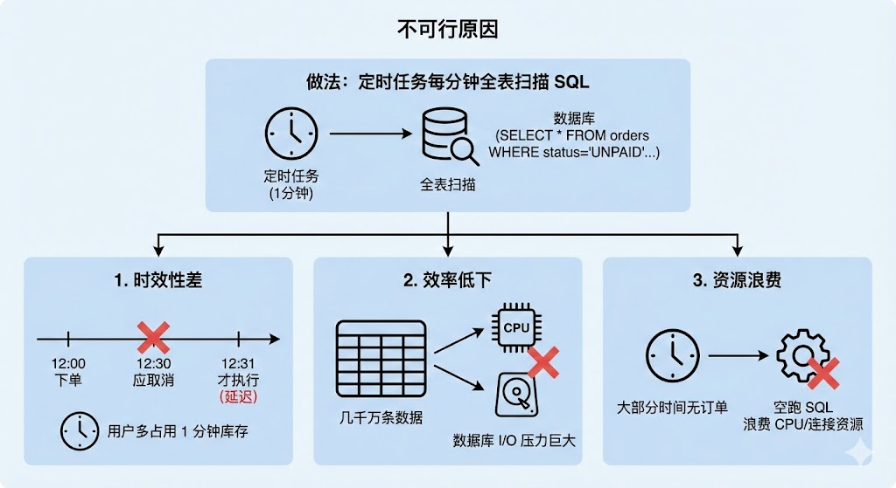
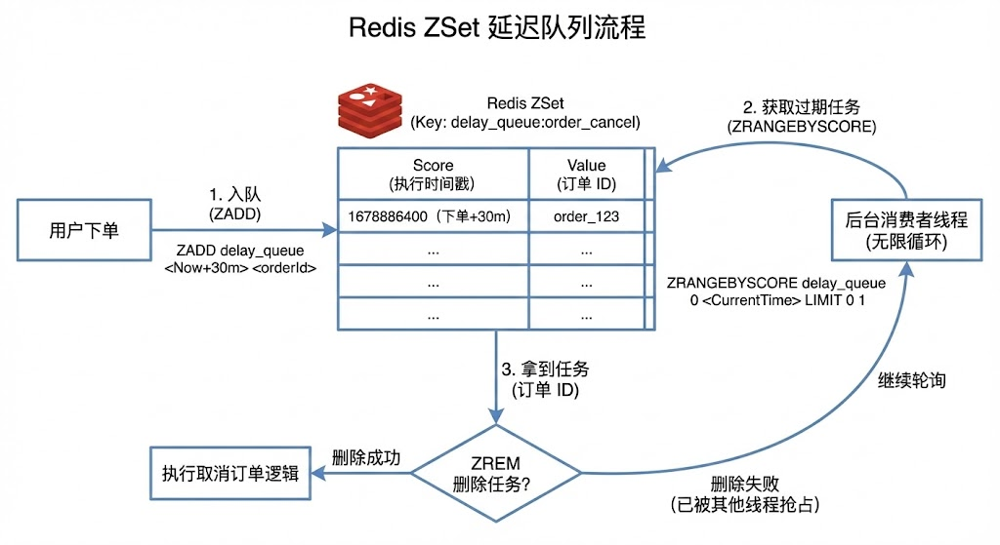
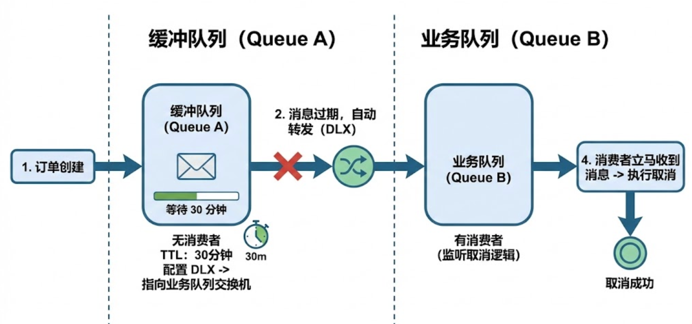
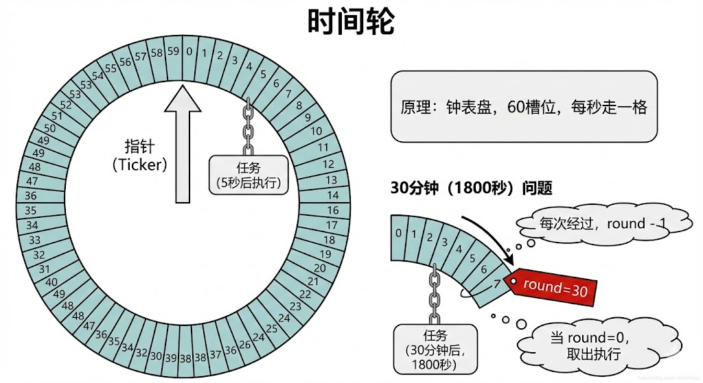

回答的核心逻辑是：**摒弃传统的被动轮询，转向基于事件的主动触发。**

简单概括：**实现订单自动取消，最原始的方法是数据库定时轮询；轻量级方案是利用 Redis 的 ZSet 实现延迟队列；企业级最稳健的方案是利用 RabbitMQ 的死信队列或延迟插件；而如果是在单机且追求极致性能的中间件开发中，我们会用到时间轮算法。**

### 为什么轮询数据库不可行？

- **做法：** 搞一个定时任务（比如 Spring Schedule），每分钟执行一次 SQL：`SELECT * FROM orders WHERE status = 'UNPAID' AND create_time < Now() - 30m`，查出来后，遍历取消。
- **不可行原因：**
    - **时效性差：** 定时任务通常有间隔（比如 1 分钟）。意味着 12:00 下单，12:30 应该取消，但可能等到 12:31 定时任务才跑，用户多占用了 1 分钟库存。
    - **效率低下：** 随着订单量增加，表里可能有几千万条数据。每次都要全表扫描大量未支付订单，数据库 I/O 压力巨大。
    - **资源浪费：** 在大部分时间里，可能并没有订单需要取消，但 SQL 依然在空跑，浪费 CPU 和连接资源。

### 利用 Redis 实现

    - **原理：**
        - 利用 Redis 的 **ZSet** 结构。
        - **Key：**`delay_queue:order_cancel`
        - **Value：** 订单 ID。
        - **Score：****任务执行的时间戳**（即：下单时间 + 30 分钟）。
    - **流程：**
        - **入队：** 用户下单时，执行 `ZADD delay_queue <Now+30m> <orderId>`。
        - **消费：** 启动一个后台线程，无限循环轮询 Redis。
        - **获取：** 每次执行 `ZRANGEBYSCORE delay_queue 0 <CurrentTime> LIMIT 0 1`。意思是：拿出 Score 小于等于当前时间（即已经过期的）的第一个任务。
        - **执行：** 如果拿到了任务，先利用 `ZREM` 删除该任务，删除成功后再去执行取消订单逻辑。

### 利用 RabbitMQ 的死信队列实现？

RabbitMQ 本身不支持“延迟投递”，但我们可以利用 **TTL（消息过期时间）** + **DLX（死信交换机）** 来曲线救国。

- **实现步骤：**
    - **创建“缓冲队列”（Queue A）：**
        1. **不配置消费者**。
        2. 设置消息 TTL 为 30 分钟。
        3. 配置 DLX 参数，指向“业务队列”的交换机。
    - **创建“业务队列”（Queue B）：**
        1. 配置消费者（监听取消订单逻辑）。
    - **流程：**
        1. 订单创建 -> 发送消息到 Queue A。
        2. 消息在 Queue A 里安静地躺 30 分钟。
        3. 时间一到，消息过期 -> RabbitMQ 自动把它踢给 DLX -> 转发到 Queue B。
        4. 消费者立马从 Queue B 收到消息 -> 执行取消。

*(注：现在的 RabbitMQ 也可以安装* `*rabbitmq_delayed_message_exchange*` *插件来实现，比 DLX 更简单，但 DLX 是经典原理。)*

### 时间轮算法

- **痛点：** 如果不依赖 Redis/MQ，在单机内存里维护数万个延时任务，用 `PriorityQueue`（最小堆）插入和删除是 $$O(\log N)$$。当任务量巨大时，性能不够极致。

