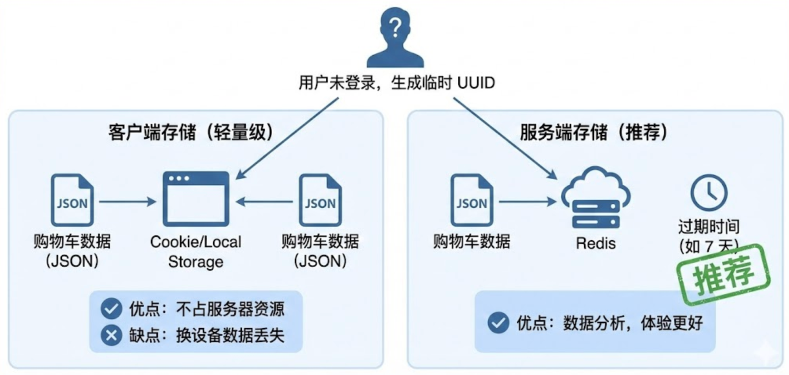
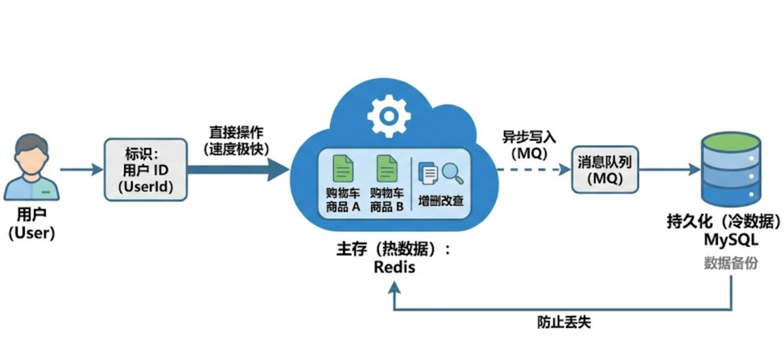
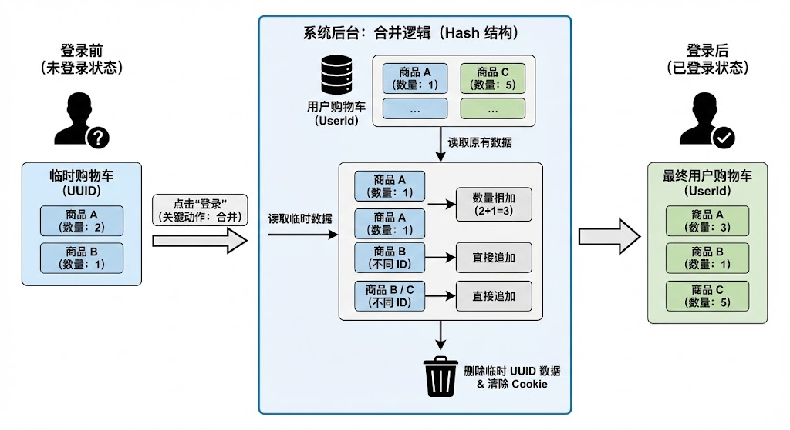

**购物车系统的核心架构应该是“Redis 为主，DB 为辅”的混合存储模式。设计的关键在于如何处理“离线购物车”与“在线购物车”的数据合并。**

---

### 一、 核心架构与存储策略

购物车不同于订单，它是一个**高频读写、临时性强、但数据价值相对较低**的场景。如果每次添加商品都直接写 MySQL，数据库很快就会崩掉。因此，并发量大的场景可以考虑基于 **Redis** 来做。

我们需要针对三种场景设计存储策略：

#### 未登录状态（离线购物车）

    - **标识：** 用户没登录，我们不知道他是谁。
    - **方案：** 在客户端生成一个临时的 **UUID**，存放在浏览器的 Cookie 或 LocalStorage 中。
    - **存储：**
        - *客户端存储（轻量级）：* 直接把购物车数据（JSON格式）存在 Cookie/Local Storage 里。优点是不占服务器资源，缺点是换个设备就没了。
        - *服务端存储（推荐）：* 将 UUID 作为 Key，把数据存在 Redis 中。设置一个过期时间（如 7 天）。优点是可以做数据分析，且用户体验更好。

#### 已登录状态（在线购物车）

    - **标识：** 用户 ID (UserId)。
    - **存储：** 必须走服务端存储。
        - **主存（热数据）：****Redis**。所有的增删改查直接操作 Redis，速度极快。
        - **持久化（冷数据）：****MySQL**。为了防止 Redis 宕机导致数据丢失，通常采用“异步写入”<u>【可以使用MQ来实现】</u>的方式，将 Redis 的数据同步到 MySQL 中做备份。

#### 登录那一刻（关键动作：合并）

    - 这是购物车设计中最复杂的逻辑。
    - 当用户在“未登录”状态下加了几个商品，然后点击“登录”。系统必须在登录接口的逻辑中，**自动读取临时 UUID 下的购物车数据，将其与 UserId 下原有的购物车数据进行合并**。
    - **合并策略：** 通常是 `Hash` 结构的合并。如果商品 ID 相同，数量相加；如果不同，直接追加。合并完成后，删除临时 UUID 的数据，并清除 Cookie。

---

### 二、 Redis 数据结构设计

在 Redis 中怎么存购物车？最合适的数据结构是 **Hash（哈希表）**。

- **Key:**`cart:{userId}` (或者 `cart:{uuid}`)
- **Field:**`skuId` (商品 SKU ID)
- **Value:** JSON 字符串（包含数量、加入时间、勾选状态等）

为什么要用 Hash？

因为购物车操作通常是针对单个商品的。

- 如果我要把“苹果”的数量从 1 改成 2，使用 Hash 只需要 `HINCRBY cart:1001 apple_sku 1`。
- 如果使用 String 类型存储整个 JSON List，每次修改都要把整个 List 取出来，反序列化，改完再序列化存回去，网络带宽和 CPU 消耗都太大了。

---

### 三、 关键业务逻辑

除了存储，面试中这几个业务细节必须回答到位，能体现你的实战经验：

#### 价格同步问题

**问： 购物车里存商品价格吗？**

答： 绝对不能只存价格，或者说存了也不能信。

商品价格是会变的（比如商家改价、促销结束）。用户加入购物车时是 100 元，结算时可能变成了 120 元。

- **展示时：** 每次打开购物车页面，前端虽然可以直接显示 Redis 里的数据，但建议异步调用“商品服务”查询最新价格，如果价格变了，给用户一个“比加入时降价/涨价”的提示。
- **结算时：** 生成订单的那一刻，必须重新去商品服务查实时价格，以实时价格为准。

#### 库存扣减时机

**问： 加入购物车要减库存吗？**

答： 不减。

购物车是典型的“占坑不拉屎”行为。如果加入就锁库存，恶意用户可以把所有商品加进购物车导致别人买不了。

- **加入购物车时：** 只做简单的“是否有货”校验。
- **下单时：** 真正的扣减库存（锁定库存）是在“提交订单”环节进行的。

#### 购物车上限

**问： 一个用户可以无限加商品吗？**

答： 不行。为了防止恶意攻击导致 Redis 内存爆满，必须限制购物车商品种类的上限（比如淘宝限制 100 种）。超过限制时，提示用户清理旧商品。
