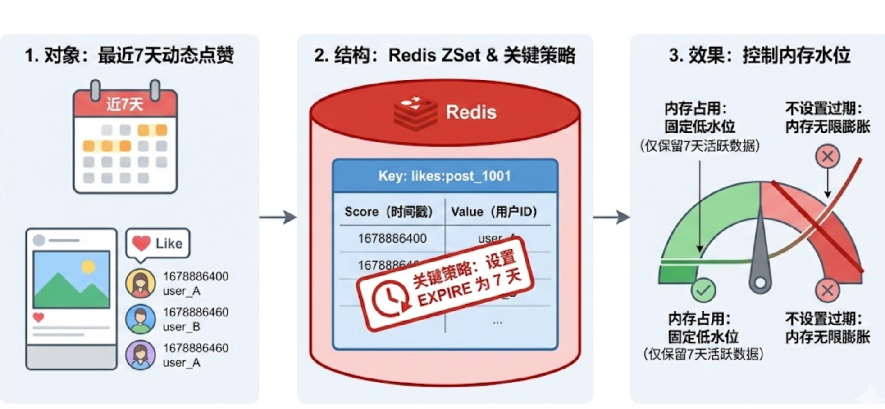
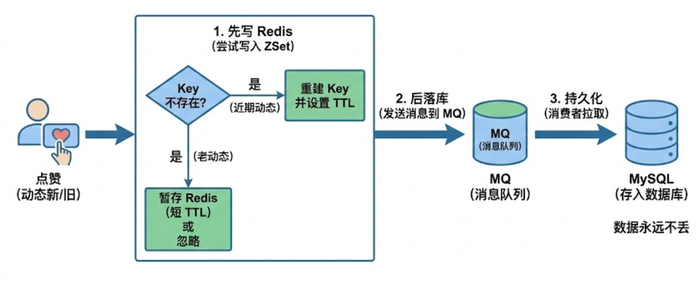
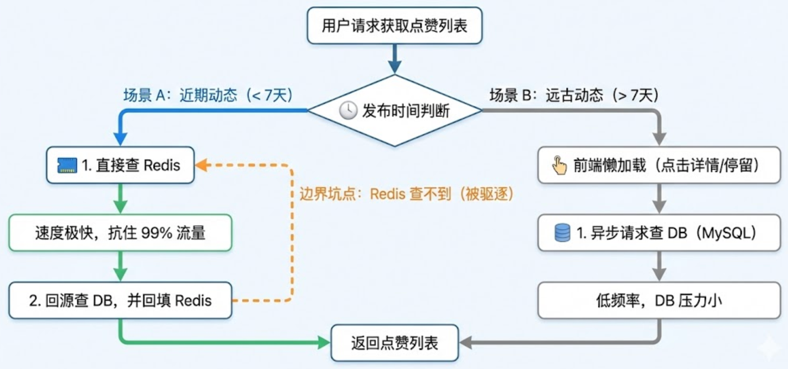
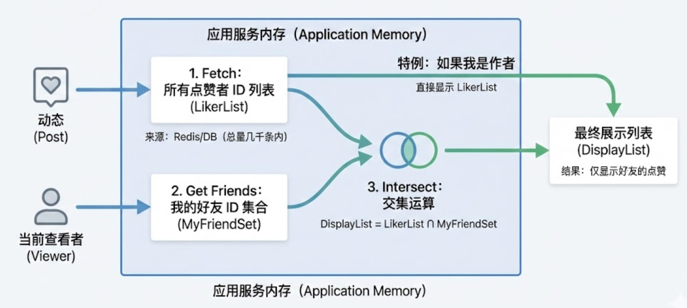

核心的设计思路必须是：**“冷热分离” + “时间轴分级存储”**。

简单来说：**只有最近几天的“热动态”的点赞才存 Redis，7 天前的“冷动态”点赞全部沉淀到磁盘存储（MySQL/HBase）。读取时，根据动态发布的时间来决定去哪查。**

---

### 一、基于“时间轴”的冷热分离

微信朋友圈的流量有一个极强的特征：<u>时间衰减。</u>

绝大多数人只会刷最近 24 小时的动态，极少有人会去翻朋友半年前的内容。因此，我们没必要把半年前的点赞数据也放在昂贵的内存（Redis）里。

#### 1. 热数据存储

- **对象：** 最近 **7 天内**（或者 3 天，看成本预算）发布的动态。
- **结构：** 依然使用 `ZSet`。
    - Key: `likes:post_1001`
    - Value: `user_id`
    - Score: `timestamp`
- **关键策略：****必须设置过期时间！**
    - 在写入 Key 时，设置 `EXPIRE` 为 7 天。
    - 这样，Redis 中永远只保留最近 7 天的活跃数据，内存占用被死死地控制在一个固定的水位，不会随着用户量增长而无限膨胀。

#### 2. 冷数据存储

- **对象：** 全量的历史点赞数据。
- **选型：** 鉴于微信的体量，单表 MySQL 肯定不行，可以考虑按照 `post_id` 分库分表。

---

### 二、 读写流程设计

#### 1. 写入流程

当用户给一条动态点赞时，无论这条动态是新的还是旧的，逻辑如下：

1. **先写 Redis：** 尝试写入 `ZSet`。
    1. *注意：* 如果 Key 不存在（说明是老动态或者 Key 已过期），则需要判断一下：如果是近期动态，重建 Key 并设置 TTL；如果是老动态，可以选择暂存 Redis（设个短 TTL）或者直接忽略 Redis 这一步。
2. **后落库：** 发送消息到 MQ。
3. **持久化：** 消费者从 MQ 拉取数据，存入 MySQL。这保证了数据永远不丢。

#### 2. 读取流程

这是节省成本的关键。当用户请求获取某条动态的点赞列表时，后端服务根据**该动态的发布时间**做路由：

- **场景 A：近期动态（发布时间 &lt; 7天）**
    - **直接查 Redis**。
    - 速度极快，抗住 99% 的日常流量。
    - *边界坑点：* 如果 Redis 查不到（比如被意外驱逐了），回源查 DB，并回填到 Redis。
- **场景 B：远古动态（发布时间 > 7天）**
    - **直接查 DB (MySQL)**。
    - 前端可以设计为“懒加载”：用户翻到半年前的朋友圈，默认不显示点赞详情，点击“详情”或者停留 1 秒后，再发起异步请求去查 DB。
    - 因为这种行为频率极低，DB 的读压力完全可以承受。

### 三、 共同好友过滤

微信好友上限 5000，这意味着我们拿到的点赞列表（无论是 Redis 里的还是 DB 里的），最多也就几千条。

**过滤逻辑依然在内存中进行：**

1. **Fetch：** 后端拿到该动态的所有点赞者 ID List（假设有 50 人点赞）。
2. **Get Friends：** 获取当前查看者的好友 ID Set。
3. **Intersect：** 在应用服务的内存中做交集运算。
    1. `DisplayList` = `LikerList` ∩ `MyFriendSet`。
    2. *特例：* 如果我是作者，直接显示 `LikerList`。
