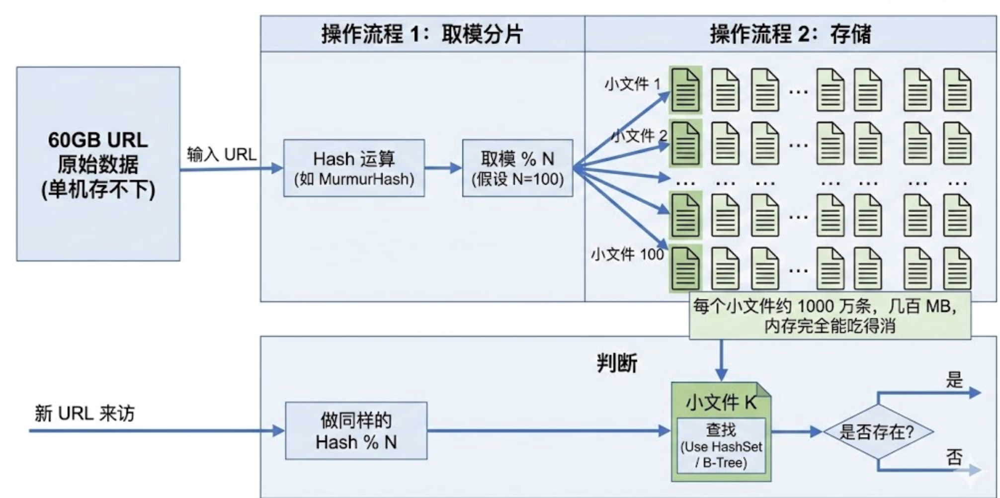

这道题核心在于：**内存限制**。10 亿条 URL，如果每条 64 字节，光存字符串就需要 60GB+ 的内存，直接用 HashMap 肯定 OOM。

---

### 一、 核心方案：布隆过滤器

这是工业界解决此类问题的标准答案，适合绝大多数“去重”或“黑名单”场景。

#### 基本原理

它的底层是一个很长的**位数组**和 K 个不同的 Hash 函数。

- **写入时：** 将 URL 经过 K 个 Hash 函数计算，得到 K 个位置，把位数组中这 K 个位置都置为 `1`。
- **判断时：** 将新来的 URL 同样经过 K 个 Hash 计算。
    - 如果 K 个位置**全都是 1**，则判定该 URL **可能存在**。
    - 如果有**任意一个位置是 0**，则判定该 URL **一定不存在**。

#### 内存消耗

面试官通常会问你大概需要多少内存。

- 假设我们允许 **1% 的误判率**。
- 根据布隆过滤器公式，平均每个元素大约需要 9.6 个 bit。
- 10 亿条数据 $$\times 10 bit \approx$$ 100 亿 bit。
- $$100 \text{亿} / 8 \approx 1.2 \text{GB$$。
- **结论：** 仅需 **1.2GB ~ 1.5GB** 的内存，单台普通的服务器就能轻松抗住 10 亿数据，不需要分片。

#### 优缺点权衡

- **优点：** 极快（内存操作）、空间极省。
- **缺点（关键）：**
    - **误判：** 它可能会把“没出现过”的 URL 误报为“存在”（因为 Hash 冲突导致位被占了）。
    - **无法删除：** 标准布隆过滤器不支持删除操作（删了可能影响别的 URL）。

---

### 二、 兜底方案

如果面试官说：“我的业务**一条都不能错**，不允许有误判”，那么布隆过滤器就被毙掉了，必须走精确匹配。

#### 核心思路：分治法

单机存不下 60GB 的 URL，那就切分成小块存到多台机器（或多个小文件）里。

#### 操作流程

1. **取模分片：** 对 URL 进行 Hash 运算（如 `MurmurHash`），得到一个整数值，然后 `% N`（假设 N=100）。
2. **存储：** 这样 10 亿条 URL 就被均匀分散到了 100 个小文件中（或 100 台 Redis 节点中）。每个小文件大约 1000 万条数据，几百 MB，内存完全能吃得消。
3. **判断：** 新 URL 来了，做同样的 `Hash % N`，知道它应该在第几个分片，然后去那个特定的分片里查找（用 HashSet 或 B-Tree）。
