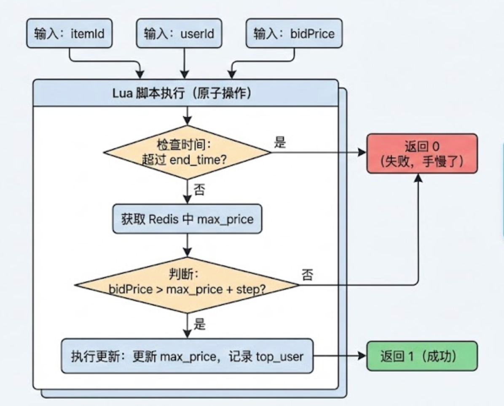
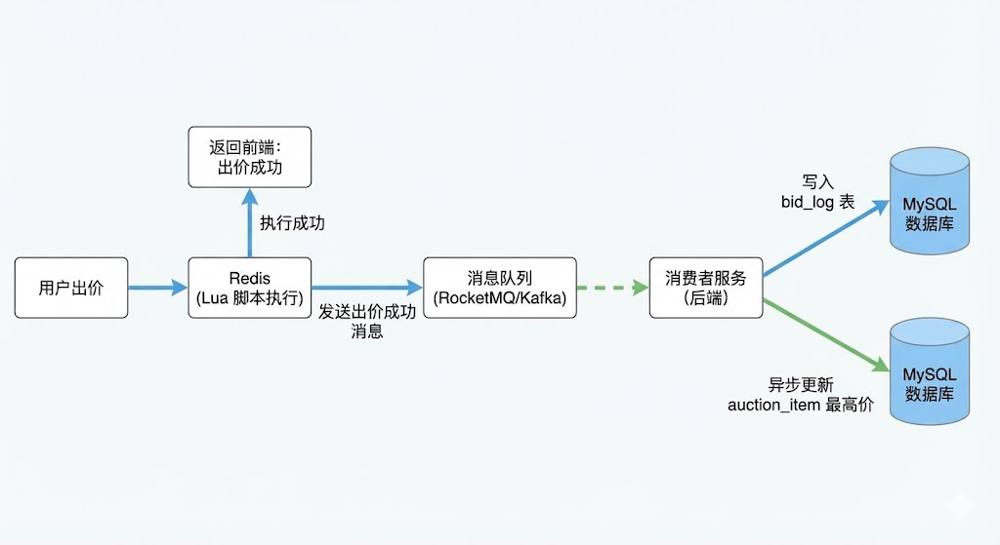

### 一、 核心架构总览

这个功能的瓶颈在于“写”。几万人同时出价，数据库的行锁会直接导致系统瘫痪。

我们必须把战线前移，所有的竞价逻辑全部在 Redis 中完成，数据库（MySQL）只负责归档和事后审计，不参与实时计算。

### 二、 详细设计

#### API 接口设计

我们需要两个核心接口：出价和获取最新价。

- **出价接口:**
    - `POST /api/auction/bid`
    - **参数:**`itemId` (商品ID), `userId` (用户ID), `price` (出价金额), `token` (防篡改Token), `timestamp` (防重放).
    - **返回:**`Success` (出价成功) / `Fail` (价格已被超越/拍卖结束).
- **实时价格流:**
    - `WebSocket: /ws/auction/{itemId}`
    - **机制：** 客户端建立长连接。一旦有人出价成功，服务端广播最新的 `current_price` 给所有在线用户。

#### 数据库表设计

- **拍卖商品表 (**`**auction_item**`**)**
    - `id`: 主键
    - `item_id`：商品id
    - `current_price`: 当前最高价
    - `end_time`: 结束时间
    - `status`: 状态 (进行中/已结束)
- **出价流水表 (**`**bid_log**`**)**
    - `id`: 主键
    - `item_id`: 商品ID (索引)
    - `user_id`: 用户ID
    - `bid_price`: 出价金额
    - `create_time`: 出价时间

---

### 三、 性能优化

#### 解决“并发写”：Redis Lua 脚本

我们不能在 Java 代码里写 get current_price 然后 if new > current 然后 set。这会有严重的并发安全问题。

必须使用 Lua 脚本 保证原子性：

- **逻辑：**
    - 脚本接收 `itemId`, `userId`, `bidPrice`。
    - 检查当前时间是否超过 `end_time`。
    - 获取 Redis 中该商品的 `max_price`。
    - **判断：** 如果 `bidPrice > max_price + step` (比如最小加价幅度)。
    - **执行：** 更新 `max_price`，同时记录当前最高出价人 `top_user`。
    - 返回 1 (成功)；否则返回 0 (失败，手慢了)。
- **优势：** Redis 单线程执行 Lua，不需要加分布式锁，性能极高。

#### 解决“数据落库”：MQ 削峰

Redis 出价成功后，绝对不能同步写 MySQL。

- **流程：** Lua 脚本执行成功 -> 发送一条“出价成功消息”到 **RocketMQ/Kafka** -> 立即返回前端“出价成功”。
- **消费者：** 后端服务慢慢消费 MQ，将出价记录写入 MySQL 的 `bid_log` 表，并异步更新 `auction_item` 的最高价。

#### 解决“读热点”：广播与本地缓存

当 Redis 更新了最高价，怎么让 10 万个人立刻看到？

- **WebSocket 推送：** 最优解。Redis 修改成功后，触发消息推送到 Netty 网关，广播给所有订阅该商品的用户。
