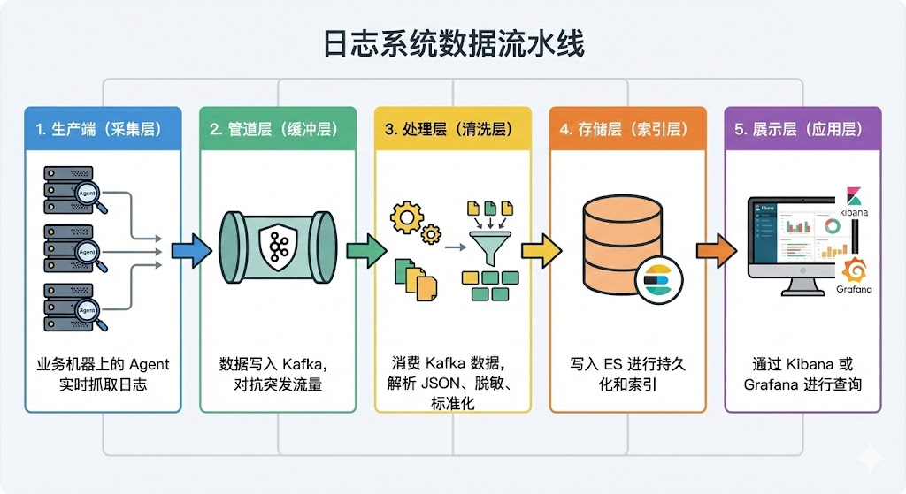

### 一、 整体架构流程

我们可以把日志系统看作一条“数据流水线”。

1. **生产端（采集层）：** 业务机器上的 Agent实时抓取日志。
2. **管道层（缓冲层）：** 数据写入 **Kafka**，对抗突发流量。
3. **处理层（清洗层）：** 消费 Kafka 数据，解析 JSON、脱敏、标准化。
4. **存储层（索引层）：** 写入 ES 进行持久化和索引。
5. **展示层（应用层）：** 通过 Kibana 或 Grafana 进行查询。

---

### 二、 关键模块详细设计

#### 采集层

日志采集最忌讳的是“喧宾夺主”，抢占了业务服务的 CPU 和内存。

- **采集方式：** 坚决不建议业务代码直接发 HTTP 请求给日志服务器（网络阻塞会搞挂业务）。
- **最佳实践：**
    - **异步写盘：** 业务代码只负责极速把日志写入本地磁盘文件。
    - **Sidecar 模式：** 部署一个独立的轻量级 Agent与业务进程同机部署。
    - **原理：** Agent 监听日志文件的变化，通过系统级 API实时读取新增内容并发送。这样做到了业务与采集的物理隔离。

#### 缓冲层

面对大促或系统故障时的报错风暴，日志量会瞬间翻倍。直接写数据库必死无疑。

- **选型：****Kafka** 是标准答案。
- **作用：**
    - **削峰：** 先把日志存下来，后端慢慢消费。
    - **解耦：** 采集端不需要关心后端存储是 ES 还是 ClickHouse。

#### 存储层

- **Elasticsearch**
    - **原理：****倒排索引**。
    - **优势：** 全文检索能力无敌。
    - **缺点：** 写入性能也是瓶颈，且索引占用磁盘空间巨大（膨胀率高）。

#### 扩展性设计

- **冷热分离**
    - 日志数据有时效性。最近 3 天的日志是“热数据”，存 SSD，保证秒级查询。
    - 3 天到 30 天是“温数据”，迁移到 HDD。
    - 30 天以上是“冷数据”，直接归档到 S3 或 HDFS，甚至从 ES 中删除索引，只留备份。
