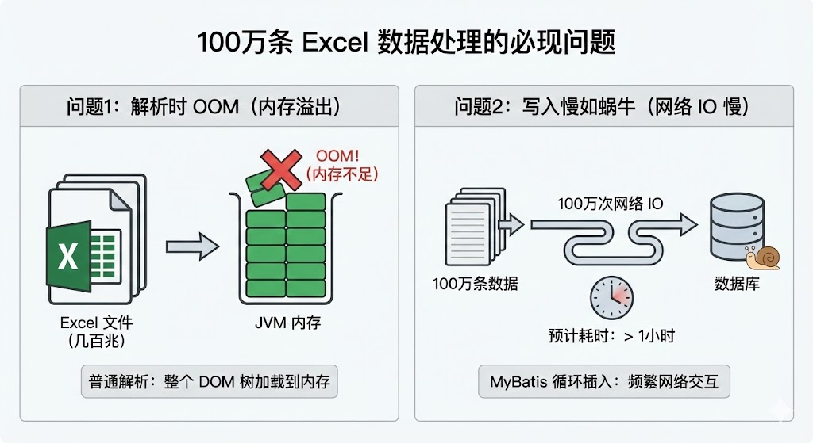
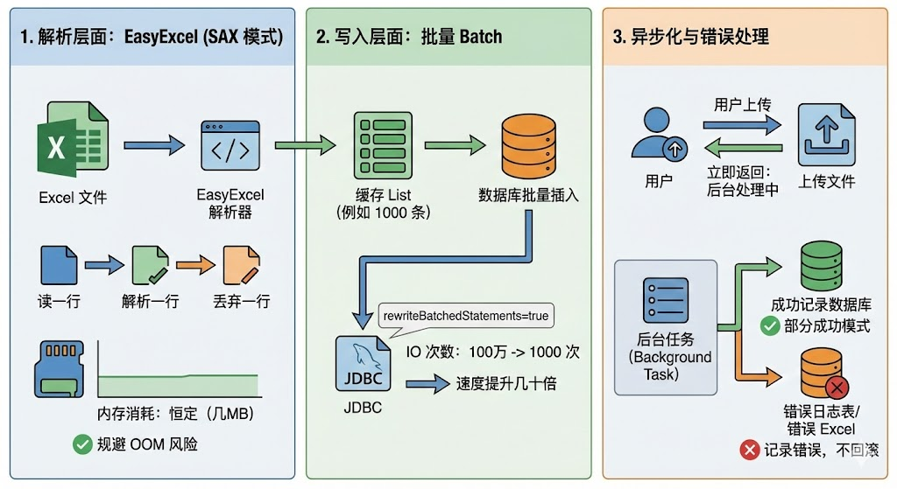

对于百万级数据导入，核心思路就一句话：**“读要像流水一样细水长流，写要像卡车一样批量装卸。”** 绝对不能一次性把文件加载到内存，也绝对不能一条一条地写数据库。

### 一、 核心方案总览

面对 100 万条 Excel 数据，普通的 `POI` 解析 + `MyBatis` 循环插入会导致两个必现的问题：

1. **解析时 OOM：** Excel 本质是 XML，普通解析会将整个 DOM 树加载到内存，几百兆的文件能瞬间吃光 JVM 内存。
2. **写入慢如蜗牛：** 100 万次网络 IO 交互，哪怕一条 1 毫秒，也要 16 分钟，加上事务开销，实际可能要跑一个小时。

**标准解法：** 使用 **EasyExcel（SAX 模式流式读取）** 配合 **批量合并写入**，再加上 **异步处理**。

---

### 二、 详细落地步骤

#### 解析层面：换掉 POI，上 EasyExcel

不要使用原生的 Apache POI，它会把整个 Excel 加载到内存里。

- **工具选型：** 阿里巴巴开源的 **EasyExcel**。
- **原理（SAX 模式）：** 它不会一次性加载整个文件，而是**读一行、解析一行、丢弃一行**。
- **内存消耗：** 无论 Excel 有多大（100M 还是 1G），它占用的内存都是恒定的（几 MB 到十几 MB），完全规避了 OOM 风险。

#### 写入层面：拒绝循环，必须 Batch

这是提速的关键。

- **代码层：**
    - 利用 EasyExcel 的监听器。
    - 每解析一行，放入一个 `List<Data>` 缓存。
    - 当 List 攒够了 **1000 条**（阈值），触发一次数据库批量插入，然后清空 List 继续攒。
- **驱动层（MySQL 必做）：**
    - 在 JDBC 连接串中必须加上 `rewriteBatchedStatements=true`。
    - **原理：** 只有加上这个，驱动才会把应用层发出的 `insert into t values (a); insert into t values (b);` 真正重写为 `insert into t values (a), (b), ...`。
    - **效果：** 100 万条数据，如果每 1000 条一次提交，网络 IO 从 100 万次降到了 1000 次，速度提升几十倍。

#### 异步化

百万级导入即使优化到极致，也需要几十秒甚至几分钟（取决于数据库性能）。

- **异步执行：** 接口收到文件后，上传到服务器临时目录，立刻返回“上传成功，正在后台处理中”。
- **错误处理：** 千万别因为第 99 万条数据格式不对导致整个事务回滚。而是应该采用“部分成功”模式。遇到格式错误的数据，记录到一张“错误日志表”或生成一个新的 Excel 返回给用户，让用户改完再单独导那几条。
