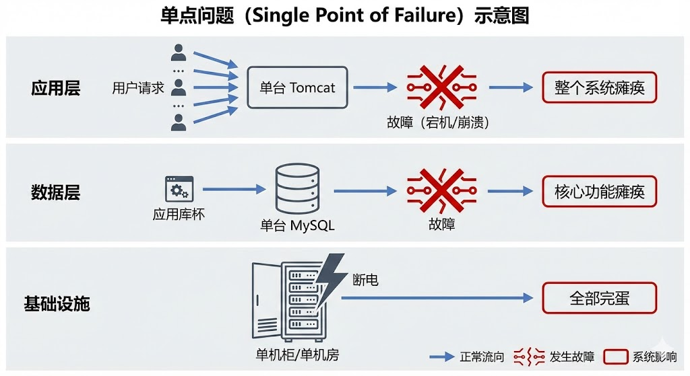

### 一、 核心概念

**什么是单点问题？**

简单来说，就是系统中的某个组件没有任何备份。一旦这个组件发生故障（服务器宕机、进程崩溃、网线被拔），整个系统或某个核心功能就彻底瘫痪了。

单点问题通常出现在以下层面：

- **应用层：** 只有一台 Tomcat 在跑。
- **数据层：** 只有一台 MySQL 数据库。
- **基础设施：** 所有的服务器都在同一个机柜，或者同一个机房（断电就全完了）。

---

### 二、 面试标准回答

**单点问题是分布式系统设计中最大的隐患，它是指某个模块或组件在系统中没有备份，一旦出现故障，会导致整个系统不可用。**

**解决单点问题的核心方针只有两个字：****“冗余”**。

**具体落地时，我们需要在不同的架构层级做不同的处理，通常分为“应用层”和“数据层”两方面来看：**

第一，在应用层的解决思路：

这是最容易解决的。因为应用层通常是无状态的。

- **方案：** 我们通过部署**多台服务器**来运行相同的服务，然后在前面架设一个**负载均衡器**。
- **效果：** 流量会被分发到不同的机器上。如果其中一台机器挂了，负载均衡器会自动剔除故障节点，将流量打到健康的机器上，用户完全无感知。

第二，在数据层的解决思路：

这里比较麻烦，因为涉及数据一致性。

- **方案：** 我们通常采用 **“主从复制”** 加上 **“自动故障转移”** 的机制。
- **举例：**
    - **MySQL：** 使用一主多从。当主库挂了，工具会自动选一个新的从库升级为主库，并把应用连接切换过去。
    - **Redis：** 使用 **Redis Sentinel，**哨兵会监控主节点，一旦主节点挂了，自动选举新主。
